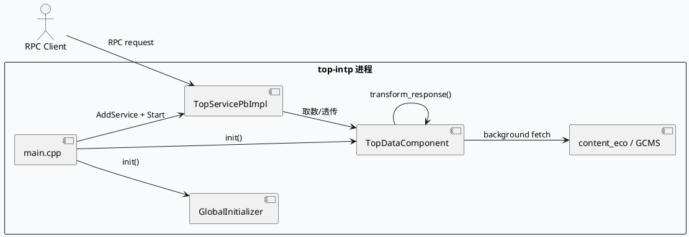
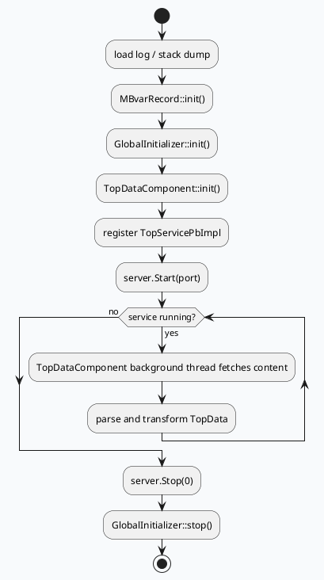

# 2026-08-18 周二代码理解：top-intp 启动引导与 TopData 生命周期
<!-- topic-nav:start -->
> 主题：`base/top-intp-bootstrap` · 同题补充 / 历史版本 · [主题目录](README.md) · [先读主文](20260817-top-intp-brpc-bootstrap-component-lifecycle.md)
<!-- topic-nav:end -->


> 日期：2026-08-18  
> 主题来源：2026-08-18 daily-plan 文件未找到，按历史未覆盖主题 fallback 到 `top-intp` 的启动引导 + TopData 生命周期链路；KU/业务背景需人工补充。  
> 范围：只分析 `src/main.cpp`、`src/component/top_data_component.cc`、`src/component/gcms_component.h`、`src/common/gcms_data.h`、`conf/common_component/gcms_plugin_pb.conf`、`conf/ns_plugin.conf`，关注服务启动、后台拉取、响应转换与 GCMS 结构边界，不展开完整业务策略。

---

## 0. 架构全景图
<div style="font-family:system-ui,-apple-system,BlinkMacSystemFont,'Segoe UI',Roboto,sans-serif;background:#f8fafc;border:1px solid #d9e2ec;border-radius:14px;padding:18px;margin:16px 0;color:#243b53"><div style="font-size:22px;font-weight:800;margin-bottom:12px;color:#102a43">top-intp 启动到 TopData 拉取的基础链路</div><div style="display:grid;grid-template-columns:1.1fr 1.2fr 1fr;gap:12px"><div style="background:#fff;border:1px solid #d9e2ec;border-radius:10px;padding:12px"><div style="font-weight:700;margin-bottom:8px;color:#1d4e89">启动层</div><div>• `com_loadlog` 装载日志</div><div>• `StackDump::init()` 初始化崩溃栈</div><div>• `MBvarRecord::init()` 打点注册</div><div>• `GlobalInitializer::init()` 拉起全局组件</div><div>• `TopDataComponent::init()` 启动后台线程</div></div><div style="background:#fff;border:1px solid #d9e2ec;border-radius:10px;padding:12px"><div style="font-weight:700;margin-bottom:8px;color:#1d4e89">服务层</div><div>• `baidu::rpc::Server` 提供 RPC 入口</div><div>• `TopServicePbImpl` 绑定服务实现</div><div>• `server.Start(FLAGS_port, &amp;options)` 进入运行态</div><div>• 退出前调用 `server.Stop(0)` 与 `GlobalInitializer::stop()`</div></div><div style="background:#fff;border:1px solid #d9e2ec;border-radius:10px;padding:12px"><div style="font-weight:700;margin-bottom:8px;color:#1d4e89">数据层</div><div>• `content_eco` HTTP/Channel 拉取</div><div>• GCMS 插件配置驱动请求批量与超时</div><div>• `TopData` / `SmfwGcmsRespItem` 承载结构化结果</div><div>• `transform_response()` 把外部响应转回内部对象</div></div></div><div style="margin-top:12px;background:#eef4f9;border:1px dashed #b6c6d6;border-radius:10px;padding:10px 12px;font-size:13px;line-height:1.55">基础判断：`main.cpp` 负责把日志、全局初始化、后台数据组件和 RPC 服务拼成完整进程；真正的数据变化不在入口里展开，而是在 `TopDataComponent` 的后台线程与响应转换逻辑里完成。</div></div>

## 1. 入口链路
`src/main.cpp` 先装载日志和栈追踪，再初始化 `MBvarRecord`、`GlobalInitializer` 和 `TopDataComponent`，最后把 `TopServicePbImpl` 注册到 `baidu::rpc::Server` 并启动服务。它的职责不是处理请求细节，而是把进程生命周期和服务生命周期串起来。

### 关键路径
- `src/main.cpp:37-46`：日志、栈追踪、MBvar、全局初始化、TopDataComponent 初始化
- `src/main.cpp:48-61`：构建 `baidu::rpc::Server`，注册 `TopServicePbImpl`，`server.Start(...)`
- `src/main.cpp:63-69`：优雅退出时停服务并释放全局资源

## 2. 核心流程图


### 生命周期活动图


## 3. 配置/结构信息图
```infographic
infographic list-grid-badge-card
 data
  title top-intp 关键配置面
  desc 进程启动后依赖的日志、RPC、GCMS 相关配置
  items
   - label service_name
     desc topintp
     value 1
     icon mdi/server
   - label gcms_srv_addr
     desc rns://group.smartbns-from_product=gcms-sdk-srv-utf8%group.flow-gcms-pb-sdk-srv-multishard.SUPERPAGE.all|bns
     value 1
     icon mdi/database-search
   - label req_batch_size
     desc 10
     value 10
     icon mdi/view-grid
   - label req_max_concurrency
     desc 100
     value 100
     icon mdi/arrow-expand-all
   - label req_type
     desc 2
     value 2
     icon mdi/source-branch
   - label timeoutms
     desc 100
     value 100
     icon mdi-timer-outline
 theme
  palette #2563eb #0f766e #f59e0b
```

## 4. 组件边界
`TopDataComponent` 的职责更像一个基础库式的调度器：`init()` 拉起依赖通道，`run()` 在后台周期性调用 `call_content_eco()`，`transform_response()` 把返回体转换为内部 `TopData`，`parse_one_item()` 则做细粒度字段解析。`gcms_component.h` 和 `gcms_data.h` 负责把 GCMS 响应结构收进统一数据模型，避免入口层直接碰外部协议细节。

### 证据来源
- `src/main.cpp:37-46`
- `src/main.cpp:48-69`
- `src/component/top_data_component.cc:15-18`
- `src/component/top_data_component.cc:30-33`
- `src/component/top_data_component.cc:49-60`
- `src/component/top_data_component.cc:73-77`
- `src/component/top_data_component.cc:144-249`
- `src/component/gcms_component.h:17-21`
- `src/common/gcms_data.h:17-29`
- `conf/common_component/gcms_plugin_pb.conf:3-17`
- `conf/ns_plugin.conf:1-11`

## 5. Pitfalls
<div style="display:grid;grid-template-columns:1fr;gap:10px;margin:14px 0"><div style="background:#fff7ed;border:1px solid #fdba74;border-radius:10px;padding:12px 14px"><div style="font-weight:800;color:#9a3412;margin-bottom:4px">配置通道为空</div><div style="color:#7c2d12;line-height:1.55">`TopDataComponent::init()` 会直接依赖 `content_eco` channel。若 `ChannelComponent::get_instance().get(...)` 为空，进程在启动阶段就会失败，不会等到首个请求才暴露问题。</div></div><div style="background:#eff6ff;border:1px solid #93c5fd;border-radius:10px;padding:12px 14px"><div style="font-weight:800;color:#1d4ed8;margin-bottom:4px">后台线程生命周期</div><div style="color:#1e3a8a;line-height:1.55">`run()` 是长期后台任务，退出时必须和 `stop()` 对齐。只看 RPC 启停不够，真正的资源释放在组件停止路径里。</div></div><div style="background:#f0fdf4;border:1px solid #86efac;border-radius:10px;padding:12px 14px"><div style="font-weight:800;color:#166534;margin-bottom:4px">GCMS 配置与代码分离</div><div style="color:#14532d;line-height:1.55">`gcms_plugin_pb.conf` 决定服务地址、并发、超时和分片参数，但字段语义在代码里才真正落地。只看配置会漏掉 `transform_response()` 的实际转换规则。</div></div></div>

## 6. 调试 checklist
```infographic
infographic list-column-done-list
 data
  title 调试 checklist
  items
   - label main.cpp 是否成功进入 server.Start
     done true
   - label GlobalInitializer 和 TopDataComponent 是否在启动阶段完成 init
     done true
   - label content_eco channel 是否可取到
     done true
   - label TopDataComponent 是否在后台线程中持续 run
     done true
   - label transform_response 是否能把外部返回转换成 TopData
     done true
   - label gcms_plugin_pb.conf 是否与代码预期一致
     done true
 theme
  palette #2563eb #10b981 #f59e0b
```

## 7. 结论
`top-intp` 的基础层不是复杂业务逻辑，而是把进程、RPC、后台数据拉取和 GCMS 结构收束成一个可运行系统。读 `main.cpp` 的正确方式是先看生命周期边界，再顺着 `TopDataComponent` 去看外部依赖和内部转换，不要把入口文件当成业务策略本体。

> 内容整理：重复扫描统计驱动的历史适配附录；不作为已核实的迁移结论，已移出正文。[查看原始版本及附录](https://github.com/1998-program/cpp-core-notes/blob/5738832bab4b13ba26356af0a37a0a32e477b675/notes/base-lib/20260818-top-intp-bootstrap-and-top-data-lifecycle.md)。
