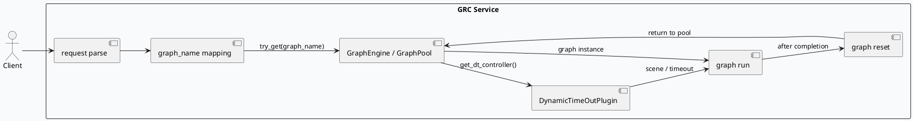

# 2026-08-20 周四代码理解：GraphPool 复用与动态超时绑定

> 日期：2026-08-20  
> 主题来源：2026-06-01 daily-plan 文件没有可直接执行的当日计划，按历史未覆盖主题 fallback 到 `GraphPool` 对象池复用与 `DynamicTimeOutPlugin` 的注入链路；KU/业务背景需人工补充。  
> 范围：只分析 `src/service/grc_service.cpp`，聚焦 `GraphEngine` 取图、`GraphPool::try_get`、图名映射、动态超时控制器获取、`graph->run()` 与 `graph->reset()` 的生命周期。

---

## 0. 架构全景图
<div style="font-family:system-ui,-apple-system,BlinkMacSystemFont,'Segoe UI',sans-serif;border:1px solid #d0d7de;border-radius:8px;padding:14px;background:#f8fafc;line-height:1.45;">
  <div style="display:grid;grid-template-columns:1.2fr 1.2fr 1fr;gap:12px;align-items:stretch;">
    <div style="border:1px solid #cbd5e1;border-radius:8px;padding:12px;background:#fff;">
      <div style="font-size:12px;color:#475569;font-weight:700;letter-spacing:0;text-transform:uppercase;">入口层</div>
      <div style="margin-top:8px;font-size:16px;font-weight:700;color:#111827;">GRC RPC Handler</div>
      <div style="margin-top:8px;color:#334155;">接收请求、解析 UA、准备 request/response 上下文，并决定后续图实例与控制器策略。</div>
    </div>
    <div style="border:1px solid #cbd5e1;border-radius:8px;padding:12px;background:#fff;">
      <div style="font-size:12px;color:#475569;font-weight:700;letter-spacing:0;text-transform:uppercase;">运行层</div>
      <div style="margin-top:8px;font-size:16px;font-weight:700;color:#111827;">GraphEngine + GraphPool</div>
      <div style="margin-top:8px;color:#334155;">按 `graph_name` 借出图实例，执行业务图，再在结束后归还并 reset，避免状态串用。</div>
    </div>
    <div style="border:1px solid #cbd5e1;border-radius:8px;padding:12px;background:#fff;">
      <div style="font-size:12px;color:#475569;font-weight:700;letter-spacing:0;text-transform:uppercase;">控制层</div>
      <div style="margin-top:8px;font-size:16px;font-weight:700;color:#111827;">DynamicTimeOutPlugin</div>
      <div style="margin-top:8px;color:#334155;">从应用上下文获取动态超时控制器，把 scene / timeout 写回执行上下文，约束整条调用链的时延。</div>
    </div>
  </div>
  <div style="margin-top:12px;border-top:1px solid #dbe3eb;padding-top:12px;color:#334155;">
    <strong>关键关系：</strong> `request -> graph_name 选择 -> GraphPool::try_get -> dt_controller -> graph->run() -> graph->reset()`
  </div>
</div>

## 1. 核心流程图


## 2. 结构信息图
```infographic
infographic sequence-ascending-steps
data
  title GRC 处理链路的 4 个稳定节点
  items
    - label 图名选择
      desc `ua` 驱动 `graph_name`，决定进入哪条业务图
      value 1
      icon mdi/cursor-default-click
    - label 图实例借出
      desc `graph_engine->try_get(graph_name)` 从池中取图
      value 2
      icon mdi/database-outline
    - label 动态超时注入
      desc `get_dt_controller()` 后把控制器绑定到执行上下文
      value 3
      icon mdi/timer-cog-outline
    - label 归还与 reset
      desc `graph->reset()` 清理图状态，避免下次请求污染
      value 4
      icon mdi/restore
```

## 3. 代码证据
- `src/service/grc_service.cpp:172-176`：取出 `GraphEngine`，初始化 `GraphPool::PooledObject` 和默认 `graph_name`
- `src/service/grc_service.cpp:179-196`：按 UA 映射到 `dibar_reddot`、`video_immersion`、`searchc_related`、`searchc_immersive_related`、`news_updates_dibar`、`interest_card`、`auto_play`、`default`
- `src/service/grc_service.cpp:196-217`：`try_get()` 借图，调用 `run(...)`，最后 `graph->reset()`
- `src/service/grc_service.cpp:55-64`：从 `ApplicationContext` 获取 `DynamicTimeOutPlugin`，再拿动态超时控制器

## 4. Pitfalls
<div style="display:grid;grid-template-columns:1fr 1fr;gap:12px;">
  <div style="border:1px solid #cbd5e1;border-radius:8px;padding:12px;background:#fff;">
    <div style="font-weight:700;color:#111827;">控制器为空会直接失败</div>
    <div style="margin-top:6px;color:#334155;">`_dynamic_timeout_plugin` 或 `dynamic_timeout_cntl` 为空时直接走 fatal / error 分支，说明该链路把超时配置当成运行前置条件。</div>
  </div>
  <div style="border:1px solid #cbd5e1;border-radius:8px;padding:12px;background:#fff;">
    <div style="font-weight:700;color:#111827;">图对象必须显式 reset</div>
    <div style="margin-top:6px;color:#334155;">`GraphPool` 复用带来性能收益，但也要求每次执行结束都 reset，否则请求状态会泄漏到下一次复用。</div>
  </div>
</div>

## 5. 调试 Checklist
```infographic
infographic list-column-done-list
data
  title GRC 链路排查清单
  items
    - label 确认 `graph_name` 命中
      done true
      desc 检查 UA 到图名的映射是否覆盖目标场景
      icon mdi/map-marker-path
    - label 确认控制器已注入
      done true
      desc 观察 `DynamicTimeOutPlugin` 是否可从上下文获取
      icon mdi/cog-transfer-outline
    - label 确认图实例可借出
      done true
      desc `try_get()` 是否返回有效对象，是否存在池耗尽
      icon mdi/pool
    - label 确认执行后 reset
      done true
      desc 每次调用结束都要看到 reset 路径被走到
      icon mdi/backup-restore
```

## 6. 证据来源
- `src/service/grc_service.cpp:55-64`
- `src/service/grc_service.cpp:172-217`

> 备注：KU 业务背景未逐篇读取正文，需人工补充。

> 内容整理：重复扫描统计驱动的历史适配附录；不作为已核实的迁移结论，已移出正文。[查看原始版本及附录](https://github.com/1998-program/cpp-core-notes/blob/5738832bab4b13ba26356af0a37a0a32e477b675/notes/base-lib/20260820-graphpool-reset-and-dynamic-timeout-binding.md)。
