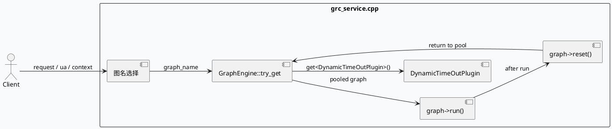

# 2026-08-22 周六代码理解：GraphPool 复用与 reset 生命周期
<!-- topic-nav:start -->
> 主题：`base/graphpool-reset` · 同题补充 / 历史版本 · [主题目录](README.md) · [先读主文](20260827-graphpool-try-get-run-reset-lifecycle.md)
<!-- topic-nav:end -->


> 日期：2026-08-22  
> 主题来源：`notes/weekly-topic-selection/daily-plan-20260529.json` 的历史候选项回退；本次 cron 没有可直接执行的当日 daily-plan，KU/业务背景需人工补充。  
> 范围：只分析 `src/service/grc_service.cpp` 中的 `GraphPool::try_get`、图名选择、`graph->run()`、`graph->reset()` 与 `DynamicTimeOutPlugin` 获取链路。

---

## 0. 架构全景图
<div style="font-family:system-ui,-apple-system,BlinkMacSystemFont,'Segoe UI',sans-serif;border:1px solid #d0d7de;border-radius:8px;padding:14px;background:#f8fafc;line-height:1.45;">
  <div style="display:grid;grid-template-columns:1.1fr 1.2fr 1.1fr;gap:12px;align-items:stretch;">
    <div style="background:#ffffff;border:1px solid #cbd5e1;border-radius:8px;padding:12px;">
      <div style="font-size:12px;font-weight:700;color:#475569;text-transform:uppercase;letter-spacing:.04em;">入口层</div>
      <div style="margin-top:8px;font-size:14px;color:#1f2937;">`grc_service.cpp` 请求入口</div>
      <div style="margin-top:8px;font-size:12px;color:#475569;">选择 `graph_name`、装配上下文、触发执行与回收</div>
    </div>
    <div style="background:#eef6ff;border:1px solid #bfdbfe;border-radius:8px;padding:12px;">
      <div style="font-size:12px;font-weight:700;color:#1d4ed8;text-transform:uppercase;letter-spacing:.04em;">核心中枢</div>
      <div style="margin-top:8px;font-size:14px;color:#1e3a8a;">`GraphEngine::try_get()` + `GraphPool`</div>
      <div style="margin-top:8px;font-size:12px;color:#1e40af;">复用图对象，避免重复构造；执行后必须 `reset()`</div>
    </div>
    <div style="background:#fff7ed;border:1px solid #fed7aa;border-radius:8px;padding:12px;">
      <div style="font-size:12px;font-weight:700;color:#c2410c;text-transform:uppercase;letter-spacing:.04em;">控制层</div>
      <div style="margin-top:8px;font-size:14px;color:#7c2d12;">`DynamicTimeOutPlugin`</div>
      <div style="margin-top:8px;font-size:12px;color:#9a3412;">从应用上下文读取超时控制器，影响整条图执行路径</div>
    </div>
  </div>
  <div style="margin-top:12px;display:grid;grid-template-columns:1fr 70px 1fr 70px 1fr;gap:10px;align-items:center;">
    <div style="background:#fff;border:1px solid #cbd5e1;border-radius:8px;padding:10px;text-align:center;">请求上下文<br><span style="font-size:12px;color:#64748b;">`ua` / `res_cnt` / `cntl`</span></div>
    <div style="text-align:center;color:#64748b;font-size:18px;">→</div>
    <div style="background:#fff;border:1px solid #cbd5e1;border-radius:8px;padding:10px;text-align:center;">图名映射<br><span style="font-size:12px;color:#64748b;">`news_updates_dibar` 等</span></div>
    <div style="text-align:center;color:#64748b;font-size:18px;">→</div>
    <div style="background:#fff;border:1px solid #cbd5e1;border-radius:8px;padding:10px;text-align:center;">复用执行<br><span style="font-size:12px;color:#64748b;">`try_get` → `run` → `reset`</span></div>
  </div>
</div>

## 1. 核心调用链


## 2. 执行信息图
```infographic
infographic sequence-timeline-simple
data
  title GraphPool 生命周期
  desc 图对象从获取、执行到回收的最短闭环
  items
    - time 1
      label 选择图名
      desc 由 `ua` 映射到 `graph_name`
      icon mdi:swap-horizontal
    - time 2
      label 从池中取图
      desc `GraphEngine::try_get(graph_name)`
      icon mdi:cached
    - time 3
      label 执行图
      desc `run(graph, graph_name, sctx, done, cntl, res_cnt)`
      icon mdi:play
    - time 4
      label 清理状态
      desc `graph->reset()`，避免脏状态下次复用
      icon mdi:broom
```

```infographic
infographic list-grid-badge-card
data
  title 图名映射要点
  desc 业务图名不是固定常量，而是由请求属性决定
  items
    - label `ua == 97`
      desc `dibar_reddot`
      value 1
    - label `ua == 85`
      desc `video_immersion`
      value 1
    - label `ua == 155/156`
      desc `searchc_related`
      value 2
    - label `ua == 123`
      desc `searchc_immersive_related`
      value 1
    - label `ua == 102`
      desc `news_updates_dibar`
      value 1
    - label `ua == 110`
      desc `interest_card`
      value 1
```

## 3. 关键结论
<div style="font-family:system-ui,-apple-system,BlinkMacSystemFont,'Segoe UI',sans-serif;border:1px solid #cbd5e1;border-left:4px solid #2563eb;border-radius:8px;padding:14px;background:#ffffff;margin:14px 0;">
  <div style="font-size:13px;font-weight:700;color:#1e3a8a;margin-bottom:6px;">结论 1</div>
  <div style="font-size:14px;color:#1f2937;">`GraphPool` 的价值在于复用图实例，但复用前后必须维持严格的 `run -> reset` 顺序，否则会把上一次请求的状态泄漏到下一次执行。</div>
</div>
<div style="font-family:system-ui,-apple-system,BlinkMacSystemFont,'Segoe UI',sans-serif;border:1px solid #cbd5e1;border-left:4px solid #ea580c;border-radius:8px;padding:14px;background:#ffffff;margin:14px 0;">
  <div style="font-size:13px;font-weight:700;color:#9a3412;margin-bottom:6px;">结论 2</div>
  <div style="font-size:14px;color:#1f2937;">动态超时插件不是独立流程，它和取图同一条执行链绑定在一起，说明控制策略必须在图执行之前就准备好。</div>
</div>

## 4. Pitfalls
<div style="font-family:system-ui,-apple-system,BlinkMacSystemFont,'Segoe UI',sans-serif;border:1px solid #e2e8f0;border-radius:8px;padding:14px;background:#f8fafc;">
  <div style="font-size:13px;font-weight:700;color:#334155;margin-bottom:8px;">常见坑</div>
  <div style="font-size:14px;color:#1f2937;">1. 只看 `try_get` 不看 `reset`，会误判对象池“无副作用”。</div>
  <div style="font-size:14px;color:#1f2937;margin-top:6px;">2. 把 `graph_name` 当成静态配置，忽略了 `ua` 驱动的分流逻辑。</div>
  <div style="font-size:14px;color:#1f2937;margin-top:6px;">3. 认为超时控制和图执行无关，实际上它在上下文获取阶段就参与了整条链路。</div>
</div>

```infographic
infographic list-column-done-list
data
  title 调试 checklist
  items
    - label 确认 `ua` 到 `graph_name` 的映射是否命中预期分支
      done true
    - label 确认 `GraphEngine::try_get()` 返回的是池中复用对象而不是新构造对象
      done true
    - label 检查 `graph->run()` 后是否总是执行 `graph->reset()`
      done true
    - label 核对 `DynamicTimeOutPlugin` 是否在上下文中成功获取
      done true
    - label 验证异常路径是否会跳过回收
      done true
```

## 5. 证据来源
- `src/service/grc_service.cpp:56-57`
- `src/service/grc_service.cpp:180-220`
- `src/service/grc_service.cpp:228-233`

> 需人工补充：KU/业务背景未逐篇读取正文，仅使用日计划候选与源码证据。

> 内容整理：重复扫描统计驱动的历史适配附录；不作为已核实的迁移结论，已移出正文。[查看原始版本及附录](https://github.com/1998-program/cpp-core-notes/blob/5738832bab4b13ba26356af0a37a0a32e477b675/notes/base-lib/20260822-graphpool-reset-lifecycle.md)。
