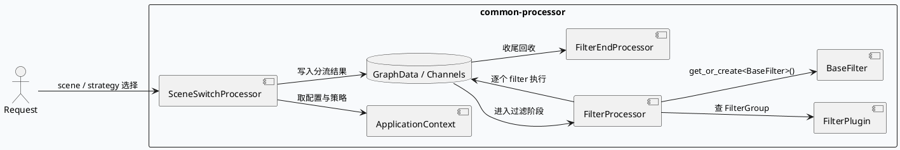
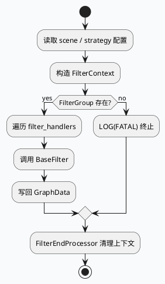

# common-processor 过滤链与场景切换：FilterProcessor、FilterEndProcessor 与 SceneSwitchProcessor
<!-- topic-nav:start -->
> 主题：`base/filter-lifecycle` · 同题补充 / 历史版本 · [主题目录](README.md) · [先读主文](2026-06-23-lite-grc-filterprocessor-exec-engine-lifecycle.md)
<!-- topic-nav:end -->


> 运行说明：2026-08-24 未发现 daily-plan 文件，按历史未覆盖主题 fallback 到 `common-processor` 的过滤链与场景切换生命周期。当前 cron 环境未验证 KU 可用性，KU/业务背景需人工补充；本文只使用本地代码与配置证据。

<div class="arch-wrapper" style="display:flex;gap:12px;align-items:stretch;background:#f8fafc;border:1px solid #d8e2ef;border-radius:8px;padding:14px;color:#1f2937;font-family:Inter,Arial,sans-serif;">
  <div class="arch-main" style="flex:1;min-width:0;">
    <div style="font-size:20px;font-weight:800;margin:0 0 10px 0;">过滤链的分层视角</div>
    <div class="arch-layer application" style="background:#fff;border:1px solid #cbd5e1;border-radius:8px;padding:10px;margin-bottom:10px;">
      <b style="display:block;margin-bottom:6px;color:#334155;">处理入口</b>
      <div style="display:grid;grid-template-columns:repeat(3,minmax(0,1fr));gap:8px;">
        <div style="background:#eef4f8;border-left:4px solid #3d5a80;padding:8px;border-radius:6px;">filter_processor.cpp: 从 `FilterPlugin` 取 `FilterGroup`，构造 `FilterContext`。</div>
        <div style="background:#eef4f8;border-left:4px solid #3d5a80;padding:8px;border-radius:6px;">filter_end_processor.cpp: 结束侧回收 `VertexContext` / `DynamicStruct`。</div>
        <div style="background:#eef4f8;border-left:4px solid #3d5a80;padding:8px;border-radius:6px;">scene_switch_processor.cpp: 基于请求字段做 scene/strategy 分流。</div>
      </div>
    </div>
    <div class="arch-layer data" style="background:#fff;border:1px solid #cbd5e1;border-radius:8px;padding:10px;margin-bottom:10px;">
      <b style="display:block;margin-bottom:6px;color:#334155;">运行时依赖</b>
      <div style="display:grid;grid-template-columns:repeat(2,minmax(0,1fr));gap:8px;">
        <div style="background:#f3f8f4;border-left:4px solid #2d6a4f;padding:8px;border-radius:6px;">`ApplicationContext` 负责插件、过滤器与策略实例的取用。</div>
        <div style="background:#f3f8f4;border-left:4px solid #2d6a4f;padding:8px;border-radius:6px;">`GraphData` / `InputChannel` / `OutputChannel` 承担 graph-engine 传递。</div>
      </div>
    </div>
  </div>
  <div class="arch-sidebar" style="width:260px;min-width:260px;">
    <div class="arch-layer infra" style="background:#fff;border:1px solid #cbd5e1;border-radius:8px;padding:10px;height:100%;">
      <b style="display:block;margin-bottom:6px;color:#334155;">配置侧</b>
      <div style="font-size:13px;line-height:1.55;color:#334155;">`test/conf/plugins/scenes.conf` 定义场景和条件。</div>
      <div style="font-size:13px;line-height:1.55;color:#334155;margin-top:8px;">`test/conf/plugins/graph/switch_graph.conf` 注册 `SidSet` 图数据供条件判断。</div>
      <div style="font-size:13px;line-height:1.55;color:#334155;margin-top:8px;">`test/conf/plugins/strategies.conf` 承载策略选择入口。</div>
    </div>
  </div>
</div>

## 核心链路





```infographic
sequence-ascending-steps
  data
    title common-processor 运行步骤
    desc 从场景决策到过滤执行，再到收尾回收
    items
      - label 场景解析
        desc 先从 scene / condition 选择 strategy
      - label 过滤组装载
        desc 通过 FilterPlugin 取 FilterGroup
      - label 过滤执行
        desc 逐个 BaseFilter 处理 GraphData
      - label 收尾
        desc FilterEndProcessor 回收上下文
```

## 结构信息图

```infographic
compare-hierarchy-left-right-circle-node-pill-badge
  data
    title 配置与运行时的职责划分
    items
      - label scenes.conf
        desc scene / condition / strategy 入口
      - label switch_graph.conf
        desc SidSet 等图数据注册点
      - label filter_processor.cpp
        desc 过滤上下文与 handler 编排
      - label filter_end_processor.cpp
        desc 收尾与资源释放
```

## 关键证据

- `src/microframe/filter/filter_processor.cpp:30-67`：`FilterContext`、`FilterGroup`、`BaseFilter` 装配与 `get_or_create<BaseFilter>()`。
- `src/microframe/filter/filter_end_processor.cpp:1-40`：`FilterEndProcessor` 依赖 `VertexContext`、`DynamicStruct`、`ConcurrentTransientQueue`。
- `src/processor/scene_switch_processor.cpp:16-80`：`SceneSwitchProcessor` 按 scene / strategy / condition 做分流。
- `test/conf/plugins/scenes.conf:1-26`：`haokan_feed_default`、`search_related` 等 scene 配置。
- `test/conf/plugins/graph/switch_graph.conf:1-5`：`SidSet` 注册，用于 `scenes.conf` 条件判断。
- `test/conf/plugins/strategies.conf`：策略入口文件，承接 scene 到 strategy 的映射。

## Pitfalls

<div style="display:grid;grid-template-columns:repeat(2,minmax(0,1fr));gap:10px;margin-top:8px;">
  <div style="background:#fff;border:1px solid #d8e2ef;border-left:4px solid #b8432f;border-radius:8px;padding:12px;">
    <div style="font-weight:700;color:#1f2937;margin-bottom:6px;">FilterGroup 为空会直接中止</div>
    <div style="color:#334155;line-height:1.55;">`filter_processor.cpp` 在拿不到 `FilterGroup` 时会 `LOG(FATAL)`，所以配置缺项不是降级路径。</div>
  </div>
  <div style="background:#fff;border:1px solid #d8e2ef;border-left:4px solid #b8432f;border-radius:8px;padding:12px;">
    <div style="font-weight:700;color:#1f2937;margin-bottom:6px;">scene 配置和图数据必须成对</div>
    <div style="color:#334155;line-height:1.55;">`scenes.conf` 的 `SidSet@...` 条件依赖 `switch_graph.conf` 注册，单改一边会造成条件失效。</div>
  </div>
</div>

## 调试 Checklist

```infographic
list-column-done-list
  data
    title 调试 checklist
    items
      - label 先看 scenes.conf 是否命中目标 scene
        done true
      - label 再确认 switch_graph.conf 是否注册对应图数据
        done true
      - label 检查 FilterPlugin 是否能返回 FilterGroup
        done true
      - label 验证 BaseFilter 实例是否可创建
        done true
      - label 收尾阶段确认 FilterEndProcessor 正常释放上下文
        done true
```

## 证据来源

- `src/microframe/filter/filter_processor.cpp`
- `src/microframe/filter/filter_end_processor.cpp`
- `src/processor/scene_switch_processor.cpp`
- `test/conf/plugins/scenes.conf`
- `test/conf/plugins/graph/switch_graph.conf`
- `test/conf/plugins/strategies.conf`
