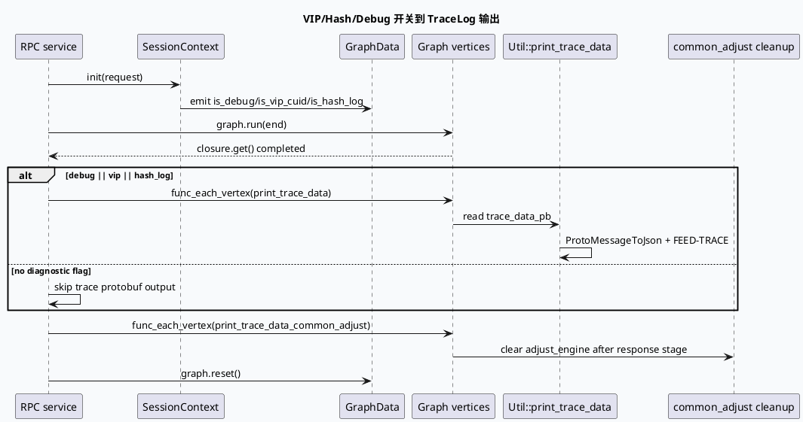

# 基础库代码理解：GRC/GRG TraceLog、VIP 与 HashLog 观测契约
<!-- topic-nav:start -->
> 主题：`base/tracelog` · 同题补充 / 历史版本 · [主题目录](README.md) · [先读主文](20260531-tracelog-vip-hashlog-business-log-layering.md)
<!-- topic-nav:end -->


> 主题：请求上下文中的 `is_vip_cuid` / `is_hash_log` / `is_debug` 如何注入 Graph，触发 trace 遍历，并在 response 前后完成日志对象清理。
> 主题选择说明：唯一 daily-plan `daily-plan-20260529.json` 已明显过期；近期笔记已覆盖 GraphPool、ApplicationContext、fork/FlowContext、DeepEs、PipelineGraphFunction 等候选。本次按 fallback 选择计划候选中的 TraceLog/VIP/HashLog 采样与日志分层主题。KU 正文未逐篇读取，业务背景需人工补充；以下以源码证据为主。

## 0. 架构全景图

<style>.obs-arch{font-family:Inter,Arial,sans-serif;border:1px solid #d8dee9;background:#f8fafc;border-radius:8px;padding:18px;margin:18px 0;color:#243041}.obs-arch h3{margin:0 0 12px;font-size:20px}.obs-grid{display:grid;grid-template-columns:repeat(4,minmax(0,1fr));gap:8px}.obs-box{border:1px solid #c9d3e3;border-left:4px solid #2d6a4f;background:#fff;border-radius:6px;padding:10px;min-height:90px}.obs-box b{display:block;font-size:13px;color:#1a2f44}.obs-box span{display:block;font-size:12px;line-height:1.5;color:#526071;margin-top:4px}.obs-gate{border-left-color:#3d5a80}.obs-vip{border-left-color:#9a5b28}.obs-risk{border-left-color:#b8432f}@media(max-width:820px){.obs-grid{grid-template-columns:repeat(2,minmax(0,1fr))}}@media(max-width:520px){.obs-grid{grid-template-columns:1fr}}</style><div class="obs-arch"><h3>Feed Graph 观测链路</h3><div class="obs-grid"><div class="obs-box obs-gate"><b>请求上下文</b><span>GRC 从 session context 读取 is_vip_cuid、is_hash_log、is_debug，并写入 GraphData。</span></div><div class="obs-box"><b>Graph 执行</b><span>各 vertex 将 trace protobuf 写入自定义 context；调整器另有 TraceLogContext 与 sample type。</span></div><div class="obs-box obs-vip"><b>条件输出</b><span>VIP 或 hash/debug 开关命中后，统一 func_each_vertex(print_trace_data) 输出 FEED-TRACE。</span></div><div class="obs-box obs-risk"><b>清理边界</b><span>common_adjust 清理 adjust_engine 必须晚于回包，否则日志 protobuf 可能被重建或丢失。</span></div></div><p style="font-size:12px;line-height:1.5;color:#526071;margin:10px 0 0">核心边界：观测开关只决定是否打印，不能改变业务结果；清理动作属于 response 后的资源收口。</p></div>

## 1. 开关注入与 trace 触发

`feeda-mv-grc/src/service/grc_service.cpp:130-149` 将 `is_debug`、`is_vip_cuid`、`is_hash_log` 等字段写入 graph。`grc_service.cpp:214-220` 在 graph run 完成后判断 `is_debug == 1 || is_vip_cuid == 1 || is_hash_log == 1`，命中任一条件就遍历所有 vertex 调用 `Util::print_trace_data`，随后无条件执行 `print_trace_data_common_adjust`。

GRG 的对应入口是 `feeda-mv-grg/src/service/grg_service.cpp:153-164`：通过 `is_hit_vip(cuid, uid)` 计算 VIP 标记并 emit 到 graph；`grg_service.cpp:295-305` 在日志收尾阶段对 VIP 请求序列化 response、输出 response 日志，再打印 trace arena。两侧语义一致，但 GRC 额外保留了 hash/debug 触发条件。



## 2. TraceLog plugin 与 VIP 判定

`src/plugin/vip_cuid.cpp:9-25` 注册 `GrcHitVipTraceLog` 为 `BaseHitVipTraceLog` 的 `trace_hit_vip` 组件。`hit()` 从 `vip_id_dict` 取 `HashSetString`，以 cuid 或 uid 任一命中作为 VIP。字典取不到时直接 fatal，说明 VIP 判定依赖的配置缺失属于启动/运行时严重错误，而不是普通 miss。

GRC 在 `grc_service.cpp:369-434` 对 UA=85 的 VIP 请求额外输出 `VIP_PreciseAdjustFactors` 与 `VIP_GrgAdjustFactors` JSON。实现使用 thread-local string、预留容量，并按 512KB 分片写日志，避免一次性日志体积无限增长。该日志是业务调权诊断，不应与通用 `FEED-TRACE` 混为同一格式。

```infographic
infographic quadrant-quarter-simple-card
data
  title 观测开关四象限
  desc 三类开关决定诊断输出范围，不改变推荐主链路
  items
    - label 普通请求
      desc 三个开关均为 0；跳过 trace protobuf 输出
      value 1
    - label Debug 请求
      desc is_debug=1；输出所有 vertex trace，适合开发排查
      value 2
    - label VIP 请求
      desc is_vip_cuid=1；输出 trace，并可能追加 VIP 调权因子 JSON
      value 3
    - label HashLog 请求
      desc is_hash_log=1；输出 trace，用于抽样审计和日志归因
      value 4
 theme
  palette #2d6a4f #3d5a80 #9a5b28 #b8432f
```

## 3. `print_trace_data` 的容错与输出

`src/util/util.cpp:147-175` 先取 `VertexContext` 和业务 `Context`，任一为空就返回 0；然后遍历 `trace_data_pb`，跳过空 data，调用 `ProtoMessageToJson`，失败时把错误写入 buffer，最后拼出带 timestamp、appId、module、logid、cuid、uid、baiduid、scene_type 的 `[FEED-TRACE]` 日志。此函数返回 0，不把单个 trace 序列化失败升级为业务失败。

`print_trace_data_common_adjust` 在 `src/util/util.cpp:118-135` 获取 `CommonAdjustContext` 后清理 `adjust_engine`。源码注释明确：必须在请求回包后 clear，因为清理会涉及日志 protobuf 对象重建。这个时机约束比“是否调用 clear”更重要。

## 4. 日志分层信息图

```infographic
infographic list-grid-badge-card
data
  title 三层诊断日志
  desc 按观测对象和生命周期区分日志格式
  items
    - label FEED-TRACE
      desc vertex trace_data_pb 转 JSON；适合逐节点追踪和 graph 路径定位
      icon mdi/graph-outline
    - label VIP_PreciseAdjustFactors
      desc UA=85 VIP 请求的调权因子，带 logid/cuid/item_count
      icon mdi/account-star-outline
    - label VIP_GrgAdjustFactors
      desc GRG 因子分片日志，超过 512KB 时拆 part/last
      icon mdi/format-list-bulleted
    - label TraceLogContext
      desc 调整器按 LogSampleType FLOW_HASH/VIP 决定样本输出
      icon mdi/timeline-text-outline
 theme
  palette #2d6a4f #3d5a80 #b8432f
```

## 5. Pitfalls

<div class="obs-arch"><h3>TraceLog 排查卡片</h3><div class="obs-grid"><div class="obs-box obs-risk"><b>把 VIP miss 当作 trace bug</b><span>VIP 判定依赖 vip_id_dict，先确认字典加载和 cuid/uid 输入，再看 trace 条件。</span></div><div class="obs-box obs-risk"><b>只看 is_vip_cuid</b><span>GRC 还有 is_debug 和 is_hash_log 两条触发路径；三者任一命中都会遍历 trace。</span></div><div class="obs-box obs-risk"><b>回包前清 adjust_engine</b><span>源码明确要求回包后清理，提前 clear 可能重建日志 protobuf，导致诊断内容不完整。</span></div><div class="obs-box"><b>把 trace 输出当业务失败</b><span>ProtoMessageToJson 失败只写错误文本并继续，不能据此断言 graph 处理失败。</span></div><div class="obs-box"><b>忽略日志分片</b><span>VIP GRG 因子日志可能包含 part/last，多条日志合并后才能恢复完整 payload。</span></div><div class="obs-box obs-gate"><b>GRC 与 GRG 触发条件不同</b><span>GRG 收尾固定打印 trace，GRC 按 debug/vip/hash 条件触发；跨服务对比时要先看入口实现。</span></div></div></div>

```infographic
infographic list-column-done-list
data
  title TraceLog 调试 Checklist
  desc 从开关到清理顺序核对
  items
    - label 检查 VIP 字典
      desc vip_id_dict 是否成功加载，cuid/uid 是否命中
      done true
      icon mdi/book-search-outline
    - label 检查 GraphData 注入
      desc is_debug/is_vip_cuid/is_hash_log 是否在 run 前 emit
      done true
      icon mdi/database-arrow-right
    - label 检查 trace 条件
      desc GRC 的三个 flag 是否至少一个为 1
      done true
      icon mdi/filter-check-outline
    - label 检查 FEED-TRACE
      desc vertex context 和 trace_data_pb 是否为空，JSON 转换是否成功
      done true
      icon mdi/text-search
    - label 检查 VIP 分片
      desc VIP_GrgAdjustFactors 的 part/last 是否齐全
      done true
      icon mdi/file-multiple-outline
    - label 检查清理时机
      desc response 完成后再执行 print_trace_data_common_adjust 和 graph.reset
      done true
      icon mdi/clock-check-outline
 theme
  palette #2d6a4f #3d5a80 #b8432f
```

## 证据来源

- `feeda-mv-grc/src/service/grc_service.cpp:130-149`：debug/VIP/hash 标记注入 Graph。
- `feeda-mv-grc/src/service/grc_service.cpp:178-221`：graph 获取、run、条件 trace 遍历和 cleanup。
- `feeda-mv-grc/src/service/grc_service.cpp:368-434`：VIP 调权因子 JSON 与 512KB 分片。
- `feeda-mv-grc/src/util/util.cpp:118-175`：trace 序列化、容错和 adjust engine 清理。
- `feeda-mv-grc/src/plugin/vip_cuid.cpp:7-25`：VIP 字典判定与组件注册。
- `feeda-mv-grg/src/service/grg_service.cpp:121-164`：GRG 基础 GraphData 与 VIP 标记注入。
- `feeda-mv-grg/src/service/grg_service.cpp:295-305`：GRG VIP response 日志与 trace 输出。
- `feeda-mv-grg/src/process/diversity_merge.cpp:168`：VIP LogSampleType 在业务 engine context 中的使用。
