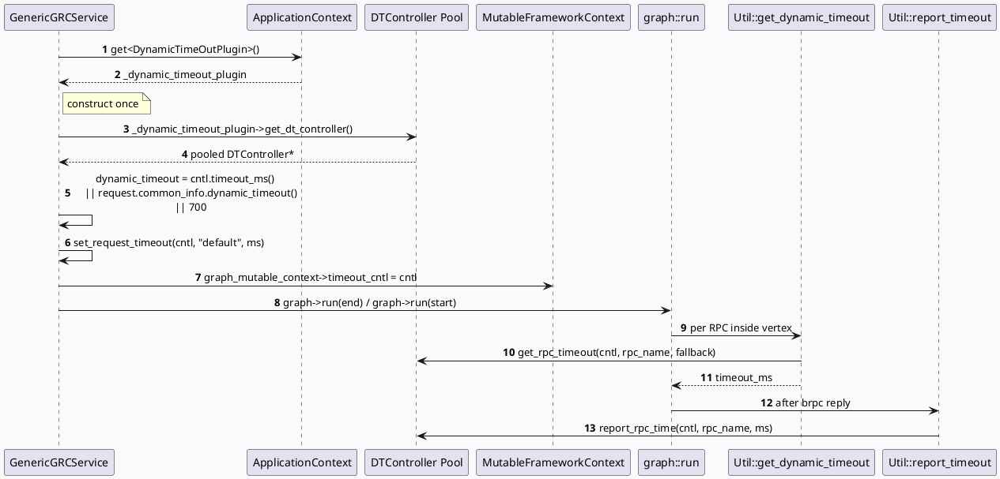

# 2026-09-26 基础库代码理解：DynamicTimeOutPlugin 与 FullLinkDynamicTimeOutController 池化合同
<!-- topic-nav:start -->
> 主题：`base/dynamic-timeout` · 同题补充 / 历史版本 · [主题目录](README.md) · [先读主文](20260725-dynamic-timeout-plugin-budget-control.md)
<!-- topic-nav:end -->


> 日期：2026-09-26（周六）
> 主题选择：未发现目标日期有效 daily-plan；仓库中仅保留 2026-05-29 的过期 weekly-plan。本次按 plan 中 `Sat: DynamicTimeOutPlugin 动态超时注入与场景映射` 回退。代码库入口 `feeda-mv-grc` 的仓内别名 `feed::general::framework::DynamicTimeOutPlugin` 指向上游 `feed-arch` 框架；本文只在 GRC 调用点反推插件对外合同，并对照 `GenericGRCService::run()` 的接入顺序与 `Util::get_dynamic_timeout()` 的 RPC 维度动态预算流程。KU 正文未读取，业务背景需人工补充；以下只陈述源码和 graph 配置可验证的行为。
> 配对关系：业务库笔记同时分析 fake_id 替换链路；本文不展开。
> 范围：`src/service/grc_service.{h,cpp}`（service 入口与 controller 注入）、`src/util/util.{hpp,cpp}`（超时计算/上报）、`src/plugin/{urs,set2set_predictor,feature_service,user_intent_predictor}.h`（DTController 别名与绑定）、`conf/plugins/dict.conf`（`controll_dict.open_dynamic_timeout` 开关）、`conf/plugins/graph/vertex.conf`（`sid_dynamic_timeout`/`sid_rpc_timeout` 键）。

## 0. 架构全景图

<div style="font-family:system-ui,-apple-system,BlinkMacSystemFont,'Segoe UI',sans-serif;background:#f5f7fa;border:1px solid #d8e1ea;border-radius:8px;padding:16px;margin:16px 0;color:#243b53;line-height:1.45;"><div style="font-size:12px;font-weight:800;color:#52606d;text-transform:uppercase;letter-spacing:.05em;">DynamicTimeOut 池化与每 RPC 注入合同</div><div style="display:grid;grid-template-columns:1fr 28px 1.15fr 28px 1.25fr 28px 1fr;gap:8px;align-items:center;margin-top:12px;"><div style="background:#fff;border:1px solid #cbd5e1;border-left:4px solid #3d5a80;border-radius:6px;padding:11px;"><div style="font-size:15px;color:#102a43;font-weight:700;">brpc Controller</div><div style="margin-top:7px;font-size:12px;color:#52606d;\">请求级 cntl.timeout_ms 上限；<br/>未设置时 fallback 至 common_info.dynamic_timeout / 700ms。</div></div><div style="text-align:center;color:#64748b;font-size:20px;">→</div><div style="background:#fff;border:1px solid #cbd5e1;border-left:4px solid #2d6a4f;border-radius:6px;padding:11px;"><div style="font-size:15px;color:#102a43;font-weight:700;">DTController Pool</div><div style="margin-top:7px;font-size:12px;color:#52606d;\">plugin->get_dt_controller() 取 pooled cntl；<br/>set_request_timeout(scene, ms) 写入。</div></div><div style="text-align:center;color:#64748b;font-size:20px;">→</div><div style="background:#fff;border:1px solid #cbd5e1;border-left:4px solid #9a5b28;border-radius:6px;padding:11px;"><div style="font-size:15px;color:#102a43;font-weight:700;">FrameworkContext</div><div style="margin-top:7px;font-size:12px;color:#52606d;\">graph_mutable_context->timeout_cntl = cntl；<br/>set_graph_log_info(logid, product, ua)。</div></div><div style="text-align:center;color:#64748b;font-size:20px;">→</div><div style="background:#fff;border:1px solid #cbd5e1;border-left:4px solid #b8432f;border-radius:6px;padding:11px;"><div style="font-size:15px;color:#102a43;font-weight:700;">RPC 维度预算</div><div style="margin-top:7px;font-size:12px;color:#52606d;\">Util::get_dynamic_timeout() 计算；<br/>Util::report_timeout() 回传真实耗时。</div></div></div><div style="margin-top:10px;font-size:12px;color:#52606d;">每次请求拉一个新 controller、写入 scene/timeout、注入 MutableFrameworkContext，RPC 完成后再回写。</div></div>

## 1. 主题边界与核心结论

`DynamicTimeOutPlugin` 与 `FullLinkDynamicTimeOutController` 在仓内仅以 `feed::general::framework` 命名空间别名出现，实现位于上游 `feed-arch` 框架。本仓可见的是 5 个对外调用点：service 入口构造、run() 中池化和初始化、`Util::get_dynamic_timeout()` 的 RPC 维度预算、`Util::report_timeout()` 的真实耗时回传，以及 plugin/rpc 头文件中的 `DTController*` 类型别名。

基于这些调用点可以反推插件对外必须满足的最小合同：

1. **对象池语义** — `get_dt_controller()` 返回的对象须是可重置的池化指针；service 在 controller 为空时直接返回 `ERR_DYNAMIC_TIMEOUT`。
2. **scene 注册与初始化** — `set_request_timeout(cntl, scene, ms)` 必须按 `scene` 字符串解析并写入内部预算表，未识别 scene 不影响返回值。
3. **预算/上报分离** — `get_rpc_timeout(cntl, rpc_name, fallback)` 与 `report_rpc_time(cntl, rpc_name, ms)` 必须成对使用，前者读预算、后者回写真实耗时。
4. **scene 注册表与 dict 开关** — `controll_dict.open_dynamic_timeout` 决定是否走真实预算；`sid_dynamic_timeout`、`sid_rpc_timeout` 是请求级别 scene 选择器。

源码中 `GenericGRCService` 构造函数预取 plugin 引用，`run()` 通过对象池取出 controller 后写入 scene，再把指针挂到 `MutableFrameworkContext.timeout_cntl`（`src/service/grc_service.cpp:55-59`、`233-289`）；`Util::get_dynamic_timeout()` 在 dict 关闭时直接走默认预算（`src/util/util.cpp:189-208`）；`report_timeout()` 单独写回实际耗时（`src/util/util.cpp:228-241`）。

## 2. 服务入口的池化与 scene 注入

### 2.1 构造函数预取引用

`GenericGRCService::GenericGRCService()` 一次性把 plugin 与另一个 `ReqExtractPlugin` 解析到成员变量，避免每次请求重新查找（`src/service/grc_service.cpp:55-61`）。这是仓内唯一能直接观察 plugin 指针生命周期的入口；其余调用都通过这两个成员。



### 2.2 scene 默认值与 fallback 链

`run()` 始终把 `scene` 初始化为 `"default"`；如果上游 `brpc cntl.timeout_ms` 没有设置，则读取 `request.common_info.dynamic_timeout()`；再降级到 700ms 硬编码（`src/service/grc_service.cpp:233-269`）。这条 fallback 链决定了下游 vertex 在调用 `Util::get_dynamic_timeout()` 时面对的预算基数，无论 scene 怎么选都不会越过这条上限。

### 2.3 scene 注册失败的处理

当 `set_request_timeout()` 返回非 0 时 service 直接返回 `ERR_DYNAMIC_TIMEOUT` 并调用 `set_error()` 写响应。这条返回路径的语义是：scene 注册是初始化合同的一部分，service 不允许 scene 写失败后继续 graph run。

## 3. RPC 维度预算与回写

### 3.1 dict 与 sid 双层开关

`Util::get_dynamic_timeout()` 先从 `controll_dict` 读 `open_dynamic_timeout`，再从 sid 表读 `sid_dynamic_timeout` 与 `sid_rpc_timeout`（`src/util/util.cpp:189-208`）。两个开关的关系是：

- `open_dynamic_timeout == 0`：直接走 `get_rpc_timeout(..., true)` 取默认预算，不关心 sid。
- `open_dynamic_timeout == 1 && sid_hit > 0`：走 `get_rpc_timeout(..., false)` 取真实预算。
- `rpc_name == "ctr_rank_rpc" && sid_timeout > 0`：硬编码 240ms 覆盖，绕过预算表。

这种实现把"是否启用实时预算"拆成两层——配置层（dict）和请求层（sid）——可以独立灰度，而不影响默认值。

### 3.2 上报路径必须配套

`Util::report_timeout()` 与 `get_dynamic_timeout()` 共享 `dynamic_cntl`：前者只在 RPC 成功时回传，后者只读预算。这两个函数都没有写状态，因此同一个 `cntl` 在 RPC 完成前后都要可见；如果 RT 超时或 controller 在 vertex 退出时被归还池中，调用方必须保证 `report_timeout` 在归还前完成。

### 3.3 RPC 命名空间的耦合点

仓内至少有 5 处通过 `typedef FullLinkDynamicTimeOutController DTController` 把 plugin 注入到具体 plugin/rpc（`src/plugin/urs.h:13`、`src/plugin/set2set_predictor.h:18`、`src/plugin/feature_service.h:20`、`src/plugin/user_intent_predictor.h:18`、`src/util/util.hpp:48`）。这意味着 plugin 的内部字段被任何一处修改都可能影响多个 plugin/rpc。

## 4. 配置与运行时对照信息图

```infographic
infographic sequence-ascending-steps
data
  title DynamicTimeOut 五段接入合同
  desc 每一段都决定下一段能否拿到预算或上报
  items
    - label 插件预取
      desc service 构造时通过 ApplicationContext 拿到 plugin 指针并缓存
      icon mdi/database-cog
    - label controller 池化
      desc get_dt_controller() 返回 pooled DTController；空指针返回 ERR_DYNAMIC_TIMEOUT
      icon mdi:pool
    - label scene 写入
      desc set_request_timeout(cntl, "default", ms) 写入 scene 表；失败立即返回错误
      icon mdi:playlist-edit
    - label RPC 预算
      desc Util::get_dynamic_timeout() 综合 controll_dict、sid_map、rpc_name 计算预算
      icon mdi:timer-sand
    - label 真实耗时回写
      desc Util::report_timeout() 在 RPC 成功后回传 ms；controller 归还前必须完成
      icon mdi:upload
  theme
    palette #3d5a80 #2d6a4f #9a5b28 #b8432f
```

```infographic
infographic list-grid-badge-card
data
  title 运行时字段与默认基线
  desc 用于配置核对、容量评估和日志对账
  items
    - label scene 默认值
      desc service run() 把 scene 硬编码为 "default"，scene 表未命中仍能跑预算
      icon mdi:label
    - label 上游超时回退
      desc cntl.timeout_ms → request.common_info.dynamic_timeout → 700ms
      icon mdi:arrow-decision
    - label ctr_rank_rpc 覆写
      desc sid_timeout > 0 时强制 240ms，跳过 RPC 预算表
      icon mdi:numeric
    - label open_dynamic_timeout
      desc controll_dict 开关；0 走 fallback true，1 + sid_hit 才走真实预算
      icon mdi:toggle-switch
    - label observability
      desc GRC_FLOW_LOG dynamic_timeout/、dynamic_report/ 与 SIA_START/END 共同度量
      icon mdi:chart-line
  theme
    palette #3d5a80 #0f766e #9a5b28 #64748b
```

## 5. Pitfalls 与调试卡片

<div style="font-family:system-ui,-apple-system,BlinkMacSystemFont,'Segoe UI',sans-serif;display:grid;grid-template-columns:1fr 1fr;gap:12px;margin:16px 0;color:#263238;"><div style="border-left:5px solid #b8432f;background:#fff7f5;border:1px solid #ecd5cf;padding:14px 16px;border-radius:6px;"><div style="font-size:12px;font-weight:800;color:#9f2d20;text-transform:uppercase;">01 · 池空指针</div><div style="margin-top:6px;font-size:15px;font-weight:750;color:#3f2d22;">pooled_object 为空必须立即返回</div><div style="margin-top:6px;font-size:13px;line-height:1.55;color:#6b5141;">`get_dt_controller()` 返回 nullptr 时 `run()` 必须返回 `ERR_DYNAMIC_TIMEOUT`，不能带着 nullptr 进入 graph run，否则下游 vertex 调 `get_dynamic_timeout()` 会产生空指针解引用。</div></div><div style="border-left:5px solid #2d6a4f;background:#f5fbf7;border:1px solid #d4e7d9;padding:14px 16px;border-radius:6px;"><div style="font-size:12px;font-weight:800;color:#28704d;text-transform:uppercase;">02 · scene 写失败</div><div style="margin-top:6px;font-size:15px;font-weight:750;color:#243126;">set_request_timeout 非 0 视为初始化失败</div><div style="margin-top:6px;font-size:13px;line-height:1.55;color:#52615a;">`run()` 把 `set_request_timeout` 返回非 0 当作初始化合同失败；scene 表里没有 `"default"` 的实现版本会让所有请求直接 500。</div></div><div style="border-left:5px solid #9a5b28;background:#fffaf3;border:1px solid #eadcc9;padding:14px 16px;border-radius:6px;"><div style="font-size:12px;font-weight:800;color:#8a4d1f;text-transform:uppercase;">03 · dict/sid 双开关</div><div style="margin-top:6px;font-size:15px;font-weight:750;color:#3f3022;">双开关是"配置灰度 + 请求灰度"</div><div style="margin-top:6px;font-size:13px;line-height:1.55;color:#6b5948;">`controll_dict.open_dynamic_timeout` 与 `sid_dynamic_timeout` 必须同时生效才会读真实预算；只看其一容易误判"预算生效与否"。</div></div><div style="border-left:5px solid #3d5a80;background:#f5f8fc;border:1px solid #d4deeb;padding:14px 16px;border-radius:6px;"><div style="font-size:12px;font-weight:800;color:#315a87;text-transform:uppercase;">04 · controller 生命周期</div><div style="margin-top:6px;font-size:15px;font-weight:750;color:#243b53;">timeout_cntl 归还前必须 report</div><div style="margin-top:6px;font-size:13px;line-height:1.55;color:#52606d;">`MutableFrameworkContext.timeout_cntl` 与 controller 池共享同一指针，RPC 完成后立即调用 `Util::report_timeout()`，否则预算表失去真实耗时样本。</div></div></div>

```infographic
infographic list-column-done-list
data
  title DynamicTimeOut 基础库排查清单
  desc 从插件预取到 controller 归还逐层核对
  items
    - label 确认 ApplicationContext 注册了 DynamicTimeOutPlugin
      done false
    - label 确认 get_dt_controller() 返回非空 controller
      done false
    - label 确认 scene 默认值与上游 timeout 回退链
      done false
    - label 确认 set_request_timeout(scene="default", ms) 写入成功
      done false
    - label 确认 controll_dict.open_dynamic_timeout、sid_dynamic_timeout、sid_rpc_timeout 与预期一致
      done false
    - label 确认 RPC 完成前完成 report_timeout()，controller 归还后不再读
      done false
    - label 确认 DTController 别名在 5 处 plugin/rpc 中均指向同一接口
      done false
    - label 确认 graph reset 后 timeout_cntl 不再被 vertex 缓存
      done false
  theme
    palette #3d5a80 #2d6a4f #b8432f
```

## 6. 结论

DynamicTimeOutPlugin 在仓内只暴露 4 个调用点（`get_dt_controller`、`set_request_timeout`、`get_rpc_timeout`、`report_rpc_time`），但下游至少有 5 个 plugin/rpc 通过 `DTController*` 别名消费它的内部字段。这条契约最容易踩的坑是池空指针、scene 写失败、dict/sid 双开关语义不清，以及 controller 归还与上报的时序错位。

出现"全量 500 但下游 RPC 正常"时，先检查 plugin 是否注册以及 scene 表是否包含 `"default"`；出现"某些请求超时更严"时，检查 `ctr_rank_rpc` 的 sid 覆写；出现"预算表不增长"时，先核对 `report_timeout` 调用点和 controller 归还时序。fake_id 替换链路、CTR/PCS 调权消费属于配对业务笔记的范围。

## 证据来源

- `src/service/grc_service.h:55`：service 持有 `_dynamic_timeout_plugin` 指针。
- `src/service/grc_service.cpp:55-61`：构造时从 `ApplicationContext` 预取 plugin。
- `src/service/grc_service.cpp:233-289`：`run()` 中 controller 池化、scene 写入、`MutableFrameworkContext.timeout_cntl` 注入与 graph run 触发。
- `src/util/util.cpp:189-208`：`Util::get_dynamic_timeout()` 的 dict/sid/rpc_name 三层预算逻辑。
- `src/util/util.cpp:228-241`：`Util::report_timeout()` 的上报路径。
- `src/util/util.hpp:47-48`、`src/plugin/urs.h:13`、`src/plugin/set2set_predictor.h:18`、`src/plugin/feature_service.h:20`、`src/plugin/user_intent_predictor.h:18`：5 处 DTController 别名与 FullLinkDynamicTimeOutController 接口假设。
- `conf/plugins/dict.conf`：`controll_dict.open_dynamic_timeout` 开关位置（需人工核对配置值）。

> 说明：本次没有读取 KU 业务背景文档，业务背景需人工补充；文档中的结论均限定在上述源码和 graph 配置证据范围内。`DynamicTimeOutPlugin` 的实现位于上游 `feed-arch` 框架，本仓只观察其对外合同。