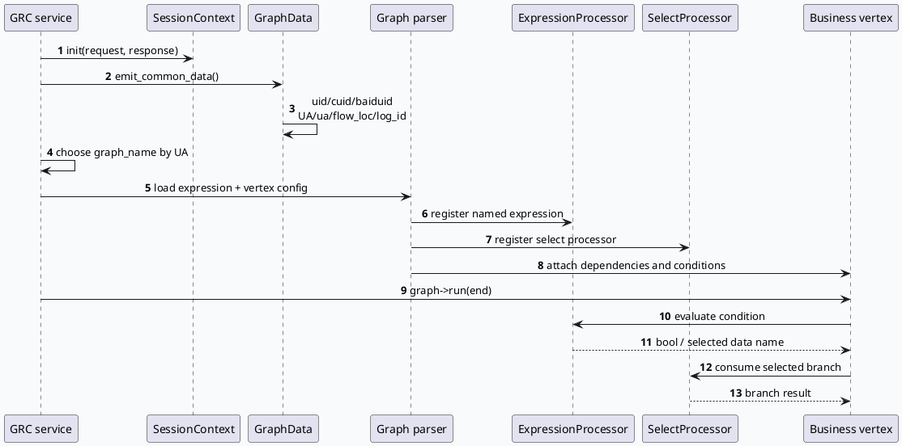

# 2026-09-27 基础库代码理解：Graph Expression 与 SelectProcessor 条件门控合同
<!-- topic-nav:start -->
> 主题：`base/expression-routing` · 同题补充 / 历史版本 · [主题目录](README.md) · [先读主文](20260909-expression-condition-routing-contract.md)
<!-- topic-nav:end -->


> 日期：2026-09-27（周日）
> 主题选择：目标日期没有新的 daily-plan；仓内唯一计划 `daily-plan-20260529.json` 已过期。计划周日槽位的基础库主题 TraceLog/VIP/HashLog 已由 2026-09-24 笔记覆盖，因此按邻近未覆盖主题回退到 **Expression/条件图路由与 SelectProcessor 排查**。KU 正文未读取，业务背景需人工补充；以下只依据 GRC 源码与 graph 配置证据。
> 配对关系：业务库笔记分析 GRG 个性化推荐入口、身份字段与 fakeid 兼容边界；本文只分析图解析器、表达式注册和条件门控，不重复业务策略。
> 范围：`src/plugin/graph_parser.h`、`src/service/grc_service.cpp`、`conf/plugins/graph/expression.conf`、`conf/plugins/graph/common_vertex.conf`。

## 0. 架构全景图

<div style="font-family:system-ui,-apple-system,BlinkMacSystemFont,'Segoe UI',sans-serif;background:#f5f7fa;border:1px solid #d8e1ea;border-radius:8px;padding:16px;margin:16px 0;color:#243b53;line-height:1.45;"><div style="font-size:12px;font-weight:800;color:#52606d;text-transform:uppercase;letter-spacing:.05em;">条件图从请求上下文到 vertex 执行</div><div style="display:grid;grid-template-columns:1.05fr 24px 1.2fr 24px 1.3fr 24px 1.1fr;gap:8px;align-items:center;margin-top:12px;"><div style="background:#fff;border:1px solid #cbd5e1;border-left:4px solid #3d5a80;border-radius:6px;padding:11px;"><div style="font-size:15px;color:#102a43;font-weight:700;">GRC request</div><div style="margin-top:7px;font-size:12px;color:#52606d;">UA、sid、IsGrgRequest、实验参数与公共身份字段进入 GraphData。</div></div><div style="text-align:center;color:#64748b;font-size:20px;">→</div><div style="background:#fff;border:1px solid #cbd5e1;border-left:4px solid #2d6a4f;border-radius:6px;padding:11px;"><div style="font-size:15px;color:#102a43;font-weight:700;">Expression registry</div><div style="margin-top:7px;font-size:12px;color:#52606d;">`expression.conf` 把布尔条件、三元选择和数据源别名注册为可复用名称。</div></div><div style="text-align:center;color:#64748b;font-size:20px;">→</div><div style="background:#fff;border:1px solid #cbd5e1;border-left:4px solid #9a5b28;border-radius:6px;padding:11px;"><div style="font-size:15px;color:#102a43;font-weight:700;">Expression / Select</div><div style="margin-top:7px;font-size:12px;color:#52606d;">解析器将条件编译为 processor；`condition` 决定依赖是否进入 vertex。</div></div><div style="text-align:center;color:#64748b;font-size:20px;">→</div><div style="background:#fff;border:1px solid #cbd5e1;border-left:4px solid #b8432f;border-radius:6px;padding:11px;"><div style="font-size:15px;color:#102a43;font-weight:700;">Graph execution</div><div style="margin-top:7px;font-size:12px;color:#52606d;">被选数据源进入下游 processor；未满足条件的边不应产生有效消费。</div></div></div><div style="margin-top:10px;font-size:12px;color:#52606d;">排查重点：输入 GraphData 是否已 emit、表达式名是否拼写一致、条件门控是否挂在正确的 `.@depend` 上。</div></div>

## 1. 核心结论

GRC 的条件图不是在业务 processor 中手写一套 if/else，而是由三层合同共同完成：

1. `GenericGRCService::emit_common_data()` 把请求上下文映射为 GraphData，例如 `uid`、`cuid`、`baiduid`、`UA`、`flow_loc` 与 `ua`（`src/service/grc_service.cpp:88-115`）。
2. `graph_parser.h` 绑定 `ExpressionProcessor`、`SelectProcessor` 与 `UnitParser`，让配置解析器可以把表达式和选择节点转换成图顶点（`src/plugin/graph_parser.h:24-49`）。
3. `expression.conf` 注册可复用表达式，vertex 配置通过 `condition` 或命名依赖消费这些表达式；条件结果最终控制数据依赖是否生效。

这条链的调试原则是：先确认输入数据，再确认表达式求值，最后确认 vertex 的条件依赖。只看某个业务 processor 是否执行，无法判断问题发生在请求注入、表达式注册还是图边门控。

## 2. 请求上下文如何进入图

### 2.1 基础身份和场景字段

`emit_common_data()` 对公共字段使用 `emit().ref()`，说明 GraphData 与 session 上下文共享底层对象，而不是在这里重新复制值。`uid/cuid/baiduid`、`UA/ua`、`flow_loc` 和 `log_id` 是表达式与下游 processor 可共同读取的基础输入（`src/service/grc_service.cpp:92-115`）。

### 2.2 graph 名称先于条件图执行

service 根据 UA 选择 graph：UA 97 走 `dibar_reddot`，85 走 `video_immersion`，155/156 走 `searchc_related`，123 走 `searchc_immersive_related`，102 走 `news_updates_dibar`，110 走 `interest_card`，其余走 `default`（`src/service/grc_service.cpp:181-200`）。因此同名表达式在不同 graph 配置中可能拥有不同的上下游数据，排查时必须先确认 graph_name。



## 3. 表达式与 SelectProcessor 的配置语义

### 3.1 三元表达式同时承担路由和数据选择

`Res_Dep` 用 `IsAppPushIndividuation ? Push_Rerank : SearchVideoResult` 选择结果源；`Push_Rerank` 再用 `is_push_rerank ? CtrRerankResult : AdjustRankResult` 继续细分（`conf/plugins/graph/expression.conf:1-7`）。这类表达式不是单纯的开关，而是将一个逻辑输出名解析为两个候选 GraphData 之一，适合排查“输出为空但 processor 没报错”的分支问题。

`CtrInput` 使用 `IsSearchRelated ? DupResultItemsVec : VfsResult` 选择输入向量（`conf/plugins/graph/expression.conf:72-74`）；`PcsRkcjRelevantResult` 使用 `IsRkcjMuteTag ? PcsPreciseParallelRet : PcsAfterMergeRet` 选择 PCS 结果（`:84-90`）。当输入变量没有被 emit 或类型不匹配时，最终选择分支可能退回错误的数据名，表现为下游依赖缺失而非表达式语法错误。

### 3.2 布尔表达式用于复用场景条件

`IsPlayQList` 组合 `UA`、sid 开关和 `IsGrgRequest`，`IsListMergeFrame` 组合多个场景标记，`IsMainDibar` 组合 UA 与 `flow_loc`（`conf/plugins/graph/expression.conf:92-110`、`:141-144`）。这些命名表达式把场景判断集中到配置层，业务 vertex 只需依赖稳定名称，降低 processor 内部重复判断的数量。

### 3.3 条件依赖是最后一道门

`common_vertex.conf` 将大量 GraphData 以 `.@depend` 声明给 vertex；在同一类 graph 配置中，`condition: <expression>` 会把某个依赖限定在表达式为真时。验证条件图时需要同时看三项：依赖 data 名、条件表达式名、表达式所需的输入 data。只改其中一项容易造成“条件恒 false”或“条件引用不存在”。

## 4. 配置合同信息图

```infographic
infographic sequence-ascending-steps
data
  title 条件图四段合同
  desc 从请求输入到下游消费的最短排查路径
  items
    - label 输入注入
      desc service emit uid/cuid/baiduid、UA/ua、flow_loc 和 log_id
      icon mdi:database-import
    - label 表达式注册
      desc expression.conf 用 name/val 注册布尔条件或三元选择
      icon mdi:code-braces
    - label 处理器绑定
      desc graph_parser.h 暴露 ExpressionProcessor 与 SelectProcessor
      icon mdi:source-branch
    - label 条件门控
      desc vertex 的 depend/condition 决定某条数据边是否参与执行
      icon mdi:filter-check
  theme
    palette #3d5a80 #2d6a4f #9a5b28 #b8432f
```

```infographic
infographic list-grid-badge-card
data
  title 条件图排查信号
  desc 用配置名和 GraphData 名快速定位故障层
  items
    - label graph_name 错
      desc UA 映射到了另一个 graph，导致表达式或 vertex 配置看似正确但未被加载
      icon mdi:source-merge
    - label 输入未 emit
      desc 表达式读取 UA、sid、IsGrgRequest 等变量时拿不到预期值
      icon mdi:database-alert
    - label 名称漂移
      desc expression name、vertex data 和 processor emit 名称不一致
      icon mdi:rename-box
    - label condition 位置错
      desc 条件挂在错误的依赖边，可能让 vertex 永远跳过或错误执行
      icon mdi:filter-off
  theme
    palette #3d5a80 #2d6a4f #b8432f #9a5b28
```

## 5. Pitfalls 与调试 checklist

<div style="font-family:system-ui,-apple-system,BlinkMacSystemFont,'Segoe UI',sans-serif;background:#fffaf5;border:1px solid #ead7c2;border-left:6px solid #b8432f;border-radius:6px;padding:15px;margin:14px 0;color:#3f2d22;line-height:1.55;"><div style="font-size:12px;font-weight:800;color:#9a3d2a;text-transform:uppercase;letter-spacing:.04em;">Pitfall 01 · 只看 processor 不够</div><div style="margin-top:6px;font-size:16px;font-weight:750;color:#3f2d22;">条件图失败通常发生在 processor 之前</div><div style="margin-top:6px;font-size:13px;color:#6b5141;">先确认 graph_name 和 GraphData emit，再检查 expression 的输入变量与 condition 挂载位置。processor 没有执行不等于 processor 自身有 bug。</div></div>

<div style="font-family:system-ui,-apple-system,BlinkMacSystemFont,'Segoe UI',sans-serif;background:#f4f8f6;border:1px solid #c8dfd1;border-left:6px solid #2d6a4f;border-radius:6px;padding:15px;margin:14px 0;color:#20352a;line-height:1.55;"><div style="font-size:12px;font-weight:800;color:#23613f;text-transform:uppercase;letter-spacing:.04em;">Pitfall 02 · ref 语义</div><div style="margin-top:6px;font-size:16px;font-weight:750;color:#20352a;">emit().ref() 让请求上下文成为图运行时输入</div><div style="margin-top:6px;font-size:13px;color:#486052;">排查时要沿 session context、GraphData 和 graph reset 的生命周期观察值是否仍有效，不能只在配置文件里确认字段名。</div></div>

```infographic
infographic list-column-done-list
data
  title 条件图调试清单
  items
    - label 确认 UA 到 graph_name 的映射
      done true
    - label 确认表达式依赖的 GraphData 已 emit
      done true
    - label 确认 expression name 与 condition 名称一致
      done true
    - label 确认 SelectProcessor 的候选数据都已注册
      done true
    - label 确认 graph reset 前后没有悬挂引用
      done true
  theme
    palette #3d5a80 #2d6a4f #9a5b28
```

## 6. 证据来源

- `src/plugin/graph_parser.h:24-49`（ExpressionProcessor、SelectProcessor 与 parser 类型绑定）
- `src/service/grc_service.cpp:88-115`（公共请求字段注入 GraphData）
- `src/service/grc_service.cpp:181-215`（UA 到 graph_name 的路由与 graph 执行入口）
- `conf/plugins/graph/expression.conf:1-19`（三元路由和场景条件示例）
- `conf/plugins/graph/expression.conf:72-110`（输入选择与列表场景表达式）
- `conf/plugins/graph/common_vertex.conf:1-20`、`:107-148`（vertex emit/depend 数据声明）

> 外部 KU 正文未读取，业务上下文需人工补充；本笔记只保留可由代码和配置复核的结论。
