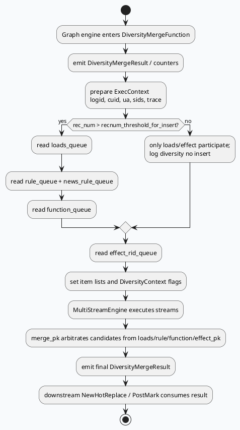

# 2026-06-09 业务库代码理解：GRG DiversityMerge 与 MultiStream 多队列打散
<!-- topic-nav:start -->
> 主题：`business/diversity-merge` · 同题补充 / 历史版本 · [主题目录](README.md) · [先读主文](20260619-grg-new-diversity-merge-multistream-engine.md)
<!-- topic-nav:end -->


> 今日主题来源：未找到 daily-plan 文件，本次按近期 GRG 多流打散链路 fallback 选题。内网 KU 未参与检索，若需业务策略背景需人工补充。

<style>.arch{font-family:-apple-system,BlinkMacSystemFont,"Segoe UI",sans-serif;background:#f8fafc;border:1px solid #dbe4ef;border-radius:18px;padding:18px;margin:16px 0;color:#1f2937}.arch-title{font-weight:800;font-size:22px;margin-bottom:12px}.lane{display:grid;grid-template-columns:1fr 1fr 1fr 1fr;gap:12px}.box{background:white;border-radius:14px;border:1px solid #e5e7eb;padding:12px;min-height:112px}.box h3{font-size:15px;margin:0 0 8px;color:#334155}.chip{display:block;background:#eef6ff;border-left:4px solid #3d5a80;border-radius:9px;padding:7px;margin:6px 0;font-size:13px}.chip.hot{background:#fff7ed;border-left-color:#c2410c}.chip.data{background:#ecfdf5;border-left-color:#047857}.card{font-family:-apple-system,BlinkMacSystemFont,"Segoe UI",sans-serif;background:#f5f7fa;border:1px solid #dbe4ef;border-radius:18px;padding:20px;margin:18px 0;color:#243042}.card-meta{font-size:12px;letter-spacing:.08em;text-transform:uppercase;color:#3d5a80;font-weight:800}.card-title{font-size:25px;font-weight:850;margin:8px 0 10px}.card-grid{display:grid;grid-template-columns:1fr 1fr;gap:14px}.card-panel{background:white;border-top:4px solid #3d5a80;border-radius:12px;padding:12px;line-height:1.65}</style>
<div class="arch"><div class="arch-title">架构全景：DiversityMerge 是业务图上的多流仲裁节点</div><div class="lane"><div class="box"><h3>输入队列</h3><span class="chip data">loads_queue</span><span class="chip data">rule_queue / news_rule_queue</span><span class="chip data">function_queue</span><span class="chip data">effect_rid_queue</span></div><div class="box"><h3>上下文注入</h3><span class="chip">ExecContext logid/cuid/ua/sids</span><span class="chip">DiversityContext 规则开关</span><span class="chip">TraceLogContext phase=6701</span></div><div class="box"><h3>MultiStreamEngine</h3><span class="chip hot">loads_select</span><span class="chip hot">rule_select</span><span class="chip hot">function_select</span><span class="chip hot">final_select / effect_pk</span><span class="chip hot">merge_pk</span></div><div class="box"><h3>业务输出</h3><span class="chip data">DiversityMergeResult</span><span class="chip data">SidRollbackCnt / DivSuccSize</span><span class="chip data">RedPointTopN</span><span class="chip data">PostMark / NewHotReplace 后处理</span></div></div></div>

## 核心结论

- `diversity_merge.cpp:65-105` 在初始化阶段从 `EngineMgr` 获取 `MultiStreamEngine`，并通过 `multi_stream_engine_plugin->bind_graph_dependency` 把图依赖绑定到引擎。
- `diversity_merge.cpp:130-181` 在每次请求中重建 `ExecContext`：logid、cuid、UA、SID、各类 key 指针和实验条件都会注入到执行上下文。
- `diversity_merge.cpp:251-270` 将候选分成 `loads/rule/function/effect` 四类输入，`rec_num` 低于阈值时不读规则/功能队列，直接影响插入策略是否生效。
- `multi_stream_diversity.conf:10-66` 定义了流式选择拓扑：先分流选择，再 `merge_pk` 汇总仲裁。
- `vertex.conf:798-934` 把 `DiversityMergeFunction` 注册为业务图上的 `engine_vertex`，并绑定 `multi_stream_diversity.conf` 与 trace phase。

## 核心流程图



## MultiStream 配置信息图

```infographic
infographic sequence-timeline-simple
data
  title multi_stream_diversity.conf 流执行顺序
  items
    - time 1
      label loads_select
      desc loads 队列，使用 loads_select_executor，支持规则打散和 cost generator
    - time 2
      label rule_select
      desc rule 队列，select_executor，硬规则可 terminal select
    - time 3
      label function_select
      desc function 队列，面向功能插入资源
    - time 4
      label final_select / effect_pk
      desc effect 队列先选择，再提前分值 PK 缩小候选集
    - time 5
      label merge_pk
      desc 本地 trival 串行汇总 loads/rule/function/effect_pk 的最终候选
theme
  palette #3d5a80 #2d6a4f #c2410c
```

## 业务图挂载点

`vertex.conf:798-934` 显示 `short_micro_video` 图中 `DiversityMergeFunction` 的核心依赖：

- 插入控制：`LoadsInsertConf`、`RuleInsertConf`；
- 候选输入：`_loads_queue`、`_rule_queue`、`_news_rule_queue`、`_function_queue`、`_effect_rid_queue`；
- 请求上下文：`Request`、`Reqnum`、`SidInfo`、`UmsFeature`、`MsvReadInfo`、`HistoryInterestInfoData`；
- 实验条件：`is_open_dnn_soft_rule`、`is_open_set2set`、`is_open_pk_generate_*` 等条件依赖；
- option：`plugin: multi_stream_engine_plugin` 与 `conf: multi_stream_diversity.conf`。

这说明 DiversityMerge 并不是单纯排序函数，而是依赖业务图中大量前置特征、历史、预测结果和实验条件的“末端仲裁器”。

## 关键策略分支

### 1. 请求上下文和 SID 注入

`diversity_merge.cpp:137-160` 将 logid、cuid、UA 和 SID 集合注入 `ExecContext`。如果 `ExpInfo` 存在，使用 `true_params_and_hit_sid_set`；否则退回 `SidInfo.sid_set`。因此排查“规则条件没有命中”时，不能只看 `SidInfo`，还要看实验参数对象是否覆盖了 SID 来源。

### 2. 插入阈值控制

`diversity_merge.cpp:251-273` 以 `rec_num` 和 `recnum_threshold_for_insert` 控制是否读取 rule/function 队列。`change_req_num` 命中后会把阈值改为 0，低刷数场景也可能开启插入。这类逻辑会造成“同一配置在不同请求数下表现不同”。

### 3. 首刷相关性保护

`diversity_merge.cpp:274-340` 对 UA=85 的首刷相关性策略做前置保护：计算 `_rk_max_corr_num`，并在特定实验下清空指定槽位前的规则队列，避免规则插入破坏相关性内容的位置。

<div class="card"><div class="card-meta">Pitfalls</div><div class="card-title">多流打散问题通常不是一个 conf 能解释完</div><div class="card-grid"><div class="card-panel"><b>队列侧：</b>先确认 loads/rule/news_rule/function/effect 哪一路为空，尤其注意 `rec_num` 阈值导致 rule/function 根本不读取。</div><div class="card-panel"><b>上下文侧：</b>算子条件依赖 `ExecContext` 中的 UA、SID、实验布尔值和 graph dependency。配置存在不代表条件表达式一定打开。</div></div></div>

## 调试 checklist

```infographic
infographic list-column-done-list
data
  title DiversityMerge 调试 checklist
  items
    - label 确认业务图挂载
      desc vertex.conf 中 option.conf 是否指向预期 multi_stream_diversity.conf
      done true
    - label 确认输入队列规模
      desc loads/rule/news_rule/function/effect 分别记录 read_queue size
      done true
    - label 检查 rec_num 阈值
      desc 小于 recnum_threshold_for_insert 时 rule/function 不参与
      done true
    - label 检查 ExecContext 条件
      desc ua、sid_set、is_open_dnn_soft_rule、set2set、pk_generate 等
      done true
    - label 检查 trace phase
      desc diversity_merge:6701 对齐 trace_log 与 SIA 指标
      done true
    - label 检查后处理覆盖
      desc NewHotReplace / PostMark 可能改变最终下发结果
      done true
theme
  palette #3d5a80 #2d6a4f #c2410c
```

## 证据来源

- `src/process/diversity_merge.cpp:65-105`：初始化 MultiStreamEngine 与绑定 graph dependency
- `src/process/diversity_merge.cpp:130-181`：ExecContext 注入 logid/cuid/UA/SID/条件
- `src/process/diversity_merge.cpp:251-270`：loads/rule/function/effect 输入构造
- `src/process/diversity_merge.cpp:274-340`：首刷相关性保护与规则队列清理
- `conf/plugins/exec_engine/multi_stream_diversity.conf:10-66`：stream 拓扑
- `conf/plugins/exec_engine/multi_stream_diversity.conf:70-160`：select_executor 规则与依赖
- `conf/plugins/graph/short_micro_video/vertex.conf:798-934`：DiversityMergeFunction 业务图挂载点
