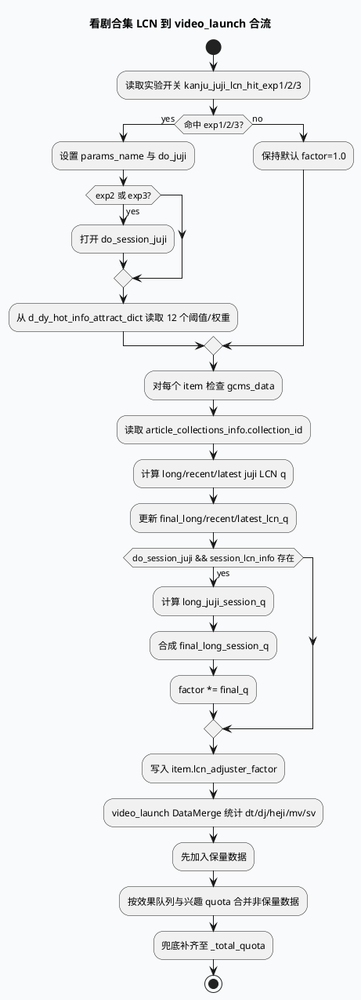

# 2026-06-12 业务库代码理解：看剧/合集/短剧 LCN 与 video_launch 合流
<!-- topic-nav:start -->
> 主题：`business/kanju-lcn` · 同题补充 / 历史版本 · [主题目录](README.md) · [先读主文](20260612-kanju-heji-duanju-lcn-fuchi.md)
<!-- topic-nav:end -->


> 今日主题来源：周五自动选题，沿用周计划中的业务主题 `看剧/合集/短剧 LCN 与扶持策略`。KU/内网检索未参与，需人工补充业务实验背景、线上效果口径和策略负责人说明；本笔记以 GRC 代码库检索结果为准。

## 架构全景图

<style>.arch-kanju{font-family:-apple-system,BlinkMacSystemFont,"Segoe UI",sans-serif;border:1px solid #d9e2d0;border-radius:18px;padding:18px;background:#f7faf5;color:#1f2937}.arch-kanju .title{font-size:22px;font-weight:900;margin-bottom:6px}.arch-kanju .sub{font-size:13px;color:#5f6f52;margin-bottom:16px}.arch-kanju .cols{display:grid;grid-template-columns:1fr 1fr 1fr;gap:12px}.arch-kanju .col{background:#fff;border:1px solid #d9ead3;border-radius:14px;padding:12px}.arch-kanju h3{margin:0 0 10px;font-size:15px;color:#2d6a4f}.arch-kanju .box{border-radius:12px;background:#f8fafc;border:1px solid #e5e7eb;padding:10px;margin:8px 0}.arch-kanju .box b{display:block;font-size:13px;margin-bottom:4px}.arch-kanju .box span{font-size:12px;color:#64748b;line-height:1.45}.arch-kanju .hot{background:#ecfdf5;border-color:#86efac}.arch-kanju .ribbon{margin-top:12px;padding:10px;border-radius:10px;background:#eef7e9;border-left:4px solid #2d6a4f;font-size:13px;color:#334155}</style><div class="arch-kanju"><div class="title">看剧/合集/短剧策略链路全景</div><div class="sub">LCN 调权并不直接决定最终队列位置，它先写入 item 级 factor，再与 video_launch 的保量、非保量、类型 quota 和兜底合流共同影响出端结构。</div><div class="cols"><div class="col"><h3>实验与参数</h3><div class="box hot"><b>exp_params.conf</b><span>`kanju_juji_lcn_hit_exp1/2/3` 决定是否启用合集 LCN 与 session 约束。</span></div><div class="box"><b>common dict</b><span>`d_dy_hot_info_attract_dict` 返回 12 个阈值/权重。</span></div><div class="box"><b>adjust conf</b><span>sketchy、first_refresh、precise_adjust_part_all 都有相关开关。</span></div></div><div class="col"><h3>Item 调权</h3><div class="box hot"><b>KanjuLcnPreciseAdjuster</b><span>读取 GCMS 的 `collection_id`，计算 long/recent/latest LCN。</span></div><div class="box"><b>session LCN</b><span>exp2/exp3 打开 `do_session_juji`，用 session 权重进一步乘到 factor。</span></div><div class="box"><b>item 字段</b><span>写入 `final_*_lcn_q`、`final_long_session_q` 与 `lcn_adjuster_factor`。</span></div></div><div class="col"><h3>合流与截断</h3><div class="box hot"><b>DataMergeFunction</b><span>合并 `_merged_baoliang_data` 与 `_effect_other_data`，目标大小为 `_total_quota`。</span></div><div class="box"><b>类型统计</b><span>按 dt、duanju、heji、microvideo、sv 统计输入结构。</span></div><div class="box"><b>兜底填充</b><span>先保量，再效果队列，最后遍历效果队列补齐 total quota。</span></div></div></div><div class="ribbon">排查关键：LCN factor 是调权信号，最终可见占比还会被保量、兴趣 quota、类型多样性和 `_total_quota` 截断共同塑形。</div></div>

## 核心流程图



## 配置结构信息图

```infographic list-grid-badge-card
data
  title 看剧 LCN 关键开关与数据字段
  desc 从实验配置、字典参数、GCMS 字段到合流 quota 的关键观测点
  items
    - label kanju_juji_lcn_hit_exp1
      desc 开启合集 LCN，使用 `kanju_juji_lcn_exp1` 参数组
      icon mdi/toggle-switch-outline
    - label kanju_juji_lcn_hit_exp2
      desc 开启合集 LCN，并启用 session 约束
      icon mdi/account-clock-outline
    - label kanju_juji_lcn_hit_exp3
      desc 同样开启 session 约束，参数组独立
      icon mdi/flask-outline
    - label collection_id
      desc 从 `get_article_collections_info().collection_id` 取合集 key
      icon mdi/identifier
    - label is_duanju / is_heji
      desc DataMerge 用于区分短剧与合集输入结构
      icon mdi/movie-open-outline
    - label _total_quota
      desc DataMerge 输出截断目标，决定最终补齐上限
      icon mdi/counter
```

## 关键结论

- 看剧 LCN 是“实验命中 → 字典阈值 → item factor”的轻量调权链路，真正的出端占比仍由后续 video_launch 合流和 quota 控制。
- `exp1` 只打开 `do_juji`；`exp2/exp3` 还打开 `do_session_juji`，会把 session 维度的 final_q 乘到最终 factor。
- 参数读取要求 `d_dy_hot_info_attract_dict` 返回至少 12 个 double，否则阈值/权重保持初始化值，容易出现命中实验但调权不生效的现象。
- 合集识别依赖 GCMS 正排的 `article_collections_info.collection_id` 与 `is_heji`，短剧依赖 `get_is_duanju()`；正排缺字段会让策略退化为普通 item。
- `DataMergeFunction` 会先合并保量，再处理非保量效果队列，最后兜底补齐 `_total_quota`；因此单看 LCN factor 无法判断最终曝光量。

## Pitfalls 卡片

<style>.pit-kanju{font-family:-apple-system,BlinkMacSystemFont,"Segoe UI",sans-serif;max-width:980px;border-radius:20px;background:#f4f3f0;border:1px solid #d6d3ce;padding:20px;color:#243126}.pit-kanju .meta{font-size:12px;letter-spacing:.08em;text-transform:uppercase;color:#2d6a4f;font-weight:900}.pit-kanju .headline{font-size:28px;line-height:1.15;font-weight:900;margin:8px 0 12px}.pit-kanju .grid{display:grid;grid-template-columns:1fr 1fr;gap:14px}.pit-kanju .panel{background:#fff;border-top:4px solid #2d6a4f;border-radius:12px;padding:12px}.pit-kanju .panel b{display:block;margin-bottom:6px}.pit-kanju .panel p{margin:0;font-size:14px;line-height:1.65;color:#3f4f43}.pit-kanju .end{margin-top:12px;font-weight:900;color:#2d6a4f}</style><div class="pit-kanju"><div class="meta">pitfall · kanju lcn</div><div class="headline">命中实验不等于最终出端生效，LCN 只是合流前的一层权重</div><div class="grid"><div class="panel"><b>字典参数是隐性依赖</b><p>代码只在 `vecVal.size() >= 12` 时覆盖阈值与权重。实验开关打开但字典缺 key 或长度不足时，日志里仍能看到命中，但 factor 可能接近默认。</p></div><div class="panel"><b>合集字段来自正排</b><p>`collection_id`、`is_heji`、`is_duanju` 都依赖 GCMS 数据。排查“合集没生效”时先确认 fill_meta/GCMS 字段，再看 adjuster 和 DataMerge。</p></div></div><div class="end">∎ 排查顺序：实验 → 字典 → 正排 → factor → DataMerge quota。</div></div>

## 调试 checklist

```infographic list-column-done-list
data
  title 看剧/合集/短剧链路排查清单
  desc 面向线上 logid 或离线样本的定位顺序
  items
    - label 检查实验命中
      desc 确认 `kanju_juji_lcn_hit_exp1/2/3` 哪个命中
      done true
    - label 检查字典参数
      desc 确认 `d_dy_hot_info_attract_dict` 中参数组存在且长度不少于 12
      done true
    - label 检查 GCMS 字段
      desc 确认 `collection_id`、`is_heji`、`is_duanju` 是否填充
      done true
    - label 检查 item factor
      desc 搜索 `[kanju_juji_lcn_precise] result` 日志与 `lcn_adjuster_factor`
      done true
    - label 检查合流结构
      desc 看 `[fsq_1400]` 中 input_dt/dj/heji/mv/sv 数量与比例
      done false
    - label 检查 quota 截断
      desc 对齐 `_total_quota`、保量 count、非保量 count 和兜底 count
      done false
```

## 证据来源

- `conf/exp_params.conf:386-404`：定义 `kanju_juji_lcn_param_vec` 和 `kanju_juji_lcn_hit_exp1/2/3` 默认开关。
- `conf/plugins/graph/micro_frame/sketchy_adjust.conf:1509-1511`：sketchy adjust 配置中注入三个 LCN 实验命中依赖。
- `conf/plugins/graph/micro_frame/first_refresh_precise_adjust.conf:548-550`：首刷精排链路同样配置 LCN exp1/2/3。
- `conf/plugins/graph/micro_frame/precise_adjust_part_all.conf:1202-1204`：全量精排分支配置 LCN exp1/2/3。
- `src/operator/adjuster/precise/kanju_lcn_precise_adjuster.cpp:44-59`：根据 exp1/2/3 选择参数组，并从 `d_dy_hot_info_attract_dict` 读取权重。
- `src/operator/adjuster/precise/kanju_lcn_precise_adjuster.cpp:99-130`：读取 `collection_id` 并计算 long/recent/latest LCN q。
- `src/operator/adjuster/precise/kanju_lcn_precise_adjuster.cpp:137-165`：session q 参与最终 factor，并写入 `lcn_adjuster_factor`。
- `src/processor/video_launch/data_merge.cpp:79-153`：DataMerge 统计 dt/dj/heji/mv/sv 输入结构，并 reserve `_total_quota`。
- `src/processor/video_launch/data_merge.cpp:155-178`：先保量、再非保量、最后兜底补齐输出。
- `conf/plugins/graph/video_launch/strategy_graph.conf:432-449`：`DataMergeFunction` 依赖 `_total_quota`、`_merged_baoliang_data` 与 `_effect_other_data`。
