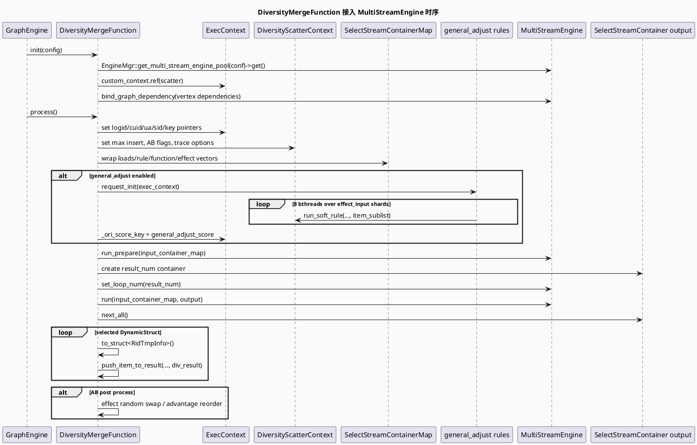

# 2026-06-13 业务库代码理解：GRG DiversityMerge 接入 MultiStreamEngine 的执行闭环
<!-- topic-nav:start -->
> 主题：`business/diversity-merge` · 同题补充 / 历史版本 · [主题目录](README.md) · [先读主文](20260619-grg-new-diversity-merge-multistream-engine.md)
<!-- topic-nav:end -->


> 今日主题来源：未发现本机 daily-plan 文件；按周六 fallback 选择 `feeda-mv-grg` 的 `DiversityMergeFunction`，聚焦它如何把 loads/rule/function/effect 输入队列转换成 MultiStreamEngine 容器，执行位置无关软打散、engine run、输出回填与实验后处理。内网 KU 未提供 URL/doc-id，业务策略背景需人工补充；本笔记以代码库检索结果为准。

## 架构全景图

<style>.arch-dm{font-family:-apple-system,BlinkMacSystemFont,"Segoe UI",sans-serif;border:1px solid #cbd5e1;border-radius:18px;padding:18px;background:#f8fafc;color:#1f2937}.arch-dm .title{font-size:22px;font-weight:900;margin-bottom:6px}.arch-dm .sub{font-size:13px;color:#64748b;margin-bottom:16px}.arch-dm .grid{display:grid;grid-template-columns:1fr 1fr 1fr;gap:12px}.arch-dm .lane{background:#fff;border:1px solid #dbeafe;border-radius:14px;padding:12px}.arch-dm h3{margin:0 0 10px;font-size:15px;color:#1d4ed8}.arch-dm .box{border-radius:12px;padding:10px;margin:8px 0;border:1px solid #e5e7eb;background:#f9fafb}.arch-dm .box b{display:block;font-size:13px;margin-bottom:4px}.arch-dm .box span{font-size:12px;color:#64748b;line-height:1.45}.arch-dm .hot{background:#eff6ff;border-color:#93c5fd}.arch-dm .note{margin-top:12px;padding:10px;border-radius:10px;background:#eef6ff;border-left:4px solid #3b82f6;font-size:13px;color:#334155}</style><div class="arch-dm"><div class="title">DiversityMerge 多队列打散执行闭环</div><div class="sub">业务函数负责准备上下文与输入容器，基础 MultiStreamEngine 负责按 stream/executor 配置完成多队列选择与 PK。</div><div class="grid"><div class="lane"><h3>输入与上下文</h3><div class="box hot"><b>exec_context</b><span>写入 logid、cuid、ua、sid、score/result/reason 等 key。</span></div><div class="box"><b>DiversityScatterContext</b><span>承载最大插入数、AB 条件、trace、融合语义 id 和软打散中间态。</span></div><div class="box"><b>_input_map</b><span>loads / rule / function / effect 多队列业务输入。</span></div></div><div class="lane"><h3>引擎输入与执行</h3><div class="box hot"><b>SelectStreamContainerMap</b><span>每个 RidTmpInfo vector 被 reinterpret 成 DynamicStruct 列表并包装为 container。</span></div><div class="box"><b>general_adjust</b><span>可选地用 bthread 分片执行位置无关软规则，重写 `general_adjust_score`。</span></div><div class="box"><b>run_prepare + run</b><span>先初始化 engine 输入，再按 result_num 设置 loop_num 并运行。</span></div></div><div class="lane"><h3>输出与后处理</h3><div class="box hot"><b>output.next_all()</b><span>取出 engine 选中的 DynamicStruct 结果并转回 RidTmpInfo。</span></div><div class="box"><b>push_item_to_result</b><span>写回 div_result，同时维护 SIA 指标与 trace 采样。</span></div><div class="box"><b>AB 后处理</b><span>effect 随机交换、advantage 重排等实验在 engine 输出后执行。</span></div></div></div><div class="note">业务边界：DiversityMerge 不自己实现多流选择算法，但它决定输入队列、AB 条件、score key、输出后处理和可观测指标。</div></div>

## 核心流程图



## 配置/结构信息图

```infographic list-grid-badge-card
data
  title multi_stream_diversity.conf 的执行结构
  desc stream 层定义候选流，executor 层定义选择算子、PK 算子和依赖集合
  items
    - label loads_select
      desc loads 队列，使用 `loads_select_executor`，优先处理强插/保量类资源
      icon mdi/format-list-numbered
    - label rule_select
      desc rule 队列，使用 `select_executor`，按硬规则产出最小下标
      icon mdi/rule
    - label function_select
      desc function 队列，使用 `select_executor`，按功能队列规则选取
      icon mdi/function
    - label final_select
      desc effect 队列，使用 `effect_select_executor` 做软打散打分
      icon mdi/chart-scatter-plot
    - label effect_pk
      desc 对 final_select 结果提前并发分值 PK，减少候选集
      icon mdi/source-branch
    - label merge_pk
      desc 汇总 loads/rule/function/effect_pk 的输出，完成最终多流 PK
      icon mdi/merge
```

## 关键结论

- 初始化阶段已完成基础设施闭环：读取 vertex 的 `plugin/conf`，从 `EngineMgr` 取 `MultiStreamEngine`，把业务 `DiversityScatterContext` ref 到 `exec_context->custom_context`，并绑定 GraphDependency。
- `process()` 前半段主要是“条件注入”：logid、cuid、ua、sid、score/result/reason key 和 AB 条件都会进入 exec_context，后续 operator condition 依赖这些字段。
- 输入转换使用 `reinterpret_cast<std::vector<DynamicStruct*>*>(&ridinfo_vec)`，因此 `RidTmpInfo` 必须满足 engine 以 DynamicStruct 视角访问的约束；这里不是深拷贝。
- `general_adjust` 是 engine run 前的业务预处理：只对 effect_input 分片并发执行软规则，然后把 effect 使用 div_res_score、其他队列使用 offer_score 作为 PK 基础分。
- engine 输出后业务仍会继续干预结果：`next_all()` 只是 engine 选择结果，后续还有 attention/log、loads_next_tq、effect 随机交换、advantage 重排与指标写入。

## Pitfalls 卡片

<style>.pit-dm{font-family:-apple-system,BlinkMacSystemFont,"Segoe UI",sans-serif;max-width:980px;border-radius:20px;background:#f5f7fa;border:1px solid #c7d2fe;padding:20px;color:#1e293b}.pit-dm .meta{font-size:12px;letter-spacing:.08em;text-transform:uppercase;color:#1d4ed8;font-weight:900}.pit-dm .headline{font-size:28px;line-height:1.15;font-weight:900;margin:8px 0 12px}.pit-dm .grid{display:grid;grid-template-columns:1.1fr 1fr;gap:14px}.pit-dm .panel{background:#fff;border-top:4px solid #3b82f6;border-radius:12px;padding:12px}.pit-dm .panel b{display:block;margin-bottom:6px}.pit-dm .panel p{margin:0;font-size:14px;line-height:1.65;color:#334155}.pit-dm .end{margin-top:12px;font-weight:900;color:#1d4ed8}</style><div class="pit-dm"><div class="meta">pitfall · diversity merge</div><div class="headline">定位打散异常时，不要只盯 MultiStreamEngine run 返回码</div><div class="grid"><div class="panel"><b>run 前会改分</b><p>`general_adjust` 命中后会把 effect 的基础分切到 `div_res_score`，并把 `_ori_score_key` 指向 `general_adjust_score`；分值异常可能发生在 engine 之前。</p></div><div class="panel"><b>run 后还会重排</b><p>`output.next_all()` 后仍有 attention、loads_next_tq、effect 随机交换和 advantage 重排实验；线上顺序不一定等于 engine 原始输出。</p></div></div><div class="end">∎ 排查顺序：输入队列 → 分值预处理 → engine 输出 → AB 后处理。</div></div>

## 调试 checklist

```infographic list-column-done-list
data
  title DiversityMerge 排查清单
  desc 从配置入口、上下文注入、输入转换、engine 执行到输出后处理逐层确认
  items
    - label 核对 vertex option
      desc `plugin: multi_stream_engine_plugin` 与 `conf: multi_stream_diversity.conf` 是否匹配
      done true
    - label 核对 exec_context 条件
      desc ua、sid、is_open_dnn_soft_rule、enable_general_adjust 等是否正确注入
      done true
    - label 核对输入队列规模
      desc 关注 `loads_input_size`、`rule_input_size`、`function_input_size`、`effect_input_size`
      done true
    - label 核对 general_adjust
      desc 命中时检查 bthread 分片、operator clear/request_init/run_soft_rule 与 score key 切换
      done false
    - label 核对 engine 返回
      desc `run_prepare` 非 0 是 fatal，`run` 非 0 只打 warning 但输出可能不完整
      done false
    - label 核对输出后处理
      desc 关注 effect 随机交换、advantage 重排、loads_next_tq 和 attention_insert 日志
      done false
```

## 证据来源

- `src/process/diversity_merge.cpp:58-90`（DiversityMerge 主类）：定义函数描述，init 中读取 plugin/conf、取 engine、绑定 custom context 与 GraphDependency。
- `src/process/diversity_merge.cpp:127-190`（exec_context 注入）：设置 logid、cuid、ua、sid、score/result/reason key 与 AB condition。
- `src/process/diversity_merge.cpp:689-699`（输入转换）：把 `_input_map` 中的业务队列包装成 `SelectStreamContainerMap`。
- `src/process/diversity_merge.cpp:718-722`（run_prepare）：在 engine run 前初始化输入容器，失败记 fatal。
- `src/process/diversity_merge.cpp:723-787`（general_adjust）：位置无关软打散 bthread 分片执行，并切换 `general_adjust_score`。
- `src/process/diversity_merge.cpp:789-805`（engine 执行）：设置 loop_num，调用 `run()`，再通过 `output.next_all()` 取结果。
- `src/process/diversity_merge.cpp:811-843`（结果回填）：对 selected item 做实验日志判断并 `push_item_to_result()`。
- `src/process/diversity_merge.cpp:846-895`（后处理实验）：effect 队列随机交换与 advantage 重排可能改变最终顺序。
- `conf/plugins/exec_engine/multi_stream_diversity.conf:1-6`（engine 全局）：声明 `dependency_schema` 与 `mutable_context_schema`。
- `conf/plugins/exec_engine/multi_stream_diversity.conf:10-65`（stream 列表）：定义 loads/rule/function/final/effect_pk/merge_pk 多流结构。
- `conf/plugins/exec_engine/multi_stream_diversity.conf:70-100`（executor 片段）：`select_executor` 声明 exec_type、stages、generator、rule 与 depend。
- `conf/plugins/graph/short_micro_video/vertex.conf:933-937`（图配置）：vertex option 绑定 `multi_stream_engine_plugin`、`multi_stream_diversity.conf` 与 trace phase。
