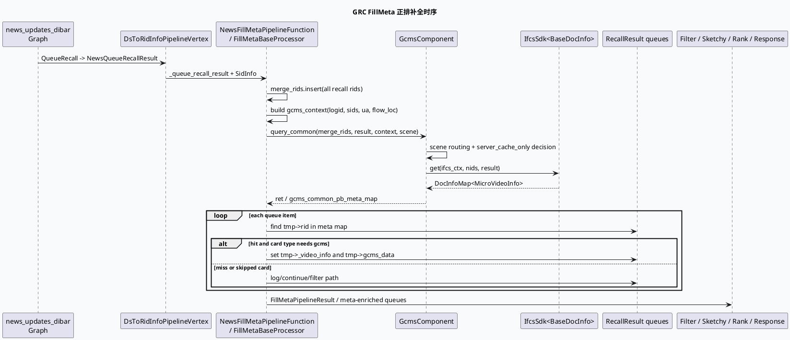

# GRC FillMeta：从召回队列到 IFCS 正排补全的业务链路
<!-- topic-nav:start -->
> 主题：`business/gcms-fillmeta` · 同题补充 / 历史版本 · [主题目录](README.md) · [先读主文](20260601-grc-gcms-ifcs-fill-meta-chain.md)
<!-- topic-nav:end -->


> 今日主题来源：未发现本机 daily-plan 文件；按周一 fallback 选择 GRC 业务库主题：`news_updates_dibar` 场景中 `NewsFillMetaPipelineFunction`/`FillMetaBaseProcessor` 如何汇总召回 rid、调用 IFCS 正排、把 `MicroVideoInfo` 回填到队列元素，并驱动后续 filter/sketchy/rank/response。内网 KU 未提供可检索 URL/doc-id；业务策略口径需人工补充，本篇以代码库检索结果为准。

## 架构全景图

<style>.fm-arch{font-family:Inter,Arial,sans-serif;background:#f8fafc;border:1px solid #d7dee8;border-radius:18px;padding:18px;margin:16px 0;color:#1f2937}.fm-arch .title{font-size:22px;font-weight:850;margin-bottom:4px}.fm-arch .sub{font-size:13px;color:#64748b;margin-bottom:16px}.fm-arch .cols{display:grid;grid-template-columns:1fr 1.2fr 1fr;gap:12px}.fm-arch .panel{background:white;border:1px solid #dbe4ef;border-radius:14px;padding:14px}.fm-arch .panel h3{margin:0 0 10px;font-size:15px;color:#315072}.fm-arch .item{background:#f8fbff;border:1px solid #e2e8f0;border-radius:10px;padding:9px;margin:8px 0;font-size:13px;line-height:1.45}.fm-arch .strong{background:#eef6ff;border-color:#82a9d9}.fm-arch .flow{font-size:12px;font-weight:800;color:#64748b;margin:8px 0;text-align:center}</style><div class="fm-arch"><div class="title">news_updates_dibar：召回 → FillMeta → 策略执行</div><div class="sub">FillMeta 是召回队列与后续业务策略之间的正排闸门：没有 `gcms_data` 的 item 很难继续参与过滤、排序、响应组装。</div><div class="cols"><div class="panel"><h3>Graph 配置入口</h3><div class="item strong">news_updates_dibar_graph.conf<br/>include queue / baoliang / diversity / response</div><div class="item">queue_vertex.conf<br/>DsToRidInfo → NewsFillMetaPipeline → Filter</div></div><div class="panel"><h3>FillMeta 核心</h3><div class="item">setup：声明匿名 RecallResult 依赖和 SidInfo/RecallResultWithMeta</div><div class="flow">↓</div><div class="item strong">process：合并 rid、构造 gcms_context、query_common</div><div class="flow">↓</div><div class="item">回填 tmp->_video_info / tmp->gcms_data，按实验改写部分字段</div></div><div class="panel"><h3>后续业务消费</h3><div class="item">NewsFilterPipelineFunction</div><div class="item">SketchyRpcConfigFunction</div><div class="item">Merge / Baoliang / VFS / Rank</div><div class="item strong">NewsResponseFunction</div></div></div></div>

## 核心时序图



## 配置/结构信息图

```infographic
infographic sequence-timeline-simple
data
  title news_updates_dibar 主链路配置
  desc graph include 顺序与 queue_vertex 中的关键业务阶段
  items
    - time graph root
      label news_updates_dibar_graph.conf
      desc 声明 global_depend 并 include graph/request/queue/baoliang/diversity/response
    - time recall
      label DsToRidInfoPipelineVertex
      desc QueueRecall 转 NewsQueueRecallResult
    - time meta
      label NewsFillMetaPipelineFunction
      desc 输入 NewsQueueRecallResult，输出 FillMetaPipelineResult
    - time filter
      label NewsFilterPipelineFunction
      desc 依赖 FillMetaPipelineResult，进入 filter_engine_plugin
    - time sketchy
      label SketchyRpcConfigFunction
      desc 配置化粗排，产出 NewsSketchyRpcConfigResult
    - time response
      label NewsResponseFunction
      desc 依赖 function/effect/slot/session 等结果组装响应
theme
  palette #3D5A80 #2D6A4F #B7791F
```

## 关键机制拆解

### 1. Graph 根配置决定业务链路边界

`conf/plugins/graph/news_updates_dibar/news_updates_dibar_graph.conf:42-57` include 了通用图、request/ums、动态召回、queue、保量、多样性、response、billing 等配置。对 FillMeta 来说，关键入口是 `queue_vertex.conf`：

- `DsToRidInfoPipelineVertex_news` 把 `QueueRecall` 变成 `NewsQueueRecallResult`（`queue_vertex.conf:1-23`）；
- `NewsFillMetaPipelineFunction` 依赖 `_queue_recall_result` 和 `SidInfo`，产出 `FillMetaPipelineResult`（`queue_vertex.conf:25-37`）；
- 后续 `NewsFilterPipelineFunction` 直接依赖 `FillMetaPipelineResult`（`queue_vertex.conf:58-72`）。

### 2. FillMeta setup 把匿名召回结果声明为可变依赖

`fill_meta.cpp:126-155` 在 setup 中：

- 检查 `handle_name`；
- 遍历 `vertex.anonymous_dependency()`，全部 `declare_mutable()` 并声明为 `RecallResult`；
- 绑定 `SidInfo`、`RecallResultWithMeta`、关注作者/合集依赖；
- 将 `FillMetaBaseContext` 存入 `context.custom_context`。

这意味着 FillMeta 不是只读旁路，它会直接修改召回队列里的 item 元信息。

### 3. 请求前先跨队列合并 rid，再一次性查询正排

`fill_meta.cpp:191-201` 遍历所有匿名依赖，把 `multi_queue_result->rids` 插入 `merge_rids` 去重集合。随后构造 `gcms_context`：

- `log_id` 用于 IFCS/Gcms 查询与日志；
- `sids_str_vec` 来自命中的小流量 sid；
- 条件值包括 `ua`、`flow_loc`；
- `gcms_smfw_columns_str_vec` 指向静态小流量列集合（`fill_meta.cpp:231-235`）。

真正的正排请求在 `fill_meta.cpp:241-252`：调用 `GcmsComponent::get_instance().query_common(merge_rids, gcms_common_pb_meta_map, ...)`。

### 4. GcmsComponent 负责 IFCS 场景路由

`gcms_component.cpp:40-79` 中 `query_common()` 会根据 `ua`、`flow_loc` 和 `searchc_query_title` 实验切到 `GCMS_SECNE_SEARCH`，并关闭 `server_cache_only`；否则按传入场景（调用方传 `GCMS_SECNE_RECALL`）走默认逻辑。它把 sids 注入 `ifcs_ctx.sids`，再执行 `_ifcs_sdk->get(ifcs_ctx, nids, result)`。

这层是业务链路与 IFCS 缓存服务之间的薄适配层，失败时只记录 `call_ifcs_recall fail` 并返回 `-1`。

### 5. 回填不是简单赋值，还会按实验改写字段

`fill_meta.cpp:296-323` 对每个队列 item 查 `gcms_common_pb_meta_map`：命中后写入 `tmp->_video_info` 与 `tmp->gcms_data`。随后还有业务字段改写，例如：

- `collection_ai_zpsmfw`：补充合集信息（`fill_meta.cpp:324-340`）；
- `sc_ipname_smfw`：复制 `MicroVideoInfo` 后改写 IP 相关字段（`fill_meta.cpp:342-464`）；
- fc_tag 过滤豁免等逻辑继续依赖回填后的 `gcms_data`。

因此 FillMeta 的职责已经超出“查正排”，它也是业务元信息规范化/实验化的第一道关口。

## Pitfalls 卡片

<style>.fm-card{font-family:Inter,Arial,sans-serif;background:#F4F3F0;border-radius:18px;padding:20px;margin:18px 0;border-top:8px solid #2D6A4F;color:#1f2937;box-shadow:0 10px 26px rgba(31,41,55,.08)}.fm-card .meta{font-size:12px;letter-spacing:.08em;text-transform:uppercase;color:#64748b;font-weight:800}.fm-card h3{font-size:25px;line-height:1.15;margin:8px 0 12px}.fm-card .grid{display:grid;grid-template-columns:2fr 1fr;gap:14px}.fm-card p,.fm-card li{font-size:14px;line-height:1.65}.fm-card ul{margin:0 0 0 18px}.fm-card .side{border-left:3px solid #2D6A4F;padding-left:12px;color:#374151}</style><div class="fm-card"><div class="meta">Pitfalls / FillMeta</div><h3>排查“后续策略异常”时，先确认 FillMeta 是否真正给每个 item 写入了 gcms_data。</h3><div class="grid"><div><ul><li><b>匿名依赖可变：</b>FillMeta 会直接改写召回队列 item，不能只看输出 data 名称。</li><li><b>IFCS 失败会中断：</b><code>query_common</code> 返回非 0 时当前处理直接返回 -1。</li><li><b>card_no_gcms_mark：</b>部分 type 即使正排命中也会跳过 GCMS 回填。</li><li><b>实验改写字段：</b>合集/IP/fc_tag 等逻辑可能让最终字段不同于 IFCS 原始返回。</li></ul></div><div class="side">核心判断：是否命中 <code>gcms_common_pb_meta_map.find(tmp->rid)</code>，以及命中后是否被 type/实验分支改写。</div></div></div>

## 调试 checklist

```infographic
infographic list-column-done-list
data
  title FillMeta 排障顺序
  desc 从图配置、输入队列、IFCS 查询到字段回填逐层确认
  items
    - label 确认 graph include 了 queue_vertex.conf
      desc news_updates_dibar_graph.conf 应包含 queue_vertex / response 等
      done true
    - label 检查 NewsFillMetaPipelineFunction 依赖
      desc 输入 NewsQueueRecallResult 与 SidInfo，输出 FillMetaPipelineResult
      done true
    - label 对比 merge_rids size 与各队列 rids
      desc 判断是否召回为空或去重后过少
      done true
    - label 检查 ua / flow_loc / sids_str_vec
      desc 影响 IFCS scene、server_cache_only 与小流量字段
      done true
    - label 查看 fill_meta_gcms_pb_rpc SIA
      desc 关注 ret 与 after gcms rpc nid size
      done true
    - label 抽样 tmp->rid 是否命中 meta map
      desc 未命中时区分 IFCS 无数据、type 跳过、实验改写
      done true
    - label 跟进 Filter / Sketchy / Response 输入
      desc 后续异常常由 gcms_data 缺失传导
      done true
theme
  palette #2D6A4F #6B7280 #B7791F
```

## 证据来源

- `conf/plugins/graph/news_updates_dibar/news_updates_dibar_graph.conf:42-57`：场景图 include 主链路。
- `conf/plugins/graph/news_updates_dibar/queue_vertex.conf:1-37`：召回结果转换与 `NewsFillMetaPipelineFunction`。
- `conf/plugins/graph/news_updates_dibar/queue_vertex.conf:58-72`：`NewsFilterPipelineFunction` 依赖 `FillMetaPipelineResult`。
- `conf/plugins/graph/news_updates_dibar/news_updates_dibar_vertex.conf:70-83`：`news_sketchy_adjust` exec_engine 节点。
- `conf/plugins/graph/news_updates_dibar/response.conf:1-28`：`NewsResponseFunction` 依赖与 phase。
- `src/processor/fill_meta.h:22-36`：`FillMetaBaseContext` 保存 merge_rids 与 `gcms_common_pb_meta_map`。
- `src/processor/fill_meta.cpp:126-155`：setup 声明依赖与输出。
- `src/processor/fill_meta.cpp:191-252`：合并 rid、构造 gcms_context、调用 `query_common()`。
- `src/processor/fill_meta.cpp:296-323`：按 rid 命中正排并写入 `tmp->_video_info` / `tmp->gcms_data`。
- `src/processor/fill_meta.cpp:324-464`：合集与 IP 字段实验改写。
- `src/plugin/gcms_component.cpp:40-79`：IFCS scene 路由、sids 注入与 `_ifcs_sdk->get()`。

## 需人工补充

- `gcms_common_pb_plugin.conf` 注释指向的 KU 正排字段开发文档需人工补充；本次未展开内网文档检索。
- `news_updates_dibar` 的业务目标、保量/多样性策略口径、实验 sid 命名规范需由业务 owner 对齐。
