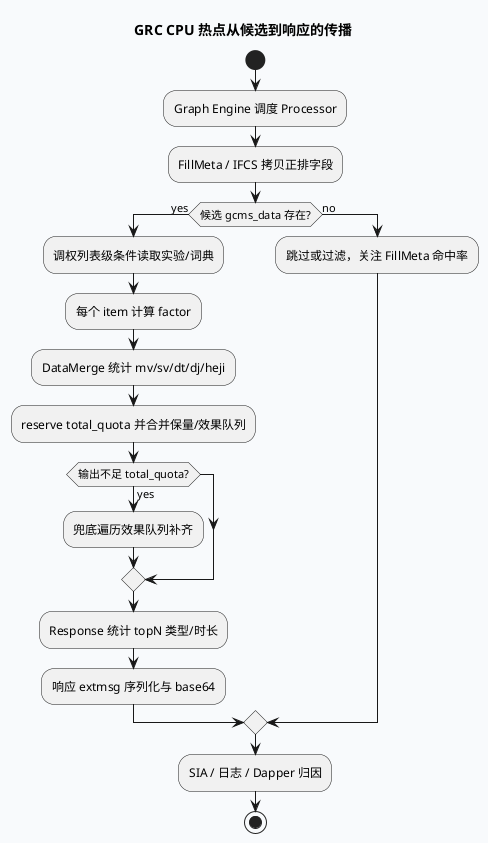

# GRC 成本/CPU 性能优化热点复盘
<!-- topic-nav:start -->
> 主题：`business/cpu-cost` · 同题补充 / 历史版本 · [主题目录](README.md) · [先读主文](20260707-grc-cpu-cost-optimization-hotspots.md)
<!-- topic-nav:end -->


> 今日主题来源：`daily-plan-20260529.json` 周二业务库主题：`GRC 成本/CPU 性能优化热点复盘`。内网周报/KU 摘要在计划中提到 feeda-mv-grc CPU 3%-5% 优化，但本 cron 环境未读取正文；业务收益与 owner 口径需人工补充。本篇以代码库证据复盘可落地的热点类型：调权参数访问、正排字段拷贝、数据合并循环、响应统计与序列化。

## 架构全景图

<style>.cpu-arch{font-family:Inter,Arial,sans-serif;background:#f8fafc;border:1px solid #d7dee8;border-radius:18px;padding:18px;margin:16px 0;color:#1f2937}.cpu-arch .title{font-size:22px;font-weight:850;margin-bottom:4px}.cpu-arch .sub{font-size:13px;color:#64748b;margin-bottom:16px}.cpu-arch .cols{display:grid;grid-template-columns:1fr 1fr 1fr;gap:12px}.cpu-arch .panel{background:white;border:1px solid #dbe4ef;border-radius:14px;padding:14px}.cpu-arch h3{margin:0 0 10px;font-size:15px;color:#315072}.cpu-arch .item{background:#f8fbff;border:1px solid #e2e8f0;border-radius:10px;padding:9px;margin:8px 0;font-size:13px;line-height:1.45}.cpu-arch .hot{background:#fff7ed;border-color:#f59e0b}.cpu-arch .ok{background:#eef6ff;border-color:#7aa7d9}.cpu-arch .flow{text-align:center;color:#64748b;font-size:12px;font-weight:800;margin:8px 0}</style><div class="cpu-arch"><div class="title">GRC CPU 成本热点：从请求到响应的四段式复盘</div><div class="sub">CPU 优化不只看单个函数，而要看“每请求一次”和“每 item 一次”的操作分别在哪里被放大。</div><div class="cols"><div class="panel"><h3>请求级一次</h3><div class="item ok">实验参数读取：calculate_list_conditions</div><div class="item">公共词典：GET_COMMON_DICT</div><div class="item hot">过量日志拼接会污染 CPU 与 IO</div></div><div class="panel"><h3>候选级循环</h3><div class="item hot">正排字段 COPY：IFCS/GCMS → doc</div><div class="flow">↓</div><div class="item hot">调权 factor：短剧/合集/类目规则</div><div class="flow">↓</div><div class="item">merge/quota：保量 + 效果队列 + 兜底</div></div><div class="panel"><h3>响应级循环</h3><div class="item">topN 类目/时长统计</div><div class="item hot">extmsg SerializeToString + base64</div><div class="item ok">SIA_ADD 形成结果数闭环</div></div></div></div>

## 核心流程图



## 配置/结构信息图

```infographic
infographic sequence-timeline-simple
data
  title CPU 热点定位层次
  desc 先分清请求级、候选级、响应级，再决定优化手段
  items
    - time request
      label 实验与词典读取
      desc 命中开关、参数向量、公共词典应在列表级缓存
    - time meta
      label IFCS/GCMS 字段复制
      desc 宽字段与 repeated 字段决定基础 CPU 底盘
    - time adjust
      label 精排调权 factor
      desc 短剧/合集/类目策略在 item 循环内放大
    - time merge
      label quota 与兜底合并
      desc reserve、is_insert 标记、重复遍历决定合并成本
    - time response
      label 统计与 extmsg 编码
      desc topN 统计、protobuf/base64 是尾部热点
    - time observe
      label SIA/Dapper/日志
      desc 必须给局部热点独立打点，否则只能看到总耗时
  
theme
  palette #3D5A80 #F59E0B #2D6A4F
```

## 关键机制拆解

### 1. 调权参数应停留在列表级，不要进入 item 热循环

`src/operator/adjuster/precise/kanju_fuchi_boost_adjuster.cpp:35-57` 在 `calculate_list_conditions()` 中读取实验开关和 12 个参数，并打印参数日志；`src/operator/adjuster/precise/kanju_fuchi_boost_adjuster.cpp:68-120` 才进入 item 级 factor 计算，读取短剧、漫剧、二创、版权等正排字段。

这个结构是正确方向：实验参数读取在请求级完成，item 级只做字段判断和数学计算。优化时要重点防止新增策略把 `EXPERIMENT_GET_PARAM`、词典查询或大日志拼接放回 `calculate_factor()`。

### 2. 词典参数读取需要按请求缓存，并关注向量长度分支

`src/operator/adjuster/precise/kanju_days_lt_precise_adjuster.cpp:32-52` 先判定实验命中和参数名；`src/operator/adjuster/precise/kanju_days_lt_precise_adjuster.cpp:77-110` 再用 `GET_COMMON_DICT` 读取权重向量，并按长度拆出短剧、漫剧、合集和盖帽参数。

这类代码的风险点是：词典结果结构变长后，item 级计算的维度增加；同时日志输出如果无采样，也会把低成本参数读取变成高成本字符串拼接。

### 3. 正排字段宽度决定所有后续策略的 CPU 底盘

`src/plugin/ifcs_component.cpp:339-430` 连续复制大量 `MvGrcItemGcmsInfo` 字段到业务 doc，包括类目、AIGC、清晰度、合集、商品、质量、安全等字段。这里每增加一个字段，不只增加 FillMeta/IFCS 解析成本，还会让后续 filter/adjust/response 更容易访问更多业务属性。

因此成本优化不能只在策略算子末端做，应反查字段是否真正被当前场景消费；如果只为小流量或少数策略服务，优先走条件字段、延迟解析或按场景裁剪。

### 4. DataMerge 已有 reserve，但仍有多轮遍历与兜底放大

`src/processor/video_launch/data_merge.cpp:79-151` 先遍历保量和效果队列统计 mv/sv/dt/dj/heji 数量与比例；`src/processor/video_launch/data_merge.cpp:153-178` 对输出 `reserve(*_total_quota)`，先加保量，再按低活兴趣 quota 分支处理效果队列，最后再次遍历效果队列兜底补齐。

这里的优化点不是简单“加 reserve”，因为已经有 reserve；更关键的是减少无效候选重复遍历、控制 `_total_quota` 与输入队列规模、以及让 `is_insert_sketchy_rank` 标记避免重复插入。

### 5. 响应统计和序列化在尾部形成二次成本

`src/processor/response.cpp:570-632` 在 ua=85 且命中特定实验时遍历 top reqnum item，统计 sv/mv 和 rec_type 分桶并写 SIA；基础库文档中还定位到 GRG `src/process/response_function.cpp:4207-4222` 的 extmsg 序列化与 base64。GRC/GRG 尾部响应逻辑容易被忽略，但它直接影响请求尾延迟和 CPU 峰值。

## Pitfalls 卡片

<style>.cpu-card{font-family:Inter,Arial,sans-serif;background:#F4F3F0;border-radius:18px;padding:20px;margin:18px 0;border-top:8px solid #2D6A4F;color:#1f2937;box-shadow:0 10px 26px rgba(31,41,55,.08)}.cpu-card .meta{font-size:12px;letter-spacing:.08em;text-transform:uppercase;color:#64748b;font-weight:800}.cpu-card h3{font-size:25px;line-height:1.15;margin:8px 0 12px}.cpu-card .grid{display:grid;grid-template-columns:2fr 1fr;gap:14px}.cpu-card p,.cpu-card li{font-size:14px;line-height:1.65}.cpu-card ul{margin:0 0 0 18px}.cpu-card .side{border-left:3px solid #2D6A4F;padding-left:12px;color:#374151}.cpu-card code{background:#e8edf3;border-radius:5px;padding:1px 5px}</style><div class="cpu-card"><div class="meta">Pitfalls / CPU Cost</div><h3>一次 CPU 优化能否稳定收益，取决于是否区分了“请求级一次”和“候选级 N 次”。</h3><div class="grid"><div><ul><li><b>不要只看函数名：</b>同一策略在列表级读参数、在 item 级算 factor，成本模型完全不同。</li><li><b>字段不是免费的：</b>正排字段复制后，后续每个策略都可能把它变成隐性依赖。</li><li><b>reserve 不是万能：</b>DataMerge 已 reserve，瓶颈可能是多轮遍历和兜底。</li><li><b>日志会变热点：</b>参数向量、候选统计、debug 字符串必须采样或分级。</li></ul></div><div class="side">复盘口径：先按 request / item / response 三层归因，再决定裁字段、缓存参数、减少遍历或补局部打点。</div></div></div>

## 调试 checklist

```infographic
infographic list-column-done-list
data
  title GRC CPU 优化复盘 checklist
  desc 每个优化项都要绑定局部证据和可回滚策略
  items
    - label 标注热点层级
      desc request-level / item-level / response-level 分开看
      done true
    - label 检查实验和词典读取位置
      desc 应在 calculate_list_conditions 或 setup 阶段缓存
      done true
    - label 统计候选规模和 reqnum
      desc 输入队列、total_quota、top reqnum 决定循环次数
      done true
    - label 裁剪未消费正排字段
      desc 从 IFCS/GCMS 字段复制清单反查消费方
      done true
    - label 给 SerializeToString 单独打点
      desc 不要让编码成本混进 RPC 或 response 总耗时
      done true
    - label 日志按 logid 或采样开关收敛
      desc 避免优化代码本身制造 IO/CPU 抖动
      done true
    - label 保留实验开关和回滚路径
      desc 成本优化必须和效果指标一起灰度
      done true
theme
  palette #2D6A4F #F59E0B #64748B
```

## 证据来源

- `src/operator/adjuster/precise/kanju_fuchi_boost_adjuster.cpp:35-57`：列表级读取实验开关与参数向量，并输出参数日志。
- `src/operator/adjuster/precise/kanju_fuchi_boost_adjuster.cpp:68-120`：item 级短剧/漫剧/factor 字段判断与计算入口。
- `src/operator/adjuster/precise/kanju_days_lt_precise_adjuster.cpp:32-52`：实验命中与参数名选择。
- `src/operator/adjuster/precise/kanju_days_lt_precise_adjuster.cpp:77-110`：公共词典向量读取与多类权重拆解。
- `src/plugin/ifcs_component.cpp:339-430`：IFCS/GCMS 大量正排字段复制到业务 doc。
- `src/processor/video_launch/data_merge.cpp:79-151`：保量/效果队列输入类型统计与比例日志。
- `src/processor/video_launch/data_merge.cpp:153-178`：`reserve(*_total_quota)`、保量/效果队列合并与兜底逻辑。
- `src/processor/response.cpp:570-632`：ua=85 响应 topN sv/mv/rec_type 统计与 SIA 打点。
- `daily-plan-20260529.json:321-324`：周二业务库主题选择。

## 需人工补充

- 周报中提到的 CPU 3%-5% 优化收益、具体上线实验、owner 与回滚记录需人工补充。
- 当前 cron 环境未执行 perf/flamegraph；本文给出代码层热点复盘与排障路径，生产归因仍需结合线上采样。
