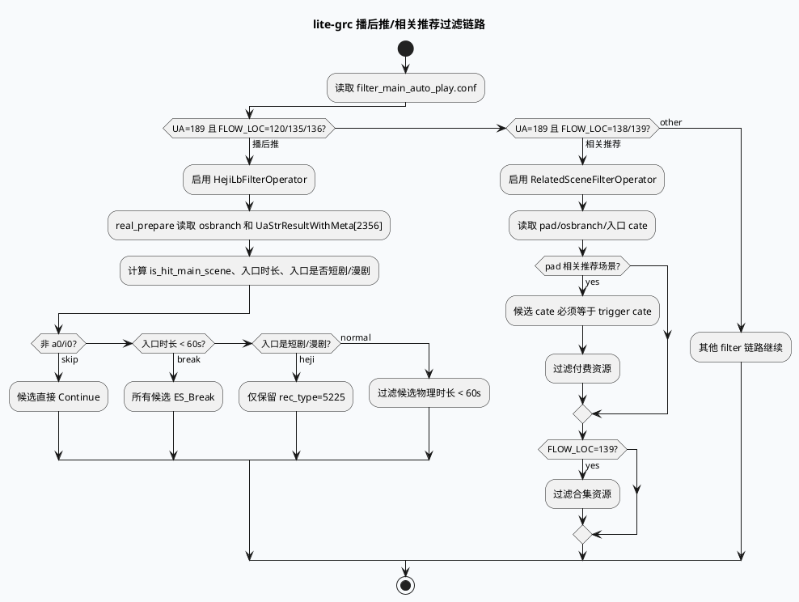

# lite-grc 播后推与相关推荐过滤链路复盘
<!-- topic-nav:start -->
> 主题：`business/related-filter` · 同题补充 / 历史版本 · [主题目录](README.md) · [先读主文](2026-06-23-ua189-postplay-related-filter-business-chain.md)
<!-- topic-nav:end -->


> 今日主题来源：未找到显式 `daily-plan-20260617.json`，按近期双 Markdown 工作流 fallback 到 lite-grc 新增/活跃过滤算子。内网 KU 未提供可检索 URL/doc-id，业务目标需人工补充；本文以代码与配置复盘 UA=189 播后推、相关推荐、pad 场景与内容质量过滤的业务链路。

## 架构全景图

<style>.biz-arch{font-family:Inter,Arial,sans-serif;background:#f8fafc;border:1px solid #d7dee8;border-radius:18px;padding:18px;margin:16px 0;color:#1f2937}.biz-arch .title{font-size:22px;font-weight:850;margin-bottom:4px}.biz-arch .sub{font-size:13px;color:#64748b;margin-bottom:16px}.biz-arch .cols{display:grid;grid-template-columns:1fr 1fr 1fr;gap:12px}.biz-arch .panel{background:white;border:1px solid #dbe4ef;border-radius:14px;padding:14px}.biz-arch h3{margin:0 0 10px;font-size:15px;color:#315072}.biz-arch .item{background:#f8fbff;border:1px solid #e2e8f0;border-radius:10px;padding:9px;margin:8px 0;font-size:13px;line-height:1.45}.biz-arch .hot{background:#fff7ed;border-color:#f59e0b}.biz-arch .ok{background:#eef6ff;border-color:#7aa7d9}.biz-arch .flow{text-align:center;color:#64748b;font-size:12px;font-weight:800;margin:8px 0}</style><div class="biz-arch"><div class="title">UA=189 场景过滤：入口资源约束驱动候选过滤</div><div class="sub">播后推与相关推荐不是单纯按候选字段过滤，而是先读取入口队列 2356 的触发资源，再决定候选侧合集、类目、时长和付费过滤规则。</div><div class="cols"><div class="panel"><h3>场景入口</h3><div class="item ok">UA=189</div><div class="item">FLOW_LOC=120/135/136：播后推</div><div class="item">FLOW_LOC=138/139：相关推荐复用播后推策略</div><div class="item hot">device_info: osbranch + is_pad</div></div><div class="panel"><h3>入口资源</h3><div class="item hot">UaStrResultWithMeta[2356]</div><div class="flow">↓ 提取 gcms_data</div><div class="item">trigger cate：new_cate_v2</div><div class="item">lianbo duration / duanju / manju</div></div><div class="panel"><h3>候选过滤</h3><div class="item hot">RelatedScene：类目一致 + 付费过滤 + 合集过滤</div><div class="item hot">HejiLb：入口短时长直接过滤；合集只保 rec_type=5225</div><div class="item ok">ContentQuality：质量档位、用户兴趣、豁免队列</div></div></div></div>

## 核心流程图



## 配置/结构信息图

```infographic
infographic compare-hierarchy-left-right-circle-node-pill-badge
data
  title 两条 UA=189 过滤分支对比
  desc 同样依赖入口队列 2356，但业务约束不同
  items
    - label HejiLbFilterOperator
      desc 播后推 FLOW_LOC=120/135/136
      children
        - label 生效设备
          desc osbranch 为 a0/i0
        - label 入口资源
          desc 读取 video_duration、is_duanju、is_unhuman_duanju
        - label 候选动作
          desc 短入口全过滤；短剧/漫剧只保 5225；普通资源过滤 <60s
    - label RelatedSceneFilterOperator
      desc 相关推荐 FLOW_LOC=138/139
      children
        - label 生效设备
          desc pad 且 osbranch 为 i0/a0
        - label 入口资源
          desc 读取 trigger_id_cate=new_cate_v2
        - label 候选动作
          desc 类目不一致过滤；付费过滤；FLOW_LOC=139 过滤合集
theme
  palette #3D5A80 #F59E0B #2D6A4F
```

## 关键机制拆解

### 1. 配置把 UA=189 分成播后推与相关推荐两条链路

`conf/plugins/graph/micro_frame/filter_main_auto_play.conf:70-82` 配置 `HejiLbFilterOperator`，条件是 `UA = 189 && FLOW_LOC = 120/135/136`；`conf/plugins/graph/micro_frame/filter_main_auto_play.conf:83-94` 配置 `RelatedSceneFilterOperator`，条件是 `UA = 189 && FLOW_LOC = 138/139`。两者都依赖 `CommonInfo`、`SidInfo`、`UaStrResultWithMeta`，说明业务判断依赖请求场景和入口资源。

### 2. 播后推 HejiLb 的核心是“入口资源决定候选边界”

`src/processor/filter/heji_lb_filter_operator.cc:19-56` 在 `real_prepare()` 中只对 a0/i0 生效，并从入口队列 2356 读取入口资源的 `video_duration`、`is_duanju`、`is_unhuman_duanju`。`src/processor/filter/heji_lb_filter_operator.cc:61-93` 中的候选过滤分三层：非 a0/i0 跳过；入口时长小于 60 秒则直接过滤；入口是短剧/漫剧时只保留 `rec_type == 5225`；否则过滤候选物理时长小于阈值的短视频。

### 3. 相关推荐 RelatedScene 复用播后推策略，但更强调 pad 与类目一致

`src/processor/filter/related_scene_filter_operator.cc:19-31` 只在 UA=189 且 FLOW_LOC=138/139 时设置场景，且 pad 相关推荐要求 `is_pad == "1"`、`osbranch == "i0" || "a0"`。`src/processor/filter/related_scene_filter_operator.cc:33-54` 从入口队列 2356 提取 `trigger_id_cate`。候选侧 `src/processor/filter/related_scene_filter_operator.cc:70-91` 要求候选 `new_cate_v2` 与入口类目一致，过滤付费资源，并在 FLOW_LOC=139 时过滤合集资源。

### 4. ContentQuality 是更复杂的质量过滤面，风险在 item 级重复查依赖与词典

`src/processor/filter/content_quality_score_filter_operator.cc:17-74` 在 `real_prepare()` 中读取 `RequestType`、`SidInfo`、`UmsFeature`、`CommonInfo`，设置多个实验开关、用户质量标记和场景豁免。候选侧 `src/processor/filter/content_quality_score_filter_operator.cc:100-170` 又再次读取 `SidInfo`、`UmsFeature`、`CommonInfo`，并访问用户满意度 map、类目、rec_type；`src/processor/filter/content_quality_score_filter_operator.cc:261-267` 在 high quality 用户分支中通过 `GET_COMMON_DICT` 读取质量阈值。业务上灵活，但性能上要警惕把请求级实验/词典读取放入 item 热循环。

### 5. 质量过滤存在多层豁免，排查误杀要先定位豁免路径

`ContentQualityScoreFilterOperator` 对 storymode、deeplink、新热队列、本地队列、高质量用户、影视/综艺兴趣、质量档位都有分支。典型例子包括 `src/processor/filter/content_quality_score_filter_operator.cc:86-99` 的 storymode/deeplink/SA 新热豁免，`src/processor/filter/content_quality_score_filter_operator.cc:227-259` 的高质量用户与新热/本地队列豁免，以及 `src/processor/filter/content_quality_score_filter_operator.cc:269-323` 的质量档位/质量分过滤。线上排查“为什么被过滤/为什么没过滤”不能只看最后的 `filter_result`。

## Pitfalls 卡片

<style>.biz-card{font-family:Inter,Arial,sans-serif;background:#F4F3F0;border-radius:18px;padding:20px;margin:18px 0;border-top:8px solid #2D6A4F;color:#1f2937;box-shadow:0 10px 26px rgba(31,41,55,.08)}.biz-card .meta{font-size:12px;letter-spacing:.08em;text-transform:uppercase;color:#64748b;font-weight:800}.biz-card h3{font-size:25px;line-height:1.15;margin:8px 0 12px}.biz-card .grid{display:grid;grid-template-columns:2fr 1fr;gap:14px}.biz-card p,.biz-card li{font-size:14px;line-height:1.65}.biz-card ul{margin:0 0 0 18px}.biz-card .side{border-left:3px solid #2D6A4F;padding-left:12px;color:#374151}.biz-card code{background:#e8edf3;border-radius:5px;padding:1px 5px}</style><div class="biz-card"><div class="meta">Pitfalls / Business Filter</div><h3>入口资源不是候选资源；播后推/相关推荐的很多过滤规则来自 trigger item。</h3><div class="grid"><div><ul><li><b>不要混淆 FLOW_LOC：</b>120/135/136 走播后推 HejiLb，138/139 走 RelatedScene。</li><li><b>不要只看候选字段：</b>入口队列 2356 的类目、时长、短剧/漫剧标记决定候选边界。</li><li><b>pad 条件很窄：</b>RelatedScene 的类目一致过滤只在 pad + a0/i0 场景打开。</li><li><b>质量过滤分支多：</b>误杀排查要同时看 storymode、deeplink、新热、本地、高质量用户豁免。</li></ul></div><div class="side">定位建议：先确认配置 condition 命中，再打印入口资源 2356 摘要，最后看候选 rec_type/cate/duration 与 filter_log。</div></div></div>

## 调试 checklist

```infographic
infographic list-column-done-list
data
  title 播后推/相关推荐过滤调试 checklist
  desc 适用于 UA=189 场景过滤误杀、漏放、类目不一致排查
  items
    - label 确认链路分支
      desc FLOW_LOC=120/135/136 看 HejiLb；FLOW_LOC=138/139 看 RelatedScene
      done true
    - label 确认设备条件
      desc osbranch 是否 a0/i0；RelatedScene 还要 is_pad=1
      done true
    - label 确认入口队列 2356
      desc UaStrResultWithMeta 是否存在，入口 gcms_data 是否为空
      done true
    - label 记录入口资源摘要
      desc trigger cate、video_duration、is_duanju、is_unhuman_duanju
      done true
    - label 对齐候选字段
      desc rec_type、new_cate_v2、is_heji、video_duration、是否付费
      done true
    - label 排查质量豁免
      desc storymode/deeplink/新热/本地/高质量用户是否提前 return
      done true
    - label 控制日志采样
      desc per-item DEBUG 在大流量下可能放大 CPU 和 IO
      done true
theme
  palette #3D5A80 #F59E0B #2D6A4F
```

## 证据来源

- `conf/plugins/graph/micro_frame/filter_main_auto_play.conf:70-82`：`HejiLbFilterOperator` 的 UA/FLOW_LOC 条件与依赖。
- `conf/plugins/graph/micro_frame/filter_main_auto_play.conf:83-94`：`RelatedSceneFilterOperator` 的 UA/FLOW_LOC 条件与依赖。
- `src/processor/filter/heji_lb_filter_operator.cc:19-56`：播后推入口资源与场景状态计算。
- `src/processor/filter/heji_lb_filter_operator.cc:61-93`：播后推候选过滤规则。
- `src/processor/filter/related_scene_filter_operator.cc:19-54`：相关推荐 pad 场景与入口类目提取。
- `src/processor/filter/related_scene_filter_operator.cc:70-91`：相关推荐候选类目、付费、合集过滤。
- `src/processor/filter/content_quality_score_filter_operator.cc:17-74`：质量过滤请求级开关与用户状态准备。
- `src/processor/filter/content_quality_score_filter_operator.cc:100-170`：影视/综艺兴趣与 hot play 分支。
- `src/processor/filter/content_quality_score_filter_operator.cc:227-323`：高质量用户豁免、质量阈值与质量档位过滤。
