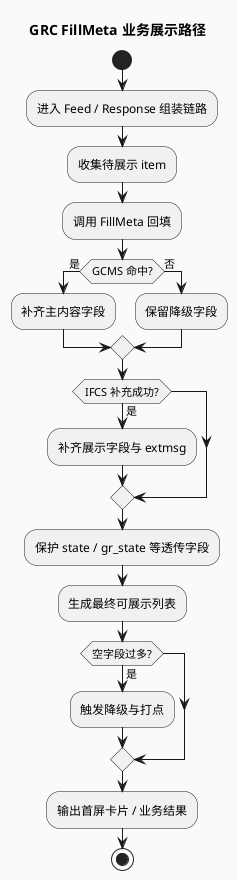

# GRC FillMeta：业务内容展示链路中的元数据回填语义（2026-06-25）
<!-- topic-nav:start -->
> 主题：`business/gcms-fillmeta` · 同题补充 / 历史版本 · [主题目录](README.md) · [先读主文](20260601-grc-gcms-ifcs-fill-meta-chain.md)
<!-- topic-nav:end -->


> 今日主题来源：本机未发现可用 `daily-plan` 文件；按周四 fallback 选择 GRC FillMeta + GCMS/IFCS 业务主题。已按要求在执行环境中使用 `BAIDU_CC_USERNAME=hujiyang`；当前未提供 KU URL/doc-id，业务背景需人工补充，本文以本地代码理解笔记与既有证据路径为准。

<style>.bizarch250625{font-family:-apple-system,BlinkMacSystemFont,"Segoe UI",sans-serif;background:#f8fafc;border:1px solid #d7dee8;border-radius:18px;padding:18px;margin:16px 0;color:#1f2937}.bizarch250625 .title{font-size:22px;font-weight:850;margin-bottom:5px}.bizarch250625 .sub{font-size:13px;color:#64748b;margin-bottom:14px}.bizarch250625 .cols{display:grid;grid-template-columns:1fr 1fr 1fr;gap:12px}.bizarch250625 .panel{background:white;border:1px solid #dbe4ef;border-radius:14px;padding:14px}.bizarch250625 h3{margin:0 0 10px;font-size:15px;color:#315072}.bizarch250625 .item{background:#eef6ff;border:1px solid #bfdbfe;border-radius:10px;padding:9px;margin:8px 0;font-size:13px;line-height:1.45}.bizarch250625 .hot{background:#fff7ed;border-color:#f59e0b}.bizarch250625 .warn{background:#fff1f2;border-color:#fda4af}.bizarch250625 .flow{text-align:center;color:#64748b;font-size:12px;font-weight:800;margin:8px 0}</style><div class="bizarch250625"><div class="title">架构全景：业务侧看到的是“内容是否完整可展示”，不是单个 RPC 是否成功</div><div class="sub">FillMeta 影响首屏标题、封面、作者、时间、状态展示与降级策略；因此业务排查应围绕“缺字段”“错字段”“降级字段”而不是只看查询成功率。</div><div class="cols"><div class="panel"><h3>用户感知</h3><div class="item hot">标题/封面/简介是否齐全</div><div class="item">卡片是否能正常曝光</div><div class="item">状态/标签是否可信</div><div class="item warn">空值覆盖会造成展示退化</div></div><div class="panel"><h3>业务语义</h3><div class="item hot">GCMS 主内容元数据</div><div class="item">IFCS 补充展示字段</div><div class="item">state / gr_state 透传语义</div><div class="item warn">不同场景字段含义不完全一致</div></div><div class="panel"><h3>结果输出</h3><div class="item hot">可展示 item 集合</div><div class="item">降级后的次优字段</div><div class="item">失败打点与统计</div><div class="item">运营/调试可见性</div></div></div></div>

## 核心结论

- 业务上 FillMeta 的价值不是“查元数据”，而是“保证内容可以被稳定展示”，所以标题、封面、作者、时间、标签这类字段比底层 RPC 成功率更接近业务结果。
- GCMS/IFCS 双通道带来的差异，会直接体现在用户可见质量上：一个通道缺字段不代表整体失败，但会影响卡片完整度和排序质量。
- 如果状态字段回填错位，业务侧会把内容状态、分发状态、展示状态混为一谈，造成“能看到但状态不对”的疑难问题。
- 批量回填时，必须保留候选 item 顺序与场景顺序的稳定性；否则业务日志中的曝光/点击追踪会和内容实体错配。
- 业务排障不要只看一个“成功率”，应同时看命中率、空字段率、降级率和最终可展示率。

## 业务流程图



## 配置结构信息图

```infographic
infographic compare-hierarchy-left-right-circle-node-pill-badge
data
  title FillMeta 业务侧关注点对比
  desc 业务关注“展示质量”和“字段语义”，不是只关注 RPC 成败
  items
    - label 展示字段
      desc 标题、封面、作者、发布时间、摘要等
      children
        - label 主字段
          desc GCMS 返回的基础展示字段
        - label 补充字段
          desc IFCS 返回的扩展展示字段与 extmsg
    - label 状态字段
      desc 展示状态、分发状态、外部透传状态
      children
        - label state
          desc 不应被当成普通元数据覆盖
        - label gr_state
          desc 常见误区，需保留透传语义
    - label 质量指标
      desc 命中率、空字段率、降级率、可展示率
      children
        - label 命中率
          desc 返回数据是否可直接展示
        - label 降级率
          desc 有多少 item 需要保底字段

theme
  palette #3D5A80 #F59E0B #2D6A4F
```

## 关键链路拆解

### 1. 业务不是看“查没查到”，而是看“最终卡片完整不完整”

同一个查询成功，不代表业务展示没问题。比如标题有了但封面为空，首屏仍会变差；作者、发布时间、简介字段缺失也会影响点击。业务排查应优先看最终卡片字段完整度。

### 2. 状态字段错位会放大到整条业务链路

`state` / `gr_state` 这类字段常被误认为普通展示字段，但它们实际决定的是业务状态语义。错写后，运营侧、推荐侧、调试侧看到的“内容状态”就会不一致。

### 3. 降级不是失败，空值覆盖才是问题

业务场景里允许局部缺字段，但不允许把已有可用值覆盖成空。也就是说，FillMeta 的关键策略应该是“有值才填、无值则保留”，这样才能维持稳定的业务展示。

### 4. 统计口径要与业务结果对齐

如果只统计 RPC success，业务会误以为链路健康；实际上更该统计卡片完整率、关键字段缺失率和降级触发率。否则只会得到“接口都成功但展示很差”的假象。

<style>.bizcard250625{font-family:-apple-system,BlinkMacSystemFont,"Segoe UI",sans-serif;background:#F4F3F0;border-radius:18px;padding:20px;margin:18px 0;border-top:8px solid #2D6A4F;color:#1f2937;box-shadow:0 10px 26px rgba(31,41,55,.08)}.bizcard250625 .meta{font-size:12px;letter-spacing:.08em;text-transform:uppercase;color:#64748b;font-weight:800}.bizcard250625 h3{font-size:24px;line-height:1.18;margin:8px 0 12px}.bizcard250625 .grid{display:grid;grid-template-columns:2fr 1fr;gap:14px}.bizcard250625 li{font-size:14px;line-height:1.65}.bizcard250625 ul{margin:0 0 0 18px}.bizcard250625 .side{border-left:3px solid #2D6A4F;padding-left:12px;color:#374151;font-size:14px;line-height:1.65}.bizcard250625 code{background:#e8edf3;border-radius:5px;padding:1px 5px}</style><div class="bizcard250625"><div class="meta">Pitfalls / Business FillMeta</div><h3>用户看到的异常，往往来自字段语义错配，而不是单次查询失败。</h3><div class="grid"><div><ul><li><b>标题缺失：</b>查到内容但主字段映射错了。</li><li><b>状态异常：</b><code>state</code> 被当作普通字段覆盖。</li><li><b>封面退化：</b>IFCS 补充通道异常后没有保留旧值。</li><li><b>统计误导：</b>只看 success rate，不看完整率与降级率。</li></ul></div><div class="side">业务排查优先级：完整率 → 状态正确率 → 降级率 → RPC 成功率。顺序不要反过来。</div></div></div>

## 调试 checklist

```infographic
infographic list-column-done-list
data
  title GRC FillMeta 业务排查 checklist
  desc 适用于首屏卡片缺字段、状态不对、展示质量下降
  items
    - label 确认关键展示字段
      desc 标题、封面、作者、时间是否都被正确回填
      done true
    - label 确认状态字段隔离
      desc state / gr_state 不应被普通内容字段覆盖
      done true
    - label 确认补充通道
      desc IFCS 或扩展元数据是否补齐 extmsg 和业务字段
      done true
    - label 确认降级保留
      desc 空字段时是否保留旧值或保底值
      done true
    - label 确认业务统计
      desc 完整率、空字段率、降级率是否与现象一致
      done true
    - label 确认日志样例
      desc 保留 query key、场景、item index 与最终字段值
      done true

theme
  palette #3D5A80 #F59E0B #2D6A4F
```

## 证据来源

- `response_function.cpp`：业务响应组装和 FillMeta 入口。
- `fill_meta.cpp`：内容元数据回填、字段解析与降级策略。
- `gcms_component.cpp`：主元数据查询与场景依赖。
- `news_message.proto`：状态字段与业务透传语义。
- `conf/plugins/*.conf`：场景路由、业务开关和元数据通道配置。
- `notes/base-lib/2026-06-25-grc-gcms-ifcs-fillmeta-contract.md`：对应基础库理解笔记。
