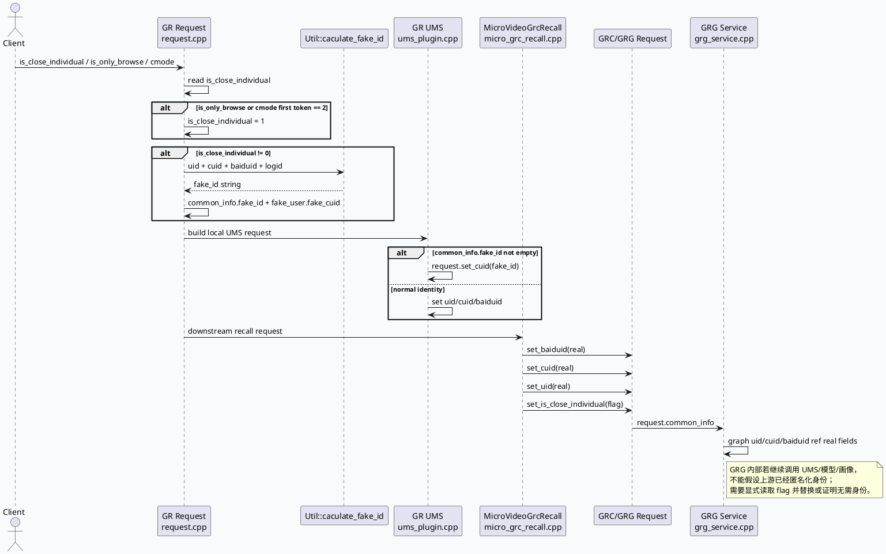

# 2026-06-27 业务库代码理解：关闭个性化 fake_id 边界与动态超时旁路
<!-- topic-nav:start -->
> 主题：`business/personalization-id` · 同题补充 / 历史版本 · [主题目录](README.md) · [先读主文](2026-07-04-close-individual-fakeid-cross-service-boundary.md)
<!-- topic-nav:end -->


> 日期：2026-06-27  
> 今日主题来源：本机未发现可用 `daily-plan` 文件；按近期双 Markdown 工作流周六 fallback，继续选择“关闭个性化推荐”链路，本次聚焦 fake_id 是否跨 GR/GRC/GRG 边界传递，以及动态超时 scene 映射对排障的旁路影响。已按要求设置 `BAIDU_CC_USERNAME=hujiyang`；未提供 KU URL/doc-id，产品口径需人工补充。  
> 范围：GR 请求解析、fake_id 生成、GR 本地 UMS 使用、GR→GRC/GRG 请求字段透传、GRG 图入口身份注入、`news_updates_dibar` 动态超时 scene 映射。

## 架构全景图
<style>.arch{font-family:-apple-system,BlinkMacSystemFont,"Segoe UI",sans-serif;background:#f8fafc;border:1px solid #dbe4ef;border-radius:18px;padding:18px;margin:16px 0;color:#1f2937}.arch-title{font-size:22px;font-weight:850;letter-spacing:-.02em;margin-bottom:12px}.lane{display:grid;grid-template-columns:repeat(4,1fr);gap:12px}.box{background:#fff;border:1px solid #e5e7eb;border-radius:14px;padding:12px;min-height:142px}.box h3{font-size:15px;margin:0 0 8px;color:#334155}.ok{border-left:5px solid #2d6a4f}.warn{border-left:5px solid #b45309}.risk{border-left:5px solid #b91c1c}.info{border-left:5px solid #3d5a80}.muted{font-size:12px;color:#64748b;line-height:1.55}.tag{display:inline-block;background:#e2e8f0;border-radius:999px;padding:2px 8px;font-size:12px;margin-top:6px}.arrow{color:#64748b;font-size:12px;margin-top:8px}</style><div class="arch"><div class="arch-title">关闭个性化链路：fake_id 生成在 GR，跨服务主要透传标志</div><div class="lane"><div class="box ok"><h3>GR 入口</h3><div class="muted">解析 `is_close_individual`；`is_only_browse` / `cmode=2` 会强制关闭个性化；非 0 时计算 fake_id。</div><span class="tag">fake_id 生成点</span><div class="arrow">request.cpp → util.cpp</div></div><div class="box ok"><h3>GR 本地依赖</h3><div class="muted">UMS 请求若 `fake_id` 非空，则使用 fake_id 作为 cuid；否则回退真实 uid/cuid/baiduid。</div><span class="tag">本地替换明确</span><div class="arrow">ums_plugin.cpp</div></div><div class="box warn"><h3>GR → GRC/GRG</h3><div class="muted">GRCRequest.common_info 写入真实 baiduid/cuid/uid，同时透传 `is_close_individual`。</div><span class="tag">标志透传，不是身份替换</span><div class="arrow">micro_grc_recall.cpp</div></div><div class="box risk"><h3>GRG 图入口</h3><div class="muted">Graph 全局 `uid/cuid/baiduid` 直接 ref 请求中的真实字段；若内部再调个性化依赖，需要自行处理关闭个性化。</div><span class="tag">风险边界</span><div class="arrow">grg_service.cpp</div></div></div></div>

## 核心调用链


## 字段责任分工信息图
```infographic
infographic compare-hierarchy-left-right-circle-node-pill-badge
data
  title 关闭个性化：字段、身份、责任三件事要分开看
  desc fake_id 不在所有跨服务请求中自动替代真实 ID
  items
    - label GR 本地责任
      desc 解析关闭个性化标志，生成 fake_id，并对本服务 UMS 等依赖替换身份
      value 80
      icon mdi-check-circle
      children
        - label is_close_individual
          desc request 字段，非 0 进入 fake_id 路径
        - label is_only_browse/cmode
          desc 可强制 is_close_individual=1
        - label fake_id
          desc uid_cuid_baiduid_logid hash
        - label UMS
          desc fake_id 非空时 set_cuid(fake_id)
    - label 下游服务责任
      desc 收到真实 ID + flag 后，按自身依赖决定是否本地替换身份
      value 60
      icon mdi-alert-circle
      children
        - label GRCRequest.common_info
          desc baiduid/cuid/uid 仍为真实值
        - label is_close_individual
          desc 作为语义标志透传
        - label GRG Graph
          desc uid/cuid/baiduid ref 请求真实字段
        - label 内部 RPC
          desc 需逐条验证是否读取 flag
```

## 业务结论

1. **代码语义是“非 0 关闭个性化”**：入口解析 `is_close_individual` 后，只要其值非 0 就计算 fake_id；`is_only_browse` 或 `cmode` 首段为 `2` 会强制把 `is_close_individual` 置为 1。
2. **fake_id 是请求级派生 ID，不是协议级全链路替换字段**：生成逻辑是 `uid_cuid_baiduid_logid` hash，因此同一用户在不同 logid 下会得到不同 fake_id，适合当前请求去个性化，但不能当成稳定用户标识。
3. **GR 本地 UMS 路径替换明确**：`ums_plugin.cpp` 在 `common_info.fake_id` 非空时只设置 `request.cuid=fake_id`；否则才使用真实 uid/cuid/baiduid。
4. **GR→GRC/GRG 是“真实身份 + 关闭标志”**：`micro_grc_recall.cpp` 明确写入真实 `baiduid/cuid/uid`，并单独写入 `is_close_individual`。因此跨服务边界传递的是语义标志，而不是已匿名化的身份。
5. **GRG 是风险边界**：`grg_service.cpp` 将 request.common_info 的真实 uid/cuid/baiduid ref 到 Graph 数据。后续节点如果访问 UMS、画像、模型特征，需要逐条验证是否读取 `is_close_individual` 并进行替换或禁用。
6. **动态超时 scene 映射会干扰业务排障**：GRG 对 `news_updates_dibar` 特判为 `short_micro_video` 后再设置动态超时。排查该业务的下游 timeout 时，配置和 bvar 可能不在原 graph_name 下。

## 旁路配置图：news_updates_dibar 的动态超时映射
```plantuml
@startuml
skinparam handwritten false
skinparam backgroundColor #f8fafc
left to right direction
participant "GRG Request" as REQ
participant "GenericGRGService\nfill_basic_data_for_graph" as S
participant "DynamicTimeOutPlugin" as DT
participant "dynamic_timeout.conf" as CONF
REQ -> S: graph_name = news_updates_dibar
S -> S: scene = graph_name
alt scene == news_updates_dibar
  S -> S: scene = short_micro_video
end
S -> DT: set_request_timeout(dt_cntl, scene, timeout)
DT -> CONF: lookup scene short_micro_video
CONF --> DT: stage/rpc budget config
DT --> S: ERR_OK or silent scene-miss return
@enduml
```

## Debug checklist
```infographic
infographic list-column-done-list
data
  title is_close_individual / fake_id 生效性排查
  desc 从入口语义到下游 RPC 请求逐段留证
  items
    - label 入口字段解析
      desc request.cpp 是否读到 is_close_individual；is_only_browse/cmode 是否强制置 1
      done true
      icon mdi-form-textbox
    - label fake_id 生成
      desc fake_id 是否由 uid/cuid/baiduid/logid hash 生成并写入 common_info
      done true
      icon mdi-fingerprint
    - label GR 本地 UMS
      desc ums_plugin 是否在 fake_id 非空时只 set_cuid(fake_id)
      done true
      icon mdi-account-switch
    - label GR 到 GRC/GRG
      desc micro_grc_recall 是否仍写真实 uid/cuid/baiduid，同时 set_is_close_individual
      done true
      icon mdi-transit-connection-variant
    - label GRG 图入口
      desc uid/cuid/baiduid 是否直接 ref request.common_info 真实字段
      done true
      icon mdi-graph
    - label GRG 内部依赖
      desc 继续搜 UMS/画像/模型请求是否读取 flag；本次需人工补齐线上证据
      done false
      icon mdi-alert-octagon
    - label 动态超时旁路
      desc news_updates_dibar 查 short_micro_video scene 和 bvar
      done true
      icon mdi-timer-cog
```

## Pitfalls 卡片
<style>.card{font-family:-apple-system,BlinkMacSystemFont,"Segoe UI",sans-serif;background:#f4f3f0;border:1px solid #ded8cf;border-radius:18px;padding:18px;margin:16px 0;color:#1f2937}.meta{font-size:12px;letter-spacing:.08em;text-transform:uppercase;color:#7c4a1d;font-weight:800}.title{font-size:26px;font-weight:850;letter-spacing:-.02em;margin:6px 0 10px}.grid{display:grid;grid-template-columns:1.25fr 1fr;gap:12px}.panel{background:#fff;border-top:4px solid #b45309;border-radius:12px;padding:12px;font-size:14px;line-height:1.65}.panel strong{color:#7c2d12}.end{font-weight:800;color:#7c4a1d;margin-top:10px}</style><div class="card"><div class="meta">Pitfall / Privacy Semantics</div><div class="title">`is_close_individual` 是语义标志，不是匿名化完成证明</div><div class="grid"><div class="panel"><strong>误区：</strong>看到上游 GR 生成 fake_id，就认为 GRC/GRG 收到的 uid/cuid/baiduid 已经被替换。代码显示跨服务请求仍写真实身份，只是额外带关闭个性化标志。</div><div class="panel"><strong>正确做法：</strong>按服务边界逐段确认：谁生成 fake_id、谁替换身份、谁只透传标志、谁继续调用个性化依赖。每条下游 RPC 都要有日志或代码证据。</div></div><div class="end">∎ 隐私语义必须在每个边界重新落地。</div></div>

## 证据来源
- `feeda-mv-gr/src/processor/request.cpp:302`：读取 `is_close_individual`。
- `feeda-mv-gr/src/processor/request.cpp:348`：读取 `is_only_browse`。
- `feeda-mv-gr/src/processor/request.cpp:352`：解析 `cmode`。
- `feeda-mv-gr/src/processor/request.cpp:357`：`is_only_browse` 强制关闭个性化。
- `feeda-mv-gr/src/processor/request.cpp:361`：`is_close_individual != 0` 进入 fake_id 路径。
- `feeda-mv-gr/src/processor/request.cpp:362`：调用 `Util::caculate_fake_id`。
- `feeda-mv-gr/src/processor/request.cpp:364`：写入 `fake_user.fake_cuid`。
- `feeda-mv-gr/src/util/util.cpp:563`：fake_id 生成函数。
- `feeda-mv-gr/src/util/util.cpp:566`：hash 输入为 uid/cuid/baiduid/logid。
- `feeda-mv-gr/src/processor/ums_plugin.cpp:102`：fake_id 非空分支。
- `feeda-mv-gr/src/processor/ums_plugin.cpp:103`：UMS request 设置 `cuid=fake_id`。
- `feeda-mv-gr/src/processor/ums_plugin.cpp:105`：无 fake_id 时回退真实 uid。
- `feeda-mv-gr/src/processor/ums_plugin.cpp:108`：无 fake_id 时回退真实 cuid。
- `feeda-mv-gr/src/processor/ums_plugin.cpp:111`：无 fake_id 时回退真实 baiduid。
- `feeda-mv-gr/src/processor/micro_grc_recall.cpp:547`：GRCRequest 写入真实 baiduid。
- `feeda-mv-gr/src/processor/micro_grc_recall.cpp:558`：GRCRequest 写入真实 cuid。
- `feeda-mv-gr/src/processor/micro_grc_recall.cpp:559`：GRCRequest 写入真实 uid。
- `feeda-mv-gr/src/processor/micro_grc_recall.cpp:578`：GRCRequest 透传 `is_close_individual`。
- `feeda-mv-grg/src/service/grg_service.cpp:121`：GRG 图基础数据填充入口。
- `feeda-mv-grg/src/service/grg_service.cpp:133`：Graph `uid` ref 请求字段。
- `feeda-mv-grg/src/service/grg_service.cpp:136`：Graph `cuid` ref 请求字段。
- `feeda-mv-grg/src/service/grg_service.cpp:139`：Graph `baiduid` ref 请求字段。
- `feeda-mv-grg/src/service/grg_service.cpp:211`：动态超时 scene 初始使用 graph_name。
- `feeda-mv-grg/src/service/grg_service.cpp:212`：`news_updates_dibar` 特判。
- `feeda-mv-grg/src/service/grg_service.cpp:213`：映射为 `short_micro_video`。
- `feeda-mv-grg/src/service/grg_service.cpp:215`：调用 `set_request_timeout`。

## 需人工补充
- KU/产品文档中“关闭个性化”的 0/1 口径与用户场景定义，避免与代码“非 0 关闭”语义冲突。
- GRG 内部所有 UMS/画像/模型调用是否已读取 `is_close_individual` 并替换身份；本次代码证据只覆盖入口注入，线上链路需补日志。
- `news_updates_dibar` 业务排障时对应 `short_micro_video` scene 的线上 dynamic_timeout bvar 截图或曲线。
