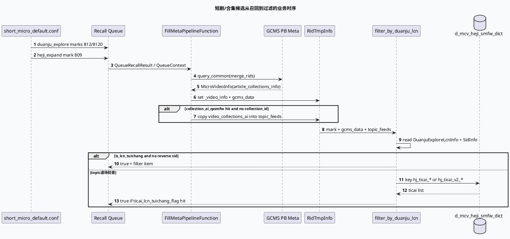

# 2026-07-06 业务库代码理解：短剧/合集队列从召回配置到 LCN 过滤的业务链
<!-- topic-nav:start -->
> 主题：`business/gcms-fillmeta` · 同题补充 / 历史版本 · [主题目录](README.md) · [先读主文](20260601-grc-gcms-ifcs-fill-meta-chain.md)
<!-- topic-nav:end -->


> 日期：2026-07-06｜类型：业务库笔记  
> 今日主题来源：本机未发现可用 `daily-plan` 文件；按周一 fallback 与基础库 Queue Pipeline 配对，选择短剧/合集 `duanju_explore`、`heji_expand` 队列进入 FillMeta/Filter 后的业务语义。  
> 内网 KU：本次任务未提供 KU URL/doc-id；如流知识库检索需人工补充。本文以本地代码库证据为准。  
> 范围：`short_micro_default.conf` 中短剧/合集 fork_type、`fill_meta_pipeline.cpp` 中合集正排补齐/AI 合集改写、`queue_filter.cpp` 中 `filter_by_duanju_lcn` 对 LCN 与题材退场的判定。

## 架构全景图

<style>.arch-0706-biz{font-family:-apple-system,BlinkMacSystemFont,"Segoe UI",sans-serif;background:#f4f8f6;border:1px solid #c7dfce;border-radius:20px;padding:18px;color:#17392c}.arch-0706-biz .title{font-size:25px;font-weight:900;margin-bottom:6px}.arch-0706-biz .sub{font-size:13px;color:#4c6d5d;margin-bottom:16px}.arch-0706-biz .grid{display:grid;grid-template-columns:1fr 1.15fr 1fr;gap:12px}.arch-0706-biz .lane{background:#fff;border:1px solid #d8eadf;border-radius:16px;padding:12px}.arch-0706-biz h3{font-size:15px;margin:0 0 10px;color:#2d6a4f}.arch-0706-biz .box{background:#f7fbf8;border:1px solid #d7e5dc;border-radius:12px;padding:10px;margin:8px 0}.arch-0706-biz .box b{display:block;font-size:13px;margin-bottom:4px}.arch-0706-biz .box span{font-size:12px;color:#4c6d5d;line-height:1.5}.arch-0706-biz .hot{background:#ecfdf5;border-color:#86efac}.arch-0706-biz .warn{background:#fff8e5;border-color:#e0b85f}.arch-0706-biz .note{margin-top:12px;border-left:4px solid #2d6a4f;background:#edf7f1;border-radius:10px;padding:10px;font-size:13px;color:#214c3b}</style><div class="arch-0706-biz"><div class="title">短剧/合集业务链：队列配置不是终点，题材与实验决定最终去留</div><div class="sub">`duanju_explore` / `heji_expand` 只定义候选来源与配额；候选进入 Pipeline 后，还会被 GCMS 合集字段、AI 合集改写、LCN 退场字典与 Sid 实验共同裁决。</div><div class="grid"><div class="lane"><h3>召回队列</h3><div class="box hot"><b>duanju_explore</b><span>`short_micro_default.conf:106-117`，marks 812/8120，max_len 250，quota 150/100。</span></div><div class="box hot"><b>heji_expand</b><span>`short_micro_default.conf:119-127`，mark 809，max_len 160，quota 100。</span></div></div><div class="lane"><h3>元数据补齐</h3><div class="box"><b>GCMS PB 正排</b><span>`fill_meta_pipeline.cpp:118-166` 批量查 meta 并设置 `_video_info/gcms_data`。</span></div><div class="box warn"><b>AI 合集补写</b><span>`fill_meta_pipeline.cpp:176-186` 命中 `collection_ai_zpsmfw` 时，把 `video_collections_ai` 写入 `article_collections_info.topic_feeds`。</span></div></div><div class="lane"><h3>过滤裁决</h3><div class="box hot"><b>LCN 退场</b><span>`queue_filter.cpp:80-95` 读取 `DuanjuExploreLcnInfo.is_lcn_tuichang`，Sid 可反转。</span></div><div class="box"><b>题材退场</b><span>`queue_filter.cpp:96-127` 用 topic_feeds 拼 `hj_ticai_*` key 查 `d_mcv_heji_smfw_dict`。</span></div></div></div><div class="note">业务语义：短剧/合集候选是否保留，不只看 mark；必须同时看 GCMS 是否填出合集字段、LCN 退场状态、题材字典与 Sid 反转开关。</div></div>

## 核心流程图



## 队列与裁决信息图

```infographic list-grid-badge-card
data
  title 短剧/合集召回配置入口
  desc short_micro_default 策略中可直接验证的队列、mark 与配额
  items
    - label duanju_explore / 812
      desc max_len 250, quota_ratio 150, 短剧探索主队列
      icon mdi/movie-open
    - label duanju_explore / 8120
      desc max_len 250, quota_ratio 100, 短剧探索补充队列
      icon mdi/movie-roll
    - label heji_expand / 809
      desc max_len 160, quota_ratio 100, 合集扩展队列
      icon mdi/folder-play
    - label video_micro_rec_new
      desc 主召回大池，短剧/合集最终仍需进入同一 Pipeline 处理
      icon mdi/source-branch
```

```infographic sequence-snake-steps-simple
data
  title LCN 与题材退场判定链
  items
    - label 读取依赖
      desc StrategyContext 取 DuanjuExploreLcnInfo 与 SidInfo
      icon mdi/import
    - label LCN 退场
      desc is_lcn_tuichang 命中且无 duanju_lcn_filter_reverse 则过滤
      icon mdi/filter-remove
    - label 合集字段
      desc 从 gcms_data.article_collections_info.topic_feeds 取合集 topic id
      icon mdi-folder-search
    - label 字典查询
      desc 拼 hj_ticai_* 或 hj_ticai_v2_* 查 d_mcv_heji_smfw_dict
      icon mdi-book-search
    - label 题材退场
      desc ticai_lcn_tuichang_flag 命中且无反转实验则过滤
      icon mdi-close-octagon
```

## 业务理解

- `short_micro_default.conf:106-117` 明确注册 `duanju_explore` fork_type：mark 812 配额 150，mark 8120 配额 100；这是短剧探索候选进入系统的配置入口。
- `short_micro_default.conf:119-127` 注册 `heji_expand`：mark 809，max_len 160，quota_ratio 100；它提供合集扩展候选，但不保证候选一定最终展示。
- `fill_meta_pipeline.cpp:118-166` 是业务字段可用性的关键节点：`RidTmpInfo` 只有在 GCMS PB 正排命中后，才会挂上 `_video_info` 与 `gcms_data`。
- `fill_meta_pipeline.cpp:176-186` 的 `collection_ai_zpsmfw` 是一个隐式字段修复：当 `article_collections_info.collection_id` 为空但 `video_collections_ai` 不为空时，会复制出 `_video_info_copy` 并把 AI 合集写回 `topic_feeds`。
- `queue_filter.cpp:80-95` 的 `filter_by_duanju_lcn` 首先处理 LCN 整体退场；`duanju_lcn_filter_reverse` 可反转该过滤。
- `queue_filter.cpp:96-127` 再做题材退场：从 `topic_feeds` 生成 `hj_ticai_*`/`hj_ticai_v2_*` key，查 `d_mcv_heji_smfw_dict` 后与 `ticai_lcn_tuichang_flag` 比对。
- `FilterCb` 返回语义是 `true = 过滤`；在短剧/合集排查中，看到 `return true` 不是“命中保留”，而是候选被移除。

## Pitfalls 卡片

<style>.pit-0706-biz{font-family:-apple-system,BlinkMacSystemFont,"Segoe UI",sans-serif;max-width:1040px;border-radius:20px;background:#f7fbf8;border:1px solid #c7dfce;padding:20px;color:#1f3328}.pit-0706-biz .meta{font-size:12px;letter-spacing:.08em;text-transform:uppercase;color:#2d6a4f;font-weight:900}.pit-0706-biz .headline{font-size:28px;line-height:1.15;font-weight:900;margin:8px 0 12px}.pit-0706-biz .grid{display:grid;grid-template-columns:1.4fr 1fr;gap:14px}.pit-0706-biz .panel{background:#fff;border-top:4px solid #2d6a4f;border-radius:12px;padding:12px}.pit-0706-biz .panel b{display:block;margin-bottom:6px}.pit-0706-biz .panel p{margin:0;font-size:14px;line-height:1.65;color:#41584b}.pit-0706-biz .end{margin-top:12px;font-weight:900;color:#2d6a4f}</style><div class="pit-0706-biz"><div class="meta">pitfall · duanju / heji</div><div class="headline">不要只拿 mark 判断短剧/合集链路是否生效</div><div class="grid"><div class="panel"><b>mark 只说明候选来源</b><p>812/8120/809 能说明候选来自短剧或合集召回，但最终去留还取决于 FillMeta 是否填出 `topic_feeds`、LCN 是否退场、题材字典是否命中、Sid 是否开启反转实验。</p></div><div class="panel"><b>AI 合集会改写字段</b><p>`collection_ai_zpsmfw` 命中后，代码会复制 `MicroVideoInfo` 并把 `video_collections_ai` 写入 `article_collections_info`；排查字段来源时要看是否走了 copy 分支。</p></div></div><div class="end">∎ 业务排查顺序：mark → GCMS → topic_feeds → LCN/题材字典 → Sid。</div></div>

## 调试 checklist

```infographic list-column-done-list
data
  title 短剧/合集业务排查清单
  items
    - label 确认命中的 fork_type 和 mark
      desc duanju_explore: 812/8120；heji_expand: 809
      done true
    - label 确认 GCMS meta 是否命中
      desc 没有 `_video_info/gcms_data`，后续合集字段与题材判断都不可靠
      done true
    - label 检查 collection_ai_zpsmfw 是否改写合集字段
      desc 命中时会把 video_collections_ai 写入 topic_feeds
      done true
    - label 检查 is_lcn_tuichang 与反转 Sid
      desc duanju_lcn_filter_reverse 会绕过整体 LCN 过滤
      done true
    - label 检查 topic_feeds 生成的字典 key
      desc duanju_ds_exp 决定 hj_ticai_* 还是 hj_ticai_v2_*
      done true
    - label 牢记 FilterCb true 表示过滤
      desc 日志/断点里看到 true 不代表候选保留
      done true
```

## 证据来源

- `conf/plugins/strategies/short_micro_default.conf:106-117`：`duanju_explore` fork_type、marks 812/8120 与 quota。
- `conf/plugins/strategies/short_micro_default.conf:119-127`：`heji_expand` fork_type、mark 809 与 quota。
- `conf/plugins/graph/queue_vertex.conf:24-57`：FillMeta Pipeline 的依赖与输出。
- `conf/plugins/graph/queue_vertex.conf:93-217`：Filter Pipeline 的宽依赖、`DuanjuFilterInfo` 与 `HejiFilterInfoNew` 等输入。
- `src/processor/video_launch/fill_meta_pipeline.cpp:118-166`：GCMS PB 正排填充 `RidTmpInfo`。
- `src/processor/video_launch/fill_meta_pipeline.cpp:176-186`：AI 合集字段改写为 `article_collections_info.topic_feeds`。
- `src/strategy/queue_filter.cpp:80-95`：LCN 退场与 `duanju_lcn_filter_reverse`。
- `src/strategy/queue_filter.cpp:96-127`：题材退场字典查询与 `ticai_lcn_tuichang_flag`。
