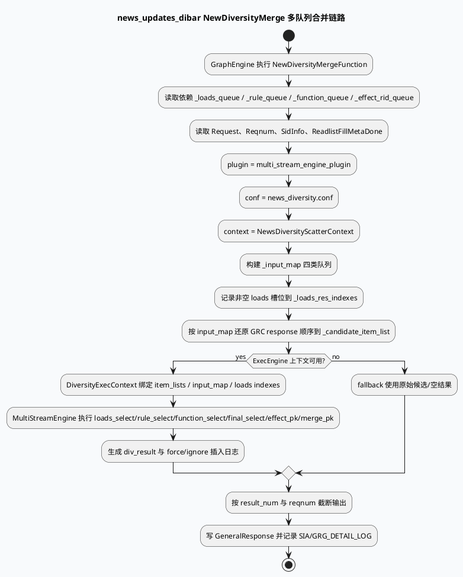

# 2026-07-08 业务库代码理解：news_updates_dibar 的 NewDiversityMerge 多队列合并链路
<!-- topic-nav:start -->
> 主题：`business/news-dibar` · 同题补充 / 历史版本 · [主题目录](README.md) · [先读主文](2026-06-18-news-updates-dibar-dual-content-flow.md)
<!-- topic-nav:end -->


> 日期：2026-07-08｜类型：业务库笔记  
> 今日主题来源：本机未发现可用 `daily-plan` 文件；按周三 fallback 与基础库 MultiStreamEngine 主题配对，选择 `news_updates_dibar` 场景下 NewDiversityMerge 的 loads/rule/function/effect 多队列合并链路。  
> 内网 KU：本次任务未提供 KU URL/doc-id；如流知识库检索需人工补充。本文以本地代码库证据为准。  
> 范围：`news_updates_dibar/vertex.conf` 中 NewDiversityMergeFunction 的依赖、`news_diversity.conf` 引入的 MultiStreamEngine 配置、`new_diversity_merge.cpp` 中输入映射、GRC 顺序还原、engine 调用、输出截断和日志。

## 架构全景图

<style>.arch-0708-biz{font-family:-apple-system,BlinkMacSystemFont,"Segoe UI",sans-serif;background:#f8fafc;border:1px solid #bae6fd;border-radius:20px;padding:18px;color:#143042}.arch-0708-biz .title{font-size:25px;font-weight:900;margin-bottom:6px}.arch-0708-biz .sub{font-size:13px;color:#52677a;margin-bottom:16px}.arch-0708-biz .grid{display:grid;grid-template-columns:1fr 1.2fr 1fr;gap:12px}.arch-0708-biz .lane{background:#fff;border:1px solid #d0e8ef;border-radius:16px;padding:12px}.arch-0708-biz h3{font-size:15px;margin:0 0 10px;color:#03686f}.arch-0708-biz .box{background:#f8fbfc;border:1px solid #e1edf2;border-radius:12px;padding:10px;margin:8px 0}.arch-0708-biz .box b{display:block;font-size:13px;margin-bottom:4px}.arch-0708-biz .box span{font-size:12px;color:#52677a;line-height:1.5}.arch-0708-biz .hot{background:#ecfeff;border-color:#67e8f9}.arch-0708-biz .warn{background:#fff7ed;border-color:#fdba74}.arch-0708-biz .note{margin-top:12px;border-left:4px solid #0891b2;background:#ecfeff;border-radius:10px;padding:10px;font-size:13px;color:#334155}</style><div class="arch-0708-biz"><div class="title">news_updates_dibar：四类队列进入 ExecEngine 后再回到业务输出</div><div class="sub">GraphEngine 顶点声明依赖和插件，NewDiversityMergeFunction 整理 loads/rule/function/effect 输入，MultiStreamEngine 执行选择与 PK，结果再被截断、打点并写回 GeneralResponse。</div><div class="grid"><div class="lane"><h3>图配置入口</h3><div class="box hot"><b>NewDiversityMergeFunction</b><span>`vertex.conf:240-271` 依赖四类队列、Request、Reqnum、SidInfo、ReadlistFillMetaDone，并绑定 `multi_stream_engine_plugin`。</span></div><div class="box"><b>场景配置</b><span>`vertex.conf:267-270` 指向 `news_diversity.conf`、`NewsDiversityScatterContext`、result_num=4。</span></div></div><div class="lane"><h3>业务合并执行</h3><div class="box hot"><b>输入映射</b><span>`new_diversity_merge.cpp:221-230` 把 `_input_map["loads"]` 的非空槽位记录到 `_loads_res_indexes`。</span></div><div class="box"><b>顺序还原</b><span>`new_diversity_merge.cpp:233-246` 遍历 input_map，按原 GRC response 顺序塞入 `_candidate_item_list`。</span></div><div class="box warn"><b>引擎调用</b><span>`new_diversity_merge.cpp:289-327` 创建 DiversityExecContext，调用 ExecEngine 并解析 div_result。</span></div></div><div class="lane"><h3>输出与观测</h3><div class="box hot"><b>结果截断</b><span>`new_diversity_merge.cpp:335-365` 以 result_num/reqnum 控制最终输出数量。</span></div><div class="box"><b>日志闭环</b><span>`new_diversity_merge.cpp:480-488` 输出 max_insert_num、rule/function/loads/effect 队列插入结果。</span></div></div></div><div class="note">业务理解：`news_updates_dibar` 不直接在函数里写死“先 loads 再 rule 再 effect”的所有规则，而是把队列输入、上下文和阈值送入配置化 ExecEngine；业务代码负责把图数据整理成 engine 能消费的容器，并把结果还原成响应。</div></div>

## 核心流程图



## 业务结构信息图

```infographic list-grid-badge-card
data
  title NewDiversityMergeFunction 顶点依赖
  desc `news_updates_dibar/vertex.conf:240-271` 把图数据、请求信息和插件配置绑定到一个业务顶点
  items
    - label loads 队列
      desc `_loads_queue` → LoadsQueueDocSampleInfo，作为强插/保量资源来源
      icon mdi/format-list-bulleted
    - label rule 队列
      desc `_rule_queue` → RuleQueueDocSampleInfo，承载规则插入资源
      icon mdi/ruler
    - label function 队列
      desc `_function_queue` → FunctionQueueDocSampleInfo，承载功能性插入资源
      icon mdi/function
    - label effect 队列
      desc `_effect_rid_queue` → EffectQueueDocSampleInfo，进入效果 PK 与软打散
      icon mdi/chart-bell-curve
    - label 请求上下文
      desc `_request`、`_reqnum`、`_sid_info` 决定结果量、小流量和条件命中
      icon mdi/account-cog
    - label 插件配置
      desc `plugin: multi_stream_engine_plugin` + `conf: news_diversity.conf`
      icon mdi/puzzle
```

```infographic sequence-timeline-simple
data
  title 从配置到响应的业务时间线
  items
    - time T0
      label 图顶点准备
      desc `grg_service.cpp:1-16` 引入 GraphEngine 与 ExecEngine 插件环境
    - time T1
      label 顶点依赖满足
      desc `vertex.conf:240-265` 等待四类队列、请求信息、FillMeta 完成信号
    - time T2
      label 输入 map 构建
      desc `new_diversity_merge.cpp:221-246` 整理 loads 索引并还原候选顺序
    - time T3
      label 引擎执行
      desc `new_diversity_merge.cpp:289-327` 进入 MultiStreamEngine 执行多阶段选择/PK
    - time T4
      label 输出截断与日志
      desc `new_diversity_merge.cpp:335-365` 控制结果量；`480-488` 打印队列插入闭环
```

## 关键结论

- `news_updates_dibar/vertex.conf:240-265` 显示 NewDiversityMergeFunction 不是单输入合并器，而是同时依赖 loads/rule/function/effect 四类队列、Request、Reqnum、SidInfo 和 FillMeta 完成信号。
- `news_updates_dibar/vertex.conf:267-270` 用 `multi_stream_engine_plugin` 接入 ExecEngine，并把场景配置指向 `news_diversity.conf`；`context_name: NewsDiversityScatterContext` 说明这条链路使用新闻场景散打上下文。
- `new_diversity_merge.cpp:221-230` 明确只把非空 loads 槽位放入 `_loads_res_indexes`，后续强插/保量判断依赖这个集合；如果 loads 资源没进这个集合，后面不会被当作 loads 可插资源处理。
- `new_diversity_merge.cpp:233-246` 的“还原 grc response 返回顺序”很关键：业务输入不是简单拼接，而是保留原候选顺序作为 engine 的候选基准。
- `new_diversity_merge.cpp:335-365` 用 result_num/reqnum 控制最终输出，`vertex.conf:270-271` 的 `result_num: 4` 与 `insert_recnum_threshold: 3` 是解释线上“为什么只出少量插入位”的第一入口。
- `new_diversity_merge.cpp:480-488` 的 detail log 已经把 `max_insert_num`、`max_rule_insert_num`、`force_insert_indexes`、`ignore_rule_indexes`、`ignore_loads_indexes` 和 `diversity_merge_result` 打齐，线上排查应优先看这组日志。

## Pitfalls 卡片

<style>.pit-0708-biz{font-family:-apple-system,BlinkMacSystemFont,"Segoe UI",sans-serif;max-width:1040px;border-radius:20px;background:#f4fbf8;border:1px solid #99d8cf;padding:20px;color:#18332f}.pit-0708-biz .meta{font-size:12px;letter-spacing:.08em;text-transform:uppercase;color:#04756f;font-weight:900}.pit-0708-biz .headline{font-size:28px;line-height:1.15;font-weight:900;margin:8px 0 12px}.pit-0708-biz .grid{display:grid;grid-template-columns:1.15fr 1fr;gap:14px}.pit-0708-biz .panel{background:#fff;border-top:4px solid #0f766e;border-radius:12px;padding:12px}.pit-0708-biz .panel b{display:block;margin-bottom:6px}.pit-0708-biz .panel p{margin:0;font-size:14px;line-height:1.65;color:#334155}.pit-0708-biz .end{margin-top:12px;font-weight:900;color:#04756f}</style><div class="pit-0708-biz"><div class="meta">pitfall · business merge</div><div class="headline">线上缺少插入结果时，先分清“队列没资源”和“资源被策略阶段过滤”</div><div class="grid"><div class="panel"><b>输入侧问题</b><p>loads/rule/function/effect 任一队列为空，或者 FillMeta 完成信号未满足，NewDiversityMergeFunction 进入 engine 前就缺少候选。先看 vertex 依赖和 `_input_map` 尺寸。</p></div><div class="panel"><b>策略侧问题</b><p>候选存在但输出为空，重点看 result_num、insert_recnum_threshold、RuleSelectOperator 小流量命中、ignore/force 插入集合，以及 final_select 是否触发 rollback。</p></div></div><div class="end">∎ 不要只看最终 response；必须把输入队列、engine 选择和输出截断三段分开定位。</div></div>

## 调试 checklist

```infographic list-column-done-list
data
  title news_updates_dibar NewDiversityMerge 排查清单
  items
    - label 确认顶点配置
      desc `vertex.conf:267-270` 是否仍绑定 multi_stream_engine_plugin、news_diversity.conf、NewsDiversityScatterContext
      done true
    - label 确认四类队列输入
      desc `_loads_queue`、`_rule_queue`、`_function_queue`、`_effect_rid_queue` 是否都按预期产出
      done true
    - label 检查 FillMeta 门闩
      desc `ReadlistFillMetaDone` 未满足时，合并顶点可能等待或拿不到完整元数据
      done true
    - label 检查 loads 非空槽位
      desc `_loads_res_indexes` 只记录 `_input_map["loads"]` 中非空位置
      done true
    - label 检查 result_num 与 reqnum
      desc `result_num: 4` 与请求 reqnum 共同决定最终输出上限
      done true
    - label 检查 detail log
      desc 搜索 `diversity_merge_result`、`force_insert_indexes`、`ignore_rule_indexes`、`ignore_loads_indexes`
      done true
```

## 证据来源

- `src/service/grg_service.cpp:1-16`：GRG service 引入 GraphEngine、ExecEngine 插件和基础运行环境。
- `conf/plugins/graph/news_updates_dibar/vertex.conf:240-265`：NewDiversityMergeFunction 的四类队列和请求上下文依赖。
- `conf/plugins/graph/news_updates_dibar/vertex.conf:267-271`：`multi_stream_engine_plugin`、`news_diversity.conf`、`NewsDiversityScatterContext`、result_num、insert_recnum_threshold。
- `src/process/new_diversity_merge.cpp:221-230`：记录 `_loads_res_indexes`。
- `src/process/new_diversity_merge.cpp:233-246`：还原 GRC response 候选顺序。
- `src/process/new_diversity_merge.cpp:289-327`：创建执行上下文并进入 ExecEngine。
- `src/process/new_diversity_merge.cpp:335-365`：结果量截断和输出控制。
- `src/process/new_diversity_merge.cpp:480-488`：多队列合并结果与插入索引日志。
