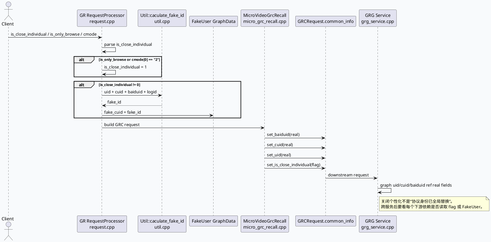

# 2026-07-11 业务库代码理解：关闭个性化 fake_id 从 GR 到 GRC/GRG 的责任切分
<!-- topic-nav:start -->
> 主题：`business/personalization-id` · 同题补充 / 历史版本 · [主题目录](README.md) · [先读主文](2026-07-04-close-individual-fakeid-cross-service-boundary.md)
<!-- topic-nav:end -->


> 日期：2026-07-11｜类型：业务库笔记  
> 今日主题来源：本机仅发现历史 `daily-plan-20260529.json`；按周六 fallback 选择 `GRC fake_id 关闭/替换链路`。已按任务要求设置 `BAIDU_CC_USERNAME=hujiyang`；本次没有 KU URL/doc-id，产品口径与线上实验需人工补充，以下结论来自本地代码库检索。

## 1. 架构全景图
<style>.bizarch711{font-family:-apple-system,BlinkMacSystemFont,"Segoe UI",sans-serif;background:#f8fafc;border:1px solid #dbe4ef;border-radius:18px;padding:18px;margin:16px 0;color:#1f2937}.bizarch711 .title{font-size:22px;font-weight:850;letter-spacing:-.02em;margin-bottom:6px}.bizarch711 .sub{font-size:13px;color:#64748b;margin-bottom:14px}.bizarch711 .lane{display:grid;grid-template-columns:repeat(4,1fr);gap:12px}.bizarch711 .box{background:#fff;border:1px solid #e5e7eb;border-radius:14px;padding:12px;min-height:160px}.bizarch711 h3{font-size:15px;margin:0 0 8px;color:#334155}.bizarch711 .ok{border-left:5px solid #2d6a4f}.bizarch711 .warn{border-left:5px solid #b45309}.bizarch711 .risk{border-left:5px solid #b91c1c}.bizarch711 .info{border-left:5px solid #3d5a80}.bizarch711 .muted{font-size:12px;color:#64748b;line-height:1.55}.bizarch711 .tag{display:inline-block;background:#e2e8f0;border-radius:999px;padding:2px 8px;font-size:12px;margin-top:8px}.bizarch711 .arrow{color:#64748b;font-size:12px;margin-top:8px}</style><div class="bizarch711"><div class="title">关闭个性化链路：GR 生成 fake_id，下游主要接收真实身份 + 语义标志</div><div class="sub">本次复核重点是跨服务边界：fake_id 是否替换协议身份，还是仅在 GR 局部依赖中使用。</div><div class="lane"><div class="box ok"><h3>GR 请求解析</h3><div class="muted">读取 `is_close_individual`；`is_only_browse` 或 `cmode` 首段为 2 时强制关闭个性化。</div><span class="tag">request.cpp:302-365</span><div class="arrow">生成 CommonInfo.fake_id</div></div><div class="box ok"><h3>FakeUser 发布</h3><div class="muted">请求开始先 `fake_user->clear()`；关闭个性化时写 `fake_user->fake_cuid = common_info->fake_id`。</div><span class="tag">request.cpp:155-175</span><div class="arrow">图内可消费 FakeUser</div></div><div class="box warn"><h3>GR → GRC</h3><div class="muted">GRCRequest 写入真实 `baiduid/cuid/uid`，同时额外写入 `is_close_individual`。</div><span class="tag">micro_grc_recall.cpp:547-578</span><div class="arrow">真实身份 + flag</div></div><div class="box risk"><h3>GRC/GRG 边界</h3><div class="muted">GRG 图入口直接 ref request.common_info 的真实 uid/cuid/baiduid；下游节点需自行落实关闭个性化语义。</div><span class="tag">grg_service.cpp:133-140</span><div class="arrow">责任不自动延续</div></div></div></div>

## 2. 核心调用链


## 3. 字段/责任信息图
```infographic
infographic compare-hierarchy-left-right-circle-node-pill-badge
data
  title fake_id 链路的两类责任：生成与消费
  desc GR 已生成 fake_id 不代表 GRC/GRG 所有依赖自动匿名化
  items
    - label GR 本地责任
      desc 解析关闭标志，生成 fake_id，发布 FakeUser，并在本地依赖中按需消费
      value 80
      icon mdi-check-circle
      children
        - label is_close_individual
          desc request 字段；非 0 即触发关闭个性化路径
        - label is_only_browse/cmode
          desc 浏览模式或 cmode 首段为 2 强制关闭个性化
        - label fake_id
          desc 由 uid/cuid/baiduid/logid 计算；请求级派生值
        - label FakeUser
          desc 图数据中写入 fake_cuid，供后续节点消费
    - label 下游服务责任
      desc 收到真实身份和关闭标志后，必须由自身节点落实禁用/替换个性化依赖
      value 60
      icon mdi-alert-circle
      children
        - label GRCRequest.common_info
          desc baiduid/cuid/uid 仍写真实值
        - label is_close_individual
          desc 作为语义标志透传
        - label GRG GraphData
          desc uid/cuid/baiduid ref request.common_info
        - label 内部 RPC/模型
          desc 需逐条确认是否读取 flag
```

## 4. 关键实现解读

### 4.1 关闭个性化入口不只看 `is_close_individual`
`request.cpp:302-365` 显示，入口先读取 `is_close_individual`；随后如果 `is_only_browse` 为真，或者 `cmode` 按 `_` 切分后的首段为 `2`，都会强制把 `is_close_individual` 置 1。换言之，排查时要同时查三类入口信号：显式关闭、只浏览模式、cmode。

### 4.2 fake_id 是请求级派生身份，不是稳定用户 ID
当 `is_close_individual != 0` 时，`request.cpp:361-365` 调用 `Util::caculate_fake_id(uid,cuid,baiduid,logid, fake_id)` 并写入 `fake_user->fake_cuid`。`util.cpp:563-569` 的实现会基于传入字段生成 hash 字符串；由于包含 logid，不能把它当跨请求稳定身份。

### 4.3 GR → GRC 没有把协议身份直接替换成 fake_id
`micro_grc_recall.cpp:547-559` 明确对 GRCRequest 的 `common_info` 写入真实 `baiduid/cuid/uid`，`micro_grc_recall.cpp:578` 再单独写 `is_close_individual`。因此跨服务传递的是“真实身份 + 关闭个性化语义标志”，不是已经完成匿名身份替换的协议。

### 4.4 GRG 图入口继续绑定真实身份字段
`grg_service.cpp:133-140` 将 `request->common_info().uid/cuid/baiduid` 直接 ref 到 GraphData。也就是说，如果 GRG 内部某个节点继续访问 UMS、画像、模型或个性化特征，不能默认上游已替换身份；要确认节点是否读取 `is_close_individual` 或其它 FakeUser 语义。

### 4.5 与基础库 DynamicTimeOut 的交叉排障点
同一业务请求如果进入 GRG 的 `news_updates_dibar`，`grg_service.cpp:186-190` 会把动态超时 scene 从 graph_name 改为 `short_micro_video`。所以排查“关闭个性化后某场景延迟异常”时，身份链路和动态超时 scene 映射要一起看。

## 5. 旁路流程图：news_updates_dibar 的动态超时 scene 映射
```plantuml
@startuml
skinparam handwritten false
skinparam backgroundColor #f8fafc
left to right direction
participant "GRG Request" as REQ
participant "GenericGRGService\nfill_basic_data_for_graph" as S
participant "DynamicTimeOutPlugin" as DT
participant "Graph Context" as CTX
REQ -> S: graph_name = news_updates_dibar
S -> S: scene = graph_name
alt scene == news_updates_dibar
  S -> S: scene = short_micro_video
end
S -> DT: set_request_timeout(dt_cntl, scene, timeout)
DT --> S: bind DTController
S -> CTX: timeout_cntl = dt_cntl
@enduml
```

## 6. Pitfalls 卡片
<style>.bizcard711{font-family:-apple-system,BlinkMacSystemFont,"Segoe UI",sans-serif;background:#f4f3f0;border:1px solid #d9d3c8;border-radius:18px;padding:18px;margin:16px 0;color:#1f2937}.bizcard711 .meta{font-size:12px;letter-spacing:.08em;text-transform:uppercase;color:#7c4a22;font-weight:800}.bizcard711 .title{font-size:26px;font-weight:850;letter-spacing:-.02em;margin:6px 0 10px}.bizcard711 .grid{display:grid;grid-template-columns:1.35fr 1fr;gap:12px}.bizcard711 .panel{background:#fff;border-top:4px solid #b45309;border-radius:12px;padding:12px;font-size:14px;line-height:1.65}.bizcard711 .panel strong{color:#7c2d12}.bizcard711 .end{font-weight:800;color:#7c2d12;margin-top:10px}</style><div class="bizcard711"><div class="meta">Pitfall / Privacy Boundary</div><div class="title">不要把 fake_id 生成误读成下游身份已替换</div><div class="grid"><div class="panel"><strong>容易误判：</strong>GR 入口确实生成了 fake_id，并写了 FakeUser；但 GR→GRC 协议里的 uid/cuid/baiduid 仍是真实值，下游只是额外拿到 `is_close_individual`。</div><div class="panel"><strong>正确做法：</strong>每新增一个 UMS/画像/模型/特征 RPC，都要检查它是否读取关闭个性化标志，或者是否显式使用 fake_cuid。</div></div><div class="end">∎ fake_id 是起点，不是全链路自动保证。</div></div>

## 7. 调试 checklist
```infographic
infographic list-column-done-list
data
  title 关闭个性化 fake_id 排障 checklist
  desc 按入口信号、fake_id 生成、跨服务协议、下游消费四步确认
  items
    - label 检查三类入口信号
      desc is_close_individual、is_only_browse、cmode 首段是否为 2
      done true
      icon mdi-toggle-switch
    - label 检查 fake_id 是否生成
      desc request.cpp 是否调用 Util::caculate_fake_id，并写入 FakeUser.fake_cuid
      done true
      icon mdi-fingerprint
    - label 检查 GRCRequest 字段
      desc common_info 中真实 baiduid/cuid/uid 与 is_close_individual 是否同时存在
      done true
      icon mdi-file-document-check
    - label 检查 GRG 图入口
      desc uid/cuid/baiduid GraphData 是否仍 ref request.common_info 的真实值
      done true
      icon mdi-graph
    - label 检查下游依赖消费
      desc UMS/画像/模型/特征 RPC 是否显式读取 flag 或 fake_cuid
      done true
      icon mdi-shield-search
```

## 8. 证据来源
- `src/processor/request.cpp:155-175`：请求解析阶段发布并清空 `FakeUser`。
- `src/processor/request.cpp:302-365`：解析 `is_close_individual`、`is_only_browse`、`cmode`，并在关闭个性化时计算 fake_id。
- `src/util/util.cpp:563-569`：`Util::caculate_fake_id` 生成 fake_id 字符串。
- `src/processor/micro_grc_recall.cpp:547-559`：GR → GRC 请求写入真实 `baiduid/cuid/uid`。
- `src/processor/micro_grc_recall.cpp:578`：GR → GRC 请求单独透传 `is_close_individual`。
- `src/service/grg_service.cpp:133-140`：GRG 图入口绑定 request.common_info 中的 uid/cuid/baiduid。
- `src/service/grg_service.cpp:186-190`：GRG `news_updates_dibar` 动态超时 scene 映射到 `short_micro_video`。

## 9. 需人工补充
- 产品侧“关闭个性化推荐”的完整口径：是否要求所有画像/模型请求禁用，还是只禁用部分推荐依赖。
- KU/周报中的实验 sid、灰度范围、线上监控指标与用户隐私合规验收标准。
