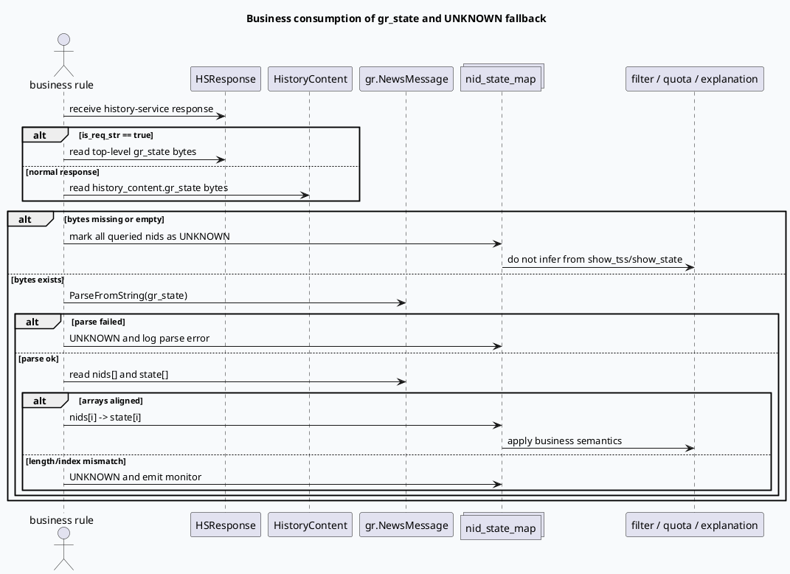

# 2026-07-12 业务库代码理解：点展状态 gr_state 的消费口径与 UNKNOWN 降级
<!-- topic-nav:start -->
> 主题：`business/state-semantics` · 同题补充 / 历史版本 · [主题目录](README.md) · [先读主文](2026-06-21-hs-state-business-semantics-grstate.md)
<!-- topic-nav:end -->


> 日期：2026-07-12｜类型：业务库笔记  
> 今日主题来源：本机未发现可用 `daily-plan` 文件；按周日 fallback 选择 History Service 点展状态业务语义，与今日基础库“HS gr_state 写入、读回与合并契约”配对。本篇聚焦业务侧如何安全消费 `gr_state`：什么时候可以解析为点展状态，什么时候必须降级为 UNKNOWN。已按任务要求设置 `BAIDU_CC_USERNAME=hujiyang`；当前未提供 KU URL/doc-id，策略口径与实验背景需人工补充，本文以本地代码库检索结果为准。  
> 路径规范：证据路径均使用相对路径，不包含机器本地绝对路径。

## 1. 架构全景图
<style>.biz0712{font-family:-apple-system,BlinkMacSystemFont,"Segoe UI",sans-serif;background:#f8fafc;border:1px solid #cbd5e1;border-radius:20px;padding:18px;margin:16px 0;color:#1f2937}.biz0712 .title{font-size:22px;font-weight:850;letter-spacing:-.02em;margin-bottom:6px}.biz0712 .sub{font-size:13px;color:#64748b;margin-bottom:14px}.biz0712 .grid{display:grid;grid-template-columns:1fr 1fr 1fr;gap:12px}.biz0712 .lane{background:#fff;border:1px solid #e5e7eb;border-radius:16px;padding:12px}.biz0712 h3{font-size:15px;color:#334155;margin:0 0 8px}.biz0712 .box{border-radius:12px;padding:10px;margin:8px 0;background:#f1f5f9;border-left:4px solid #3d5a80;font-size:13px;line-height:1.55}.biz0712 .ok{border-left-color:#2d6a4f;background:#eef7f2}.biz0712 .warn{border-left-color:#b45309;background:#fff7ed}.biz0712 .risk{border-left-color:#b91c1c;background:#fef2f2}.biz0712 .note{font-size:12px;color:#64748b;line-height:1.55;margin-top:10px}</style><div class="biz0712"><div class="title">业务消费 gr_state：先证明“状态存在”，再解释“状态含义”</div><div class="sub">`NewsMessage.state[]` 是五值点展状态数组；但业务拿到它的前提是响应里确实有 gr_state bytes，且 bytes 能成功解析并与 nids 对齐。</div><div class="grid"><div class="lane"><h3>可消费输入</h3><div class="box ok"><b>HistoryContent.gr_state</b><br/>普通响应模式下，业务从每个 `history_content` 读取状态 bytes。</div><div class="box"><b>HSResponse.gr_state</b><br/>`is_req_str=true` 时，状态可能位于顶层响应字段。</div><div class="box warn"><b>NewsMessage.state[]</b><br/>状态值是 `0/1/2/3/4`，必须与 `nids[]` 建立索引映射。</div></div><div class="lane"><h3>不可替代字段</h3><div class="box risk"><b>show_state/show_tss</b><br/>注释明确“给 grc 传递、不存 redis”，不能等价为稳定 gr_state。</div><div class="box warn"><b>show_tss/click_tss</b><br/>时间戳字段不是点展状态枚举，不能从时间戳猜测业务状态。</div><div class="box"><b>IssuedItem ts 编码</b><br/>基础库内部可用于 merge，但业务文档不应把它当 `NewsMessage.state[]` 替代品。</div></div><div class="lane"><h3>业务降级</h3><div class="box ok"><b>bytes 存在且解析成功</b><br/>构建 `nid -> state`，再进入过滤/频控/解释逻辑。</div><div class="box risk"><b>bytes 缺失</b><br/>状态应为 UNKNOWN，而不是 UNSHOW、ISSUED 或 CLICKED。</div><div class="box warn"><b>数组不对齐</b><br/>`nids[]` 与 `state[]` 长度/索引不一致时，必须打监控并降级。</div></div></div><div class="note">业务侧最重要的边界：没有 gr_state bytes 就没有状态事实；不要从辅助字段推导点展状态。</div></div>

## 2. 核心流程图


## 3. 状态口径信息图
```infographic
infographic list-grid-badge-card
data
  title gr_state 业务消费口径
  desc 五值状态只有在 bytes 存在、解析成功、数组对齐时才可使用
  items
    - label NO_ACTUAL_ISSUED
      desc value 0；没有实际下发，不等于“无状态”
      value 0
      icon mdi/numeric-0-circle
    - label ISSUED
      desc value 1；已下发
      value 1
      icon mdi/numeric-1-circle
    - label UNSHOW
      desc value 2；明确未展现，不能由 gr_state 缺失推断
      value 2
      icon mdi/numeric-2-circle
    - label SHOWED
      desc value 3；明确展现
      value 3
      icon mdi/numeric-3-circle
    - label CLICKED
      desc value 4；明确点击
      value 4
      icon mdi/numeric-4-circle
    - label UNKNOWN
      desc 业务降级态；bytes 缺失、解析失败、数组不对齐都应进入 UNKNOWN
      value -1
      icon mdi/help-circle
```

## 4. 关键结论

- 业务侧可解释状态的唯一稳妥入口是 `gr_state` bytes 解析出的 `gr::NewsMessage.state[]`，而不是 `show_state`、`show_tss`、`click_tss` 或 IssuedItem 的时间戳编码。
- `NewsMessage.state[]` 的五值语义是：`NO_ACTUAL_ISSUED=0`、`ISSUED=1`、`UNSHOW=2`、`SHOWED=3`、`CLICKED=4`。其中 `UNSHOW=2` 是明确状态，不能把“没有 gr_state”当成 `UNSHOW`。
- 响应读取位置取决于基础库的 `is_req_str` 分支：顶层 `HSResponse.gr_state` 与 `HistoryContent.gr_state` 都要覆盖，否则排查时容易误判“服务端没返回”。
- 当 `gr_state` 缺失、解析失败、`nids[]/state[]` 不对齐时，业务应该降级为 `UNKNOWN` 并记录监控；具体是否过滤、放行或保守降权，需要产品/策略口径人工补充。
- 基础库 `get_gr_state()` 有 provider、prefix、开关门禁；业务文档中不应写“读 SNDB 后一定有状态”，只能写“满足门禁并命中后可获得状态”。

## 5. Pitfalls 卡片
<style>.bizcard0712{font-family:-apple-system,BlinkMacSystemFont,"Segoe UI",sans-serif;background:#f4f3f0;border:1px solid #ded8ce;border-radius:18px;padding:18px;margin:18px 0;color:#2f3437}.bizcard0712 .meta{font-size:12px;letter-spacing:.08em;text-transform:uppercase;color:#7c6f64;font-weight:700}.bizcard0712 .title{font-size:24px;font-weight:850;letter-spacing:-.02em;margin:6px 0 12px}.bizcard0712 .grid{display:grid;grid-template-columns:1.2fr 1fr;gap:14px}.bizcard0712 .panel{background:#fffdf8;border-top:4px solid #2d6a4f;border-radius:14px;padding:12px;font-size:13px;line-height:1.65}.bizcard0712 .panel b{color:#1f4f3b}.bizcard0712 .end{font-size:18px;color:#2d6a4f;margin-top:8px}</style><div class="bizcard0712"><div class="meta">Pitfalls · business semantics</div><div class="title">最危险的业务误判：把“没有证据”写成“明确未展现”</div><div class="grid"><div class="panel"><b>缺失不是 UNSHOW。</b><br/>`UNSHOW=2` 是 state 数组里的明确枚举；无 bytes 时只能是 UNKNOWN。</div><div class="panel"><b>时间戳不是状态。</b><br/>`show_tss/click_tss` 可辅助排查，但不能替代 `NewsMessage.state[]`。</div><div class="panel"><b>show_state 不是稳定存储。</b><br/>注释说明它给 GRC 传递且不存 redis，不能当历史服务稳定读源。</div><div class="panel"><b>别只查一个响应位。</b><br/>`is_req_str` 不同导致状态 bytes 落点不同，排查脚本要同时看顶层和 HistoryContent。</div></div><div class="end">∎</div></div>

## 6. 调试 checklist
```infographic
infographic list-column-done-list
data
  title 业务侧 gr_state 消费 checklist
  desc 先确认状态事实，再讨论业务策略
  items
    - label 检查响应中是否存在 gr_state bytes
      desc 普通响应查 `HistoryContent.gr_state`，bytes 模式查 `HSResponse.gr_state`
      done true
    - label ParseFromString 前判空
      desc 空 bytes 直接降级 UNKNOWN
      done true
    - label 校验 `NewsMessage.nids[]` 与 `state[]` 对齐
      desc 长度或索引不一致时不要部分使用
      done true
    - label 区分五值状态与 UNKNOWN
      desc UNKNOWN 是消费侧降级态，不是 proto 中的 `0/1/2/3/4`
      done true
    - label 禁止用 `show_tss/click_tss` 推断状态
      desc 时间戳字段无法表达完整状态枚举
      done true
    - label 禁止把 `show_state` 当稳定存储字段
      desc 注释写明“不存 redis”
      done true
    - label 反查基础库门禁
      desc provider、prefix、开关、SNDB miss 都会导致没有 gr_state
      done true
```

## 7. 证据来源

- `proto/history_service.proto:165-174`：`HistoryContent.gr_state` 是业务常见响应承载位。
- `proto/history_service.proto:195-208`：`HSRequest.gr_state_read_sndb` 是 optional 读源开关。
- `proto/history_service.proto:212-218`：`HSResponse.gr_state` 是 `is_req_str` 场景的顶层承载位。
- `proto/redisprotocol.proto:168-169`：`NewsMessage` 以 `nids[]` 作为资源索引数组。
- `proto/redisprotocol.proto:238-239`：`show_state/show_tss` 注释为“给 grc 传递”，其中 `show_tss` 标注“不存 redis”。
- `proto/redisprotocol.proto:307`：`NewsMessage.state[]` 的五值点展状态定义。
- `src/dao/sndb_dao.cc:234-273`：基础库读 SNDB gr_state 的 provider、prefix、SNDB hit 和缓存写入门禁。
- `src/history/strategy.cc:513-526`：`state_merge_strategy()` 按 `is_req_str` 决定业务应读取的响应位置。

## 8. 需人工补充

- 业务策略对 UNKNOWN 的处理：放行、保守过滤、降权还是只打监控。
- 当前哪些调用方显式设置 `gr_state_read_sndb=true`，以及灰度范围。
- KU/周报中的点展状态指标口径、线上监控面板和报警 owner。