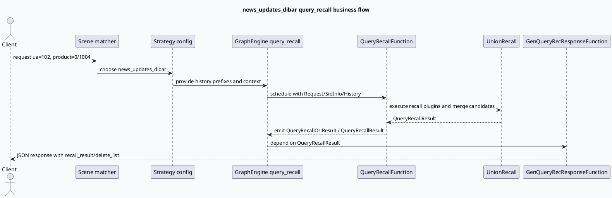

# 2026-07-17 业务代码理解：news_updates_dibar 场景到 query_recall 响应链
<!-- topic-nav:start -->
> 主题：`business/news-dibar` · 同题补充 / 历史版本 · [主题目录](README.md) · [先读主文](2026-06-18-news-updates-dibar-dual-content-flow.md)
<!-- topic-nav:end -->


> 本文补齐 MV-GR 业务侧链路：`news_updates_dibar` 如何由场景配置命中策略，携带多路历史前缀进入 `query_recall` 图，再经 `QueryRecallFunction`、`UnionRecall` 和 `GenQueryRecResponseFunction` 生成查询召回响应。

<style>
.nud-arch{font-family:Inter,Arial,sans-serif;background:#f8fafc;border:1px solid #d8e0ea;border-radius:8px;padding:18px;margin:16px 0;color:#1f2937}.nud-arch h3{margin:0 0 12px;font-size:18px}.nud-grid{display:grid;grid-template-columns:1fr 1.25fr 1fr;gap:12px}.nud-layer{background:#fff;border:1px solid #dbe3ef;border-radius:8px;padding:12px}.nud-layer h4{margin:0 0 10px;font-size:13px;color:#334155;text-transform:uppercase}.nud-box{border:1px solid #ccd6e3;border-radius:7px;padding:10px;margin:8px 0;background:#f8fafc}.nud-box strong{display:block;color:#1d4ed8;margin-bottom:4px}.nud-flow{display:flex;gap:8px;align-items:center;justify-content:center;margin:12px 0;color:#475569;font-size:12px}.nud-card{font-family:Inter,Arial,sans-serif;border:1px solid #d8e0ea;border-left:5px solid #c2410c;border-radius:8px;background:#fffaf6;padding:16px;margin:18px 0;color:#1f2937}.nud-card .meta{font-size:12px;font-weight:700;text-transform:uppercase;color:#9a3412}.nud-card .title{font-size:20px;font-weight:800;margin:6px 0 8px}.nud-card .body{font-size:14px;line-height:1.65}.nud-card .cols{display:grid;grid-template-columns:1fr 1fr;gap:10px;margin-top:12px}.nud-card .panel{background:#fff;border:1px solid #fed7aa;border-radius:7px;padding:10px;font-size:13px;line-height:1.55}
</style>
<div class="nud-arch">
<h3>业务链路全景：场景命中、策略装配、图内召回、响应生成</h3>
<div class="nud-grid">
<div class="nud-layer"><h4>Scene / Strategy</h4><div class="nud-box"><strong>scenes.conf</strong>`ua: 102` 且 `product: 0|1004` 命中 `news_updates_dibar`。</div><div class="nud-box"><strong>strategies.conf</strong>策略配置 `main_history: msv_`，并展开 target 0/2/4 的历史前缀。</div></div>
<div class="nud-layer"><h4>Graph: query_recall</h4><div class="nud-box"><strong>QueryRecallFunction</strong>依赖 Request、SidInfo、SmallHistory、MixPluginResult 等上下文，输出 QueryRecall 结果。</div><div class="nud-box"><strong>UnionRecall</strong>承接多路召回插件，把业务候选结果合并到图数据。</div></div>
<div class="nud-layer"><h4>Response Boundary</h4><div class="nud-box"><strong>GenQueryRecResponseFunction</strong>依赖 `QueryRecallResult`，写入 JSON 响应字段。</div><div class="nud-box"><strong>response graph</strong>`query_recall.conf` 把数据声明、处理函数和响应节点串起来。</div></div>
</div>
<div class="nud-flow">scene condition -> strategy history -> query_recall graph -> recall result -> JSON response</div>
</div>

## 核心流程



```infographic
infographic list-grid-badge-card
data
  title 配置与代码锚点
  desc query_recall 链路中最容易断开的 5 个节点
  items
    - label Scene 条件
      desc scenes.conf:451-456 将 ua/product 绑定到 news_updates_dibar
      icon mdi/source-branch
    - label Strategy 历史
      desc strategies.conf:1988-2002 配置 msv_ 和多 target 历史前缀
      icon mdi/history
    - label Graph 数据
      desc query_recall.conf:5-8 声明 QueryRecallOriResult 与 QueryRecallResult
      icon mdi/graph-outline
    - label Recall 函数
      desc query_recall.cpp:217-230 声明 emit/depend 并注册函数
      icon mdi/call-merge
    - label Response 函数
      desc gen_response_query_rec.cpp:18-129 生成 JSON 返回并注册函数
      icon mdi/code-json
theme
  palette #3d5a80 #2d6a4f #c2410c
```

## 代码解读

`news_updates_dibar` 的业务入口首先在 `scenes.conf:451-456` 通过 UA 和 product 条件绑定同名 strategy。这个配置的意义不是直接决定召回实现，而是把请求归入一个业务场景，使后续策略读取到对应的历史、实验和图配置。

`strategies.conf:1988-2002` 展开了 `main_history: msv_` 以及 target 0、2、4 的 `@key_prefix: msv_`。这说明该场景依赖微视频历史前缀做召回上下文，排查“召回为空”时需要先确认历史是否被正确读取，而不是只看召回插件本身。

`query_recall.conf:5-8` 声明 `QueryRecallOriResult` 和 `QueryRecallResult`，`query_recall.conf:38-50` 继续把 `GenQueryRecResponseFunction` 放在响应阶段。图配置将业务召回结果从处理阶段传递到响应阶段，任何 emit/depend 名称不一致都会表现为响应层拿不到数据。

`query_recall.cpp:217-230` 注册 `QueryRecallFunction`，并通过图宏声明输入依赖和输出数据。`union_recall.cpp:18-377` 是多路召回插件的聚合实现，业务侧新增或调整召回时，应确认插件结果是否进入 UnionRecall 的合并路径。

`gen_response_query_rec.cpp:18-129` 是最终响应边界。它依赖 `QueryRecallResult`，设置 `load_history`、`delete_list` 等 JSON 字段，并遍历 `_query_recall_result` 写回响应；因此响应缺字段时，排查顺序应从图数据是否存在开始，再看 JSON 写入分支。

<div class="nud-card">
<div class="meta">Pitfall Card</div>
<div class="title">不要把“业务场景未命中”误判为“召回插件失败”</div>
<div class="body">`news_updates_dibar` 的链路跨越 scene、strategy、graph 和 response 四层。只看 `UnionRecall` 或 response JSON 很容易漏掉前置条件：UA/product 没命中、history prefix 错、graph 数据名不匹配，都会让下游表现为“没有召回结果”。</div>
<div class="cols">
<div class="panel"><strong>先验条件</strong><br>确认 `scenes.conf` 命中 `ua: 102` 和 `product: 0|1004`，并选择同名 strategy。</div>
<div class="panel"><strong>数据契约</strong><br>确认 `QueryRecallResult` 在图配置、C++ emit/depend 宏、响应函数中拼写一致。</div>
</div>
</div>

```infographic
infographic list-column-done-list
data
  title 调试 checklist
  desc 从入口条件到响应字段的最短排查路径
  items
    - label 检查场景命中：ua/product 是否进入 news_updates_dibar
      done true
    - label 检查 strategy history：msv_ 前缀与 target 列表是否符合预期
      done true
    - label 检查 query_recall.conf：data/function/response 节点是否完整
      done true
    - label 检查 QueryRecallFunction：emit/depend 宏是否与配置数据名一致
      done true
    - label 检查 GenQueryRecResponseFunction：是否拿到非空 QueryRecallResult
      done true
theme
  palette #3d5a80 #2d6a4f #c2410c
```

## 证据来源

- `output/conf/plugins/scenes.conf:451-456`：`news_updates_dibar` 场景条件与 strategy 绑定。
- `output/conf/plugins/strategies.conf:1988-2002`：同名 strategy 的历史前缀配置。
- `output/conf/plugins/graph/query_recall.conf:5-50`：`QueryRecallResult` 数据声明和 `GenQueryRecResponseFunction` 响应节点。
- `src/processor/query_recall.cpp:217-230`：`QueryRecallFunction` 的图数据 emit/depend 与注册。
- `src/plugin/union_recall.cpp:18-377`：多路召回聚合实现。
- `src/processor/gen_response_query_rec.cpp:18-129`：响应 JSON 生成边界。
