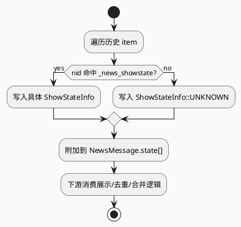

# 2026-07-19 业务代码理解：`gr_state` 业务消费与 `UNKNOWN` 回退语义
<!-- topic-nav:start -->
> 主题：`business/state-semantics` · 同题补充 / 历史版本 · [主题目录](README.md) · [先读主文](2026-06-21-hs-state-business-semantics-grstate.md)
<!-- topic-nav:end -->


> 本文补齐业务侧链路：新闻/历史卡片如何在构造 `NewsMessage` 时读取 show-state，并在缺失状态时回退到 `ShowStateInfo::UNKNOWN`。重点不是单点字段，而是“业务可消费状态”如何从 history 层透传出来并在召回/下发链路中保持可解释。

<style>
.bs-arch{font-family:Inter,Arial,sans-serif;background:#f8fafc;border:1px solid #d7dee8;border-radius:8px;padding:18px;margin:16px 0;color:#1f2937}.bs-arch h3{margin:0 0 12px;font-size:18px}.bs-grid{display:grid;grid-template-columns:1.05fr 1.3fr 1.05fr;gap:12px}.bs-box{background:#fff;border:1px solid #dbe3ef;border-radius:8px;padding:12px}.bs-box h4{margin:0 0 8px;font-size:13px;color:#334155}.bs-box ul{margin:0;padding-left:18px}.bs-box li{margin:4px 0;line-height:1.45}.bs-tag{display:inline-block;padding:2px 8px;border-radius:999px;background:#dcfce7;color:#166534;font-size:11px;font-weight:700;letter-spacing:0}.bs-flow{margin-top:12px;display:grid;grid-template-columns:repeat(4,1fr);gap:10px}.bs-node{border:1px solid #cfd9e5;border-radius:8px;background:#fff;padding:10px;min-height:92px}.bs-node strong{display:block;margin-bottom:6px;font-size:12px;color:#0f172a}.bs-node p{margin:0;font-size:12px;line-height:1.45;color:#334155}.bs-arrow{margin-top:8px;color:#64748b;font-size:12px}.bs-note{margin-top:10px;font-size:12px;color:#475569}.bs-mini{margin-top:12px;display:grid;grid-template-columns:1fr 1fr;gap:10px}.bs-mini .bs-mini-card{border:1px solid #dbe3ef;border-radius:8px;background:#fff;padding:10px}.bs-mini .bs-mini-card h5{margin:0 0 6px;font-size:12px;color:#334155}.bs-mini .bs-mini-card p{margin:0;font-size:12px;line-height:1.45;color:#475569}</style>

<div class="bs-arch">
  <h3>业务侧 `gr_state` 消费全景</h3>
  <div class="bs-grid">
    <div class="bs-box">
      <h4>历史/召回上下文</h4>
      <ul>
        <li><span class="bs-tag">gr/history/news_history.cc</span> 组装 `NewsMessage`。</li>
        <li>业务判断依据来自 `_news_showstate` 与历史状态映射。</li>
        <li>缺省时显式写入 `ShowStateInfo::UNKNOWN`，避免空状态。</li>
      </ul>
    </div>
    <div class="bs-box">
      <h4>状态消费层</h4>
      <ul>
        <li>下游业务读取 `news_msg->state[]` 来决定是否展示、去重或补历史。</li>
        <li>状态不一定来自目标 item 的原始字段，而是从 gr_state / showstate 映射中透传。</li>
        <li>如果状态缺失，业务应按 UNKNOWN 处理，而不是默认为可展示。</li>
      </ul>
    </div>
    <div class="bs-box">
      <h4>边界与解释</h4>
      <ul>
        <li>状态值是业务语义，不是存储结构的裸拷贝。</li>
        <li>写回和读回都要保持同一套枚举含义。</li>
        <li>UNKNOWN 是兜底语义，不是错误码替代品。</li>
      </ul>
    </div>
  </div>
  <div class="bs-flow">
    <div class="bs-node"><strong>1. 构建消息</strong><p>`news_history.cc` 遍历历史 item，把可见状态装入 `NewsMessage`。</p><div class="bs-arrow">↓</div></div>
    <div class="bs-node"><strong>2. 匹配状态</strong><p>若 `_news_showstate` 中存在对应 nid，就写入具体 show state。</p><div class="bs-arrow">↓</div></div>
    <div class="bs-node"><strong>3. 缺省回退</strong><p>找不到状态时写入 `ShowStateInfo::UNKNOWN`，让下游可解释。</p><div class="bs-arrow">↓</div></div>
    <div class="bs-node"><strong>4. 下游消费</strong><p>召回、展示、合并、去重模块据此决定后续动作。</p></div>
  </div>
  <p class="bs-note">业务侧最重要的约束是“状态存在时要可追踪，状态不存在时要显式 UNKNOWN”。这样才能避免把缺失状态误判成可展示或已展示。</p>
  <div class="bs-mini">
    <div class="bs-mini-card"><h5>状态透传</h5><p>状态不是只写在一个对象上，而是沿着召回结果、消息体和历史映射一路传递，最终影响业务结果。</p></div>
    <div class="bs-mini-card"><h5>UNKNOWN 语义</h5><p>UNKNOWN 表示当前没有可证实状态，不应被当作正常已知状态继续参与强假设逻辑。</p></div>
  </div>
</div>

## 核心流程



## 状态与语义

```infographic
compare-binary-horizontal-underline-text-vs
data
  title 业务状态的两种结果
  desc 命中历史状态时写具体值，未命中时写 UNKNOWN
  items
    - label 命中历史映射
      desc _news_showstate 中有对应 nid，写入具体 ShowStateInfo
      icon mdi/check-circle
    - label 未命中历史映射
      desc 明确回退为 ShowStateInfo::UNKNOWN，避免空值歧义
      icon mdi/help-circle
    - label 下游消费
      desc 展示、去重、合并模块读取 state[] 决策
      icon mdi/eye
    - label 语义要求
      desc UNKNOWN 是兜底，不是“可以忽略”的空字段
      icon mdi/alert-circle
theme
  palette #2d6a4f #3d5a80 #f97316
```

## Pitfalls

<div style="background:#fff;border:1px solid #dbe3ef;border-radius:8px;padding:14px;margin:14px 0;">
  <div style="border-left:4px solid #b45309;padding-left:12px;">
    <div style="font-weight:700;color:#0f172a;margin-bottom:6px;">不要把 `UNKNOWN` 当成“无意义状态”</div>
    <div style="color:#334155;line-height:1.55;">它是业务显式兜底。若下游把 UNKNOWN 当成可展示状态，历史回流会污染召回链路，尤其在状态缺失较多时。</div>
  </div>
</div>
<div style="background:#fff;border:1px solid #dbe3ef;border-radius:8px;padding:14px;margin:14px 0;">
  <div style="border-left:4px solid #b45309;padding-left:12px;">
    <div style="font-weight:700;color:#0f172a;margin-bottom:6px;">不要假设状态一定来自 item 自身字段</div>
    <div style="color:#334155;line-height:1.55;">当前链路是通过历史映射把状态透出来的。直接读原始 item 字段，往往会错过业务层补写或合并后的真实语义。</div>
  </div>
</div>

## 调试 Checklist

```infographic
list-column-done-list
data
  title 排障顺序
  desc 先看状态是否匹配，再看是否正确回退为 UNKNOWN
  items
    - label 检查 gr/history/news_history.cc 是否在命中时写入具体 show state
      done true
    - label 检查未命中时是否显式写入 ShowStateInfo::UNKNOWN
      done true
    - label 检查 NewsMessage.state[] 是否完整随结果流转
      done true
    - label 检查下游是否把 UNKNOWN 误判为可展示状态
      done true
    - label 检查召回/合并阶段是否丢失历史映射信息
      done true
    - label 检查状态来源是否被错误地简化为原始 item 字段
      done true
theme
  palette #2d6a4f #64748b #3d5a80
```

## 证据来源

- `gr/history/news_history.cc:296-307` — 命中状态时写入具体值，未命中时回退 `UNKNOWN`
- `gr/history/news_history.cc:1054-1115` — `gr_state` 合并与历史布局处理
- `gr/history/history.h:397-417` — History 对象与上下文初始化骨架
- `gr/history/news_history.h` — 业务历史链路入口定义
- `gr-proto/proto/history_service.proto:159-168` — `HistoryContent.gr_state`
- `gr-proto/proto/history_service.proto:212-218` — `HSResponse.gr_state` 的返回语义
