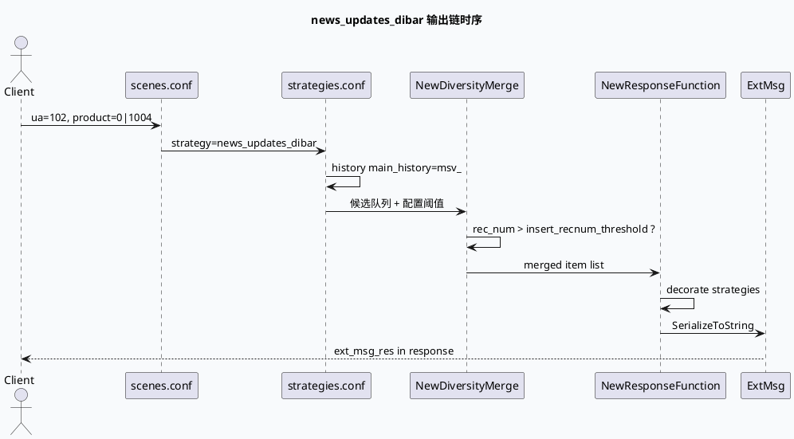
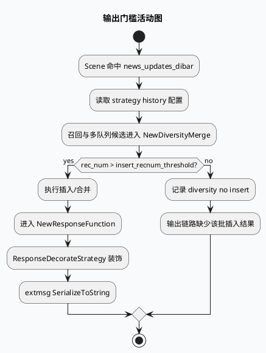

# 2026-07-20 业务代码理解：`news_updates_dibar` 多队列合并到响应输出链
<!-- topic-nav:start -->
> 主题：`business/news-dibar` · 同题补充 / 历史版本 · [主题目录](README.md) · [先读主文](2026-06-18-news-updates-dibar-dual-content-flow.md)
<!-- topic-nav:end -->


> 今日未发现可用的 daily-plan 文件，按周一 fallback 主题分析“业务输出链”。本文聚焦 `news_updates_dibar` 场景如何从 scene/strategy 配置进入多队列合并，再落到 `NewResponseFunction`/`ResponseFunction` 的 extmsg 序列化输出边界。

<style>
.nd-arch{font-family:Inter,Arial,sans-serif;background:#f8fafc;border:1px solid #d7dee8;border-radius:8px;padding:18px;margin:16px 0;color:#1f2937}.nd-arch h3{margin:0 0 12px;font-size:18px}.nd-grid{display:grid;grid-template-columns:1fr .32fr 1.05fr .32fr 1.1fr;gap:10px;align-items:stretch}.nd-box{background:#fff;border:1px solid #dbe3ef;border-radius:8px;padding:12px}.nd-box h4{margin:0 0 8px;font-size:14px;color:#334155}.nd-box p{margin:4px 0;font-size:13px;line-height:1.55}.nd-a{border-top:4px solid #3d5a80}.nd-b{border-top:4px solid #2d6a4f}.nd-c{border-top:4px solid #b45309}.nd-arrow{text-align:center;color:#64748b;font-size:24px;font-weight:700;padding-top:38px}.nd-chip{display:inline-block;background:#e8eef6;color:#27445f;border-radius:999px;padding:2px 8px;font-size:12px;margin:2px 4px 2px 0}@media(max-width:920px){.nd-grid{grid-template-columns:1fr}.nd-arrow{display:none}}</style><div class="nd-arch"><h3>架构全景：scene 命中到 response 输出</h3><div class="nd-grid"><div class="nd-box nd-a"><h4>Scene Router</h4><p><span class="nd-chip">UA 102</span><span class="nd-chip">product 0|1004</span></p><p>`scenes.conf` 将请求命中到 `news_updates_dibar` strategy。</p></div><div class="nd-arrow">→</div><div class="nd-box nd-b"><h4>Strategy + Merge</h4><p><span class="nd-chip">history</span><span class="nd-chip">NewDiversityMerge</span></p><p>`strategies.conf` 配置历史前缀，merge 阶段按推荐量门槛控制插入。</p></div><div class="nd-arrow">→</div><div class="nd-box nd-c"><h4>Response Function</h4><p><span class="nd-chip">extmsg</span><span class="nd-chip">SerializeToString</span></p><p>`NewResponseFunction` 装饰响应并序列化 extmsg，形成最终透传边界。</p></div></div></div>

## 核心结论

`news_updates_dibar` 的业务输出链不是一个单函数问题，而是配置、合并和响应函数共同构成的闭环：scene 配置决定是否进入该 strategy，strategy 配置决定历史和召回上下文，merge 函数决定候选能否进入输出队列，response function 最后把扩展信息序列化进响应。



## 配置入口

`scenes.conf:450-456` 显示 `news_updates_dibar` scene 的命中条件：`ua: 102` 且 `product: 0|1004`，随后绑定同名 strategy。这个入口是业务排查的第一步：如果线上请求没有命中 UA/product 条件，后续 merge/response 代码再正确也不会进入这条链路。

`strategies.conf:1988-2002` 进入 `[@strategy] name: news_updates_dibar`，并配置 `.history`：`main_history: msv_`、`is_clicked_only: 0`、`is_all_history: 1`，以及 target/key_prefix。它说明该策略不是纯响应拼装，还依赖历史前缀与历史读取策略来影响候选和去重上下文。

```infographic
infographic hierarchy-tree-tech-style-capsule-item
data
  title news_updates_dibar 配置结构
  desc 从 scene 条件到 strategy history 的最小可查路径
  items
    - label scene
      desc scenes.conf:450-456
      children
        - label ua 102
          desc 业务入口条件
        - label product 0|1004
          desc 产品条件
        - label strategy news_updates_dibar
          desc 路由到同名策略
    - label strategy
      desc strategies.conf:1988-2002
      children
        - label main_history msv_
          desc 主历史前缀
        - label is_clicked_only 0
          desc 不只看点击历史
        - label is_all_history 1
          desc 读取全量历史语义
theme
  palette #3d5a80 #2d6a4f #b45309
```

## 合并与响应边界

`new_diversity_merge.cpp:50-66` 从配置读取 `_insert_recnum_threshold`，`new_diversity_merge.cpp:205-222` 在输出阶段检查 `rec_num > _insert_recnum_threshold`；当推荐量不足时会记录 `diversity no insert`。因此，排查“为什么没有插入/为什么输出少”时，不能只看 response function，需要先确认 merge 阶段的推荐数量是否越过阈值。

`new_response_function.cpp:23-60` 定义 `NewResponseFunction` 并在初始化阶段加载 `ResponseDecorateStrategy`；`new_response_function.cpp:105-125` 和 `new_response_function.cpp:235-255` 都出现 `extmsg.SerializeToString(...)`，表明扩展字段最终通过 protobuf 序列化进入响应。老链路 `response_function.cpp:4208-4225`、`response_function.cpp:4880-4896` 也有相同序列化边界，可用于对比新旧 response 行为。



<style>
.nd-card{font-family:Inter,Arial,sans-serif;background:#fbfaf7;border:1px solid #e3ded4;border-left:6px solid #b45309;border-radius:8px;padding:16px;margin:16px 0;color:#2f2a24}.nd-card h3{margin:0 0 10px;font-size:18px}.nd-card-grid{display:grid;grid-template-columns:1.1fr 1fr 1fr;gap:12px}.nd-panel{background:#fff;border:1px solid #e7e0d5;border-radius:8px;padding:12px}.nd-panel strong{display:block;margin-bottom:6px;color:#7c3f10}.nd-panel p{margin:0;font-size:13px;line-height:1.6}@media(max-width:860px){.nd-card-grid{grid-template-columns:1fr}}</style><div class="nd-card"><h3>Pitfalls：业务输出少不一定是 response 丢字段</h3><div class="nd-card-grid"><div class="nd-panel"><strong>入口未命中</strong><p>先看 `ua` 和 `product` 是否进入 `news_updates_dibar`，否则后续代码证据不适用。</p></div><div class="nd-panel"><strong>merge 门槛截断</strong><p>`rec_num` 未超过 `insert_recnum_threshold` 时会跳过插入，表现为响应侧“自然缺失”。</p></div><div class="nd-panel"><strong>新旧链路混查</strong><p>`NewResponseFunction` 与老 `ResponseFunction` 都有 extmsg 序列化，排查时要确认线上实际 graph 绑定哪条链。</p></div></div></div>

```infographic
infographic list-column-done-list
data
  title 调试 Checklist
  desc news_updates_dibar 输出异常的最短排查路径
  items
    - label 查 scene 条件
      desc 确认 ua=102 与 product=0|1004 命中 scenes.conf
      done true
      icon mdi/radar
    - label 查 strategy history
      desc 确认 main_history、is_clicked_only、is_all_history 与预期一致
      done true
      icon mdi/history
    - label 查 merge 阈值
      desc 对比 rec_num 与 insert_recnum_threshold，关注 diversity no insert 日志
      done true
      icon mdi/filter-check-outline
    - label 查 response 链版本
      desc 确认使用 NewResponseFunction 还是老 ResponseFunction
      done true
      icon mdi/source-branch
    - label 查 extmsg 序列化
      desc 对齐 SerializeToString 前的字段填充与最终透传内容
      done true
      icon mdi/package-variant-closed-check
theme
  palette #3d5a80 #2d6a4f #b45309
```

## 证据来源

- `scenes.conf:450-456`：`news_updates_dibar` scene 条件与 strategy 绑定。
- `strategies.conf:1988-2002`：`news_updates_dibar` strategy 的 history 配置。
- `new_diversity_merge.cpp:50-66`：读取 `insert_recnum_threshold`。
- `new_diversity_merge.cpp:205-222`：按 `rec_num` 与阈值决定是否插入。
- `new_response_function.cpp:23-60`：`NewResponseFunction` 与装饰策略加载。
- `new_response_function.cpp:105-125`、`new_response_function.cpp:235-255`：`extmsg.SerializeToString` 输出边界。
- `response_function.cpp:4208-4225`、`response_function.cpp:4880-4896`：老链路 extmsg 序列化对照。

## 需人工补充

内网 KU/daily-plan 未在本次 cron 环境中定位到今日主题，本文使用代码库检索和历史周一 fallback 主题生成。若当天实际规划另有 KU 文档，需要人工补充对应业务背景链接。