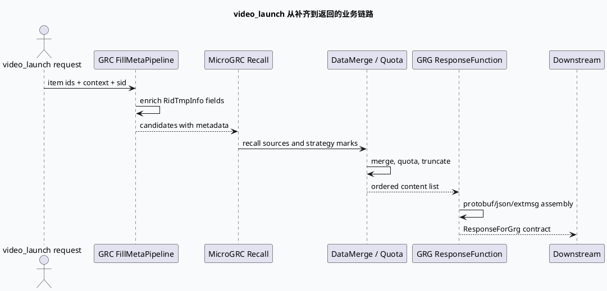

# 2026-07-24 周五代码理解：GRC video_launch 响应出口与 GRG 返回契约

> 本文基于本地 `feeda-mv-grc`、`feeda-mv-gr` 与 `feeda-mv-grg` 代码阅读生成；未读取到 daily-plan 文件，也未获得可直接读取的 KU 背景文档，线上实验、指标口径和策略负责人需人工补充。业务侧关注点是：`video_launch` 候选在 GRC 补齐后，如何穿过 MicroGRC 召回与 GRG 响应装配，最终形成可被下游解析的返回契约。

## 1. 架构全景图：从 GRC 补齐到 GRG 响应
<style>.arch-vr{font-family:-apple-system,BlinkMacSystemFont,"Segoe UI",sans-serif;background:#f8fafc;border:1px solid #d9e2ec;border-radius:12px;padding:18px;margin:16px 0;color:#243b53}.arch-vr-title{font-size:22px;font-weight:850;margin-bottom:12px;color:#102a43}.arch-vr-grid{display:grid;grid-template-columns:1fr 1fr 1fr;gap:12px}.arch-vr-layer{background:#fff;border:1px solid #d9e2ec;border-radius:10px;padding:12px}.arch-vr-layer h3{margin:0 0 10px;font-size:15px;color:#334e68}.arch-vr-box{border-left:4px solid #2d6a4f;background:#f4fbf8;padding:10px;margin:8px 0;border-radius:8px}.arch-vr-box strong{display:block;color:#102a43;margin-bottom:4px}.arch-vr-note{font-size:12px;line-height:1.55;color:#52606d}.arch-vr-flow{display:flex;gap:8px;align-items:center;justify-content:space-between;margin-top:14px}.arch-vr-step{flex:1;background:#eef4ff;border:1px solid #c7d8ff;border-radius:9px;padding:9px;text-align:center;font-weight:700;font-size:13px}.arch-vr-arrow{color:#486581;font-weight:900}@media(max-width:820px){.arch-vr-grid{grid-template-columns:1fr}.arch-vr-flow{flex-direction:column}.arch-vr-arrow{transform:rotate(90deg)}}</style><div class="arch-vr"><div class="arch-vr-title">video_launch 业务响应链路</div><div class="arch-vr-grid"><div class="arch-vr-layer"><h3>GRC 元数据出口</h3><div class="arch-vr-box"><strong>FillMetaPipelineFunction</strong><span>补齐内容、作者、卡片类型、短剧等响应前置字段。</span></div><div class="arch-vr-box"><strong>GCMS / Dict</strong><span>把外部内容元信息转成 RidTmpInfo 可携带字段。</span></div></div><div class="arch-vr-layer"><h3>MicroGRC 召回边界</h3><div class="arch-vr-box"><strong>micro_grc_recall.cpp</strong><span>承接 video_launch 召回请求、策略标记和候选集。</span></div><div class="arch-vr-box"><strong>DataMerge / quota</strong><span>控制不同召回源在响应前的配额、合并和截断。</span></div></div><div class="arch-vr-layer"><h3>GRG 返回契约</h3><div class="arch-vr-box"><strong>response_function.cpp</strong><span>把候选内容组装为 GRG 响应，处理 protobuf、base64、json/extmsg。</span></div><div class="arch-vr-box"><strong>ResponseForGrg</strong><span>下游真正依赖的是字段完整、可解析、语义稳定的响应结构。</span></div></div></div><div class="arch-vr-flow"><div class="arch-vr-step">FillMeta</div><div class="arch-vr-arrow">→</div><div class="arch-vr-step">MicroGRC Recall</div><div class="arch-vr-arrow">→</div><div class="arch-vr-step">Merge / Quota</div><div class="arch-vr-arrow">→</div><div class="arch-vr-step">ResponseForGrg</div></div><div class="arch-vr-note">业务排查不要只看最终响应。字段缺失、候选丢失和 extmsg 异常分别可能发生在 FillMeta、召回合并和 GRG 响应装配三个边界。</div></div>

## 2. 核心流程：video_launch 响应契约时序


## 3. 配置/结构信息图：响应契约的字段风险点
```infographic
infographic compare-hierarchy-left-right-circle-node-pill-badge
data
  title ResponseForGrg 契约风险拆分
  desc 同一个响应异常，可能来自补齐、召回、合并或序列化阶段
  items
    - label GRC 补齐侧
      desc 关注内容元信息、作者关系、卡片类型、短剧字段和 GCMS 缺口。
      value FillMeta
      children
        - label metadata
          desc GCMS / DictManager
        - label routing
          desc 普通、卡片、短剧通道
    - label GRG 响应侧
      desc 关注候选顺序、配额截断、extmsg 组装和 protobuf/base64 可解析性。
      value Response
      children
        - label merge
          desc DataMerge / quota
        - label encode
          desc protobuf / json / extmsg
theme
  palette #2d6a4f #2f80a7 #b7791f #52606d
```

## 4. 关键代码阅读结论

`src/processor/video_launch/fill_meta_pipeline.cpp:19-38` 显示 video_launch 的基础补齐以 `PipelineGraphFunction` 节点形式运行，输出是 `ChannelPublisher<RidTmpInfo*>`。业务层看到的候选并不是原始召回 item，而是经过图节点补齐和通道分发后的候选。

`src/processor/video_launch/fill_meta_pipeline.cpp:628-643` 通过 `GRAPH_FUNCTION_DEPEND_DATA` 声明 SidInfo、搜索落地页标记、关注集合等依赖，并以 `REGISTER_GRC_FUNCTION(FillMetaPipelineFunction)` 注册。业务排查时，如果某个 sid 或落地页场景只在部分流量中缺字段，应优先核对该依赖数据是否在对应图分支被生产。

`src/process/response_function.cpp:1-17` 引入 protobuf message、snappy、base64、json util、showlist 等响应装配依赖。这说明 GRG 侧不是简单透传，而是会把候选内容、扩展字段和编码格式重新组装成下游契约。任何字段格式变化都可能成为兼容性问题。

`src/processor/micro_grc_recall.cpp:1-23` 引入 sid、history、strategy、grc plugin、protobuf sample、json util、base64 和 localtime manager，说明 MicroGRC 召回边界同时依赖用户上下文、策略数据和编码解析。video_launch 的召回结果进入 GRG 前，必须把召回源语义和响应字段语义分清。

## 5. Pitfalls 卡片
<style>.pit-vr{font-family:-apple-system,BlinkMacSystemFont,"Segoe UI",sans-serif;background:#f7fbfd;border:1px solid #c7d8e5;border-radius:12px;padding:16px;margin:16px 0;color:#243b53}.pit-vr-title{font-weight:850;font-size:18px;margin-bottom:10px}.pit-vr-grid{display:grid;grid-template-columns:1fr 1fr;gap:12px}.pit-vr-panel{background:#fff;border-top:4px solid #2d6a4f;border-radius:8px;padding:12px;line-height:1.6}.pit-vr-panel strong{display:block;color:#1f5138;margin-bottom:4px}@media(max-width:760px){.pit-vr-grid{grid-template-columns:1fr}}</style><div class="pit-vr"><div class="pit-vr-title">video_launch 响应排查常见误区</div><div class="pit-vr-grid"><div class="pit-vr-panel"><strong>把召回异常误判为响应异常</strong>如果候选在 MicroGRC 或 DataMerge 前已经被截断，GRG ResponseFunction 只能组装剩余结果。</div><div class="pit-vr-panel"><strong>只验证字段存在，不验证可解析性</strong>extmsg、protobuf、base64 字段即使存在，也可能因编码或 schema 变更导致下游解析失败。</div><div class="pit-vr-panel"><strong>忽略 sid/场景分支</strong>video_launch 的特定 sid、落地页和卡片类型会改变 FillMeta 依赖与通道，问题可能只在分支流量中出现。</div><div class="pit-vr-panel"><strong>把 GCMS 缺口当成策略过滤</strong>字段为空继续流转时，最终表现像业务策略没命中，实际可能是内容元信息没有补齐。</div></div></div>

## 6. 调试 checklist
```infographic
infographic list-column-done-list
data
  title video_launch 响应契约调试路径
  desc 从字段来源到最终编码逐层排查
  items
    - label 先看 FillMeta 输出字段
      desc 确认 RidTmpInfo 是否已经带齐下游 ResponseForGrg 需要的元数据。
      done true
    - label 再看 MicroGRC 召回语义
      desc 区分召回源为空、策略过滤、配额截断和响应装配失败。
      done true
    - label 检查 DataMerge 顺序与 quota
      desc 响应数量异常时先核对 merge 前后候选数量。
      done true
    - label 验证 extmsg/protobuf 可解析性
      desc 字段存在不代表下游可解析，编码格式和 schema 要一起校验。
      done true
    - label 按 sid 和场景复现
      desc 对 video_launch、landing、卡片/短剧类型分别构造最小复现场景。
      done true
theme
  palette #2d6a4f #2f80a7 #b7791f #52606d
```

## 7. 证据来源

- `src/processor/video_launch/fill_meta_pipeline.cpp:19-38`：`FillMetaPipelineFunction` 类、vertex 绑定与 `ChannelPublisher` 打开。
- `src/processor/video_launch/fill_meta_pipeline.cpp:628-643`：依赖数据声明与 GRC 函数注册。
- `src/process/response_function.cpp:1-17`：GRG 响应装配依赖，包括 protobuf、base64、json、showlist。
- `src/processor/micro_grc_recall.cpp:1-23`：MicroGRC 召回依赖，包括 sid、history、strategy、grc plugin、sample protobuf。

## 8. 需人工补充

- daily-plan 未在本机检索到，本次按当天业务链路代码证据生成。
- KU 背景文档未接入，业务目标、线上实验、指标口径、异常 case 和负责人需人工补充。

---

<!-- 以下适配分析章节来自 GitHub 侧版本，合并时保留 -->

> 内容整理：仅有分析时间与目标库信息的空附录，已移出正文。[查看原始版本及附录](https://github.com/1998-program/cpp-core-notes/blob/5738832bab4b13ba26356af0a37a0a32e477b675/notes/business-lib/20260724-grc-video-launch-response-contract.md)。
