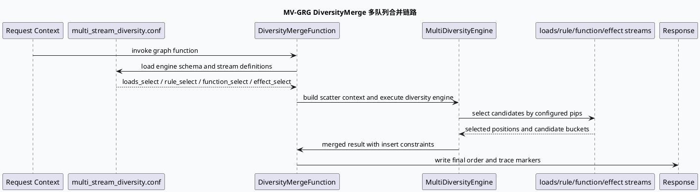

# MV-GRG DiversityMerge：多队列合并与响应边界
<!-- topic-nav:start -->
> 主题：`business/diversity-merge` · 同题补充 / 历史版本 · [主题目录](README.md) · [先读主文](20260619-grg-new-diversity-merge-multistream-engine.md)
<!-- topic-nav:end -->


> 运行说明：2026-08-04 未发现 daily-plan 文件，本篇按历史未覆盖主题 fallback 生成。KU/业务背景检索不可用时需人工补充；当前结论基于 MV-GRG 代码和配置证据。

<style>.arch-mvgrg{font-family:Inter,Arial,sans-serif;background:#f8fafc;border:1px solid #dbe4ef;border-radius:8px;padding:16px;color:#1f2937}.arch-mvgrg .title{font-size:20px;font-weight:800;margin-bottom:12px}.arch-mvgrg .band{border:1px solid #cbd5e1;border-radius:8px;background:#fff;padding:10px;margin-bottom:10px}.arch-mvgrg h3{font-size:14px;margin:0 0 8px;color:#334155}.arch-mvgrg .grid{display:grid;grid-template-columns:repeat(5,minmax(0,1fr));gap:8px}.arch-mvgrg .box{border-radius:6px;padding:8px;background:#eef6ff;border:1px solid #bfdbfe;font-size:12px;line-height:1.45}.arch-mvgrg .core{background:#ecfdf5;border-color:#86efac}.arch-mvgrg .warn{background:#fff7ed;border-color:#fed7aa}.arch-mvgrg .note{font-size:12px;color:#64748b}@media(max-width:840px){.arch-mvgrg .grid{grid-template-columns:1fr 1fr}}</style><div class="arch-mvgrg"><div class="title">架构全景：MultiStream Diversity 到 GRG 合并输出</div><div class="band"><h3>配置层</h3><div class="grid"><div class="box core">multi_stream_engine<br/>conf/plugins/exec_engine/multi_stream_diversity.conf:1-6</div><div class="box">loads_select<br/>multi_stream_diversity.conf:10-16</div><div class="box">rule_select<br/>multi_stream_diversity.conf:17-23</div><div class="box">function_select<br/>multi_stream_diversity.conf:24-30</div><div class="box">effect_select / final_select<br/>multi_stream_diversity.conf:31-40</div></div></div><div class="band"><h3>执行层</h3><div class="grid"><div class="box core">DiversityMergeFunction<br/>diversity_merge.cpp:58</div><div class="box">MultiDiversityEngine<br/>diversity_merge.cpp:5</div><div class="box">ScatterContext / soft rule<br/>diversity_merge.cpp:14-15</div><div class="box warn">recnum_threshold_for_insert<br/>diversity_merge.cpp:56</div><div class="box">trace flags<br/>diversity_merge.cpp:30-32</div></div></div><div class="band"><h3>业务输出层</h3><div class="grid"><div class="box">多队列候选</div><div class="box">规则队列最小下标</div><div class="box">功能队列选择</div><div class="box">效果队列选择</div><div class="box core">最终 merge 位置与响应边界</div></div><div class="note">业务含义：DiversityMerge 是 GRG 侧把多路召回候选转成最终展现序列的合并器，配置 stream 顺序和阈值直接影响响应分布。</div></div></div>

## 核心结论

MV-GRG 的 diversity merge 不是简单排序后拼接，而是由 `multi_stream_diversity.conf` 声明多个 stream，再由 `DiversityMergeFunction` / `NewDiversityMergeFunction` 在运行时执行队列选择、规则筛选、功能选择和效果选择。业务排查时要把 C++ merge 点和配置 stream 同时看，否则会把 stream 配置造成的候选缺失误判为代码路径未执行。

`recnum_threshold_for_insert` 是一个容易被忽视的响应边界：当候选数量低于阈值时，插入规则/功能会改变实际 merge 行为。线上“某类视频没有插入”或“插入位置不稳定”时，先核对阈值和每个 stream 的候选规模，再看 merge 算法。



```infographic
infographic sequence-snake-steps-simple
data
  title 多队列合并业务流
  desc 从配置 stream 到最终响应序列
  items
    - label loads_select
      desc 产出 loads 队列的规则最小下标
      icon mdi/format-list-numbered
    - label rule_select
      desc 按硬/软规则选择可插入候选
      icon mdi/filter-check
    - label function_select
      desc 功能队列参与插入判断
      icon mdi/function-variant
    - label effect_select
      desc 效果队列调整展现分布
      icon mdi/chart-line
    - label final_select
      desc 汇总为最终 merge 位置
      icon mdi/merge
theme
  palette #2563eb #16a34a #f59e0b #64748b
```

## 配置结构

```infographic
infographic hierarchy-tree-tech-style-capsule-item
data
  title multi_stream_diversity.conf 结构
  desc stream 配置决定 DiversityMerge 的执行闭包
  items
    - label multi_stream_engine
      desc schema 与上下文配置
      children
        - label conf_instance TestExecContextConf
          desc 运行时配置实例
        - label dependency_schema ContextInfo
          desc 依赖上下文
        - label mutable_context_schema ContextInfo
          desc 可变上下文
    - label stream 列表
      desc 每个 stream 包含一个或多个 pip
      children
        - label loads_select
          desc loads_select_executor
        - label rule_select
          desc select_executor
        - label function_select
          desc function 队列
        - label effect_select
          desc effect 队列
        - label final_select
          desc 最终选择
theme
  palette #334155 #2563eb #16a34a #f59e0b
```

<style>.biz-card{font-family:Inter,Arial,sans-serif;background:#f5f7fa;border:1px solid #cbd5e1;border-radius:8px;padding:16px;margin-top:12px;color:#1f2937}.biz-card .meta{font-size:12px;font-weight:800;color:#2563eb;text-transform:uppercase}.biz-card .title{font-size:20px;font-weight:800;margin:6px 0}.biz-card .body{font-size:14px;line-height:1.65}.biz-card .bar{height:3px;background:#2563eb;width:76px;margin:10px 0}</style><div class="biz-card"><div class="meta">Pitfall</div><div class="title">只看 merge.cpp 会漏掉 stream 闭包</div><div class="bar"></div><div class="body">`DiversityMergeFunction` 只是执行点；候选从哪些队列来、按哪些选择器走，主要在 <code>conf/plugins/exec_engine/multi_stream_diversity.conf</code> 里声明。排查插入比例、队列缺失、最终响应位置时，应同时收集 trace flag、阈值、stream 配置和候选计数。</div></div>

```infographic
infographic list-grid-badge-card
data
  title 调试 checklist
  desc 响应分布异常时的最小核查清单
  items
    - label 开启 trace
      desc print_trace_always / print_op_by_code 对齐请求级证据
      icon mdi/text-search
    - label 查阈值
      desc recnum_threshold_for_insert 影响插入规则触发
      icon mdi/less-than-or-equal
    - label 查 stream
      desc loads/rule/function/effect/final 是否全部加载
      icon mdi/source-branch-sync
    - label 查候选规模
      desc 每个队列候选数不足会导致后续 merge 表现异常
      icon mdi/counter
    - label 查 merge 位置
      desc merge_pos 或最终 select 位置决定响应可见性
      icon mdi/map-marker-path
    - label 补业务口径
      desc daily-plan 缺失，KU 业务策略说明需人工补充
      icon mdi/account-edit
theme
  palette #2563eb #16a34a #f59e0b #64748b
```

## 排查提示

- 如果 trace 中 `DiversityMergeFunction` 触发但最终响应没有目标队列，优先查 `multi_stream_diversity.conf` 的 stream 是否包含该队列。
- 如果候选足够但插入不稳定，核对 `recnum_threshold_for_insert` 与请求 recnum 的关系。
- 如果代码路径和配置都正确，下一步应补 KU/实验平台中的业务策略口径，确认当前场景是否被实验或流量分类切走。

## 证据来源

- `src/process/diversity_merge.cpp:5-15`：MultiDiversityEngine、ScatterContext、soft rule 依赖。
- `src/process/diversity_merge.cpp:30-32`：请求级 diversity trace 开关。
- `src/process/diversity_merge.cpp:56-58`：插入阈值 flag 与 `DiversityMergeFunction` 定义。
- `src/process/new_diversity_merge.cpp`：新合并函数实现入口与多队列执行逻辑。
- `conf/plugins/exec_engine/multi_stream_diversity.conf:1-6`：engine schema 和上下文配置。
- `conf/plugins/exec_engine/multi_stream_diversity.conf:10-40`：loads/rule/function/effect/final stream 定义。
