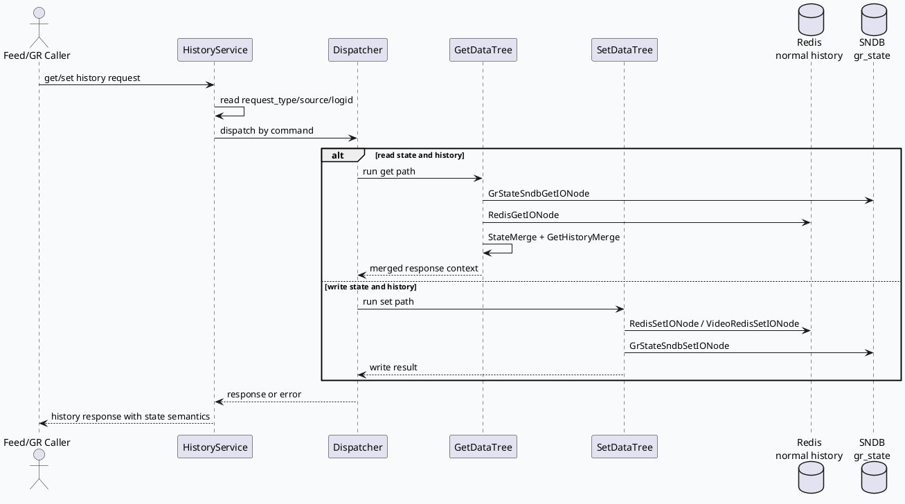

# History Service gr_state：展示状态读写与业务语义边界
<!-- topic-nav:start -->
> 主题：`business/state-semantics` · 同题补充 / 历史版本 · [主题目录](README.md) · [先读主文](2026-06-21-hs-state-business-semantics-grstate.md)
<!-- topic-nav:end -->


> 运行说明：2026-08-05 未发现 daily-plan 文件，本篇按历史未覆盖主题 fallback 生成。KU/业务背景检索不可用，需人工补充；当前结论基于 History Service 代码与配置证据。

<style>.arch-hs-biz{font-family:Inter,Arial,sans-serif;background:#f8fafc;border:1px solid #dbe4ef;border-radius:8px;padding:16px;color:#1f2937}.arch-hs-biz .title{font-size:20px;font-weight:800;margin-bottom:12px}.arch-hs-biz .lane{border:1px solid #cbd5e1;border-radius:8px;background:#fff;padding:10px;margin-bottom:10px}.arch-hs-biz h3{font-size:14px;margin:0 0 8px;color:#334155}.arch-hs-biz .grid{display:grid;grid-template-columns:repeat(5,minmax(0,1fr));gap:8px}.arch-hs-biz .box{border-radius:6px;padding:9px;border:1px solid #cbd5e1;background:#f8fafc;font-size:12px;line-height:1.45}.arch-hs-biz .box strong{display:block;font-size:13px;color:#0f172a;margin-bottom:3px}.arch-hs-biz .state{border-color:#2d6a4f;background:#eef7f2}.arch-hs-biz .business{border-color:#3d5a80;background:#edf4fb}.arch-hs-biz .risk{border-color:#b7791f;background:#fff7e6}</style><div class="arch-hs-biz"><div class="title">架构全景：gr_state 从请求到展示语义</div><div class="lane"><h3>请求与流控</h3><div class="grid"><div class="box business"><strong>Caller</strong>Feed/GR 侧按 request_type 调用 History Service</div><div class="box business"><strong>HistoryService</strong>提取 logid、source、request_type</div><div class="box"><strong>Flow Control</strong>并发/QPS 水位决定是否快速失败</div><div class="box"><strong>Dispatcher</strong>命中 get/set/del 类型处理</div><div class="box"><strong>MBvar</strong>按 source 和 request_type 记录错误</div></div></div><div class="lane"><h3>状态读路径</h3><div class="grid"><div class="box state"><strong>StateMergeNode</strong>状态合并前置节点</div><div class="box state"><strong>GrStateSndbGetIONode</strong>读取 SNDB gr_state</div><div class="box"><strong>RedisGetIONode</strong>读取普通历史</div><div class="box"><strong>GetHistoryMergeNode</strong>合并状态与历史结果</div><div class="box risk"><strong>语义边界</strong>状态不等同于 show_tss/click_tss 字段</div></div></div><div class="lane"><h3>状态写路径</h3><div class="grid"><div class="box state"><strong>RedisSetIONode</strong>写普通历史 Redis</div><div class="box state"><strong>VideoRedisSetIONode</strong>写视频历史 Redis</div><div class="box state"><strong>GrStateSndbSetIONode</strong>写 gr_state SNDB</div><div class="box"><strong>SNDB put</strong>写入超时与 backup 独立配置</div><div class="box risk"><strong>开关门控</strong>write_layout_sndb 等参数决定实际写入</div></div></div></div>

## 核心结论

`gr_state` 是 History Service 中单独建模的展示状态通道：读路径在普通 Redis 历史外增加 `GrStateSndbGetIONode`，写路径在 Redis/VideoRedis 外增加 `GrStateSndbSetIONode`。业务上排查“已展/未展/未知状态”时，不能只看历史 Redis key 或内容字段，需要同时确认状态开关、SNDB 通道、读写树节点和 response 合并阶段。



```infographic
infographic list-grid-badge-card
data
  title gr_state 业务排查四件套
  desc 展示状态问题要同时定位入口、读树、写树和后端通道
  items
    - label 入口开关
      desc main.cc 暴露 is_open_gr_state、write_layout_sndb、write_widget_sndb，决定状态链路是否参与
      icon mdi/toggle-switch
    - label 读路径
      desc get_data_tree.conf 中 StateMergeNode 与 GrStateSndbGetIONode 说明状态读取独立于普通历史读取
      icon mdi/database-search
    - label 写路径
      desc set_data_tree.conf 中 GrStateSndbSetIONode 与 Redis 写节点并列，状态写入有独立 handler
      icon mdi/database-edit
    - label 通道预算
      desc sndb_gr_state_client.conf 中 get/put timeout 不同，读状态更关注低延迟
      icon mdi/timer-cog
```

## 业务链路拆解

`main.cc:32-39` 暴露 `is_open_gr_state` 与 SNDB 写入相关开关，这些参数是业务语义能否进入状态通道的第一道门。若线上发现状态始终缺失，先确认这些 gflags 和发布配置，而不是直接怀疑下游合并逻辑。

`get_data_tree.conf:1-34` 将读路径拆成状态合并、SNDB gr_state get、普通历史 merge 和 Redis get。这个结构说明业务响应里的状态信息有独立来源：普通历史读取成功，不代表展示状态也成功读取。

`set_data_tree.conf:1-48` 将写路径拆成 `RedisSetIONode`、`VideoRedisSetIONode`、`GrStateSndbSetIONode`。写普通历史成功，不等价于 gr_state 写入成功；状态链路需要看 `sndb_gr_state_set_pre_handler` 和 `sndb_gr_state_set_after_handler` 对应的日志与错误码。

`sndb_gr_state_client.conf:6-20` 把 SNDB put/get 的超时分开：put `timeout_ms: 2000`，get `timeout_ms: 100`。读状态对在线响应延迟更敏感，所以业务侧看到状态缺失或 UNKNOWN 时，要区分“确实未写入”和“读取预算内未返回”。

```infographic
infographic sequence-snake-steps-simple
data
  title 展示状态问题定位路径
  desc 从现象到配置、树节点、后端通道逐层排查
  items
    - label 现象归类
      desc 状态缺失、UNKNOWN、与历史记录不一致
      icon mdi/alert-circle
    - label 查入口参数
      desc is_open_gr_state 与 write_layout_sndb 是否打开
      icon mdi/tune-variant
    - label 查读树
      desc StateMergeNode 和 GrStateSndbGetIONode 是否加载
      icon mdi/file-tree
    - label 查写树
      desc GrStateSndbSetIONode 是否执行，handler 是否报错
      icon mdi/database-arrow-up
    - label 查后端预算
      desc SNDB get/put timeout、backup_request 与 Redis channel 超时是否匹配
      icon mdi/timer-outline
    - label 查响应合并
      desc 确认状态合并失败没有被普通历史成功掩盖
      icon mdi/merge
```

<style>.card-hs-biz{font-family:Inter,Arial,sans-serif;background:#fff;border:1px solid #d8dee8;border-left:5px solid #2d6a4f;border-radius:8px;padding:16px;margin:14px 0;color:#1f2937}.card-hs-biz .meta{font-size:12px;font-weight:700;color:#2d6a4f;text-transform:uppercase;letter-spacing:.04em}.card-hs-biz .title{font-size:18px;font-weight:800;margin:4px 0 8px}.card-hs-biz .body{font-size:14px;line-height:1.65}.card-hs-biz code{background:#f1f5f9;padding:1px 4px;border-radius:4px}</style><div class="card-hs-biz"><div class="meta">Pitfall</div><div class="title">UNKNOWN 不能直接等价为未写入</div><div class="body">如果业务响应里展示状态落到 UNKNOWN，可能是状态未写、SNDB 读超时、状态合并未执行、入口开关未开，或读路径只拿到了普通历史。建议用 `source + request_type + logid` 串联入口日志、dispatcher 命中、树节点日志和 SNDB client 结果。</div></div>

```infographic
infographic list-column-done-list
data
  title 调试 checklist
  desc gr_state 与展示状态语义的排障顺序
  items
    - label 检查 source/request_type
      desc history_service.cc 会从 propagated tag 中提取 source，错误统计按 source/request_type 聚合
      done true
    - label 检查 DefaultProcFunction
      desc 若 command 不支持，会返回 E_PARAM_ERROR，后端状态链路不会执行
      done true
    - label 检查 StateMergeNode
      desc 读路径缺少该节点时，状态合并无法进入响应语义
      done true
    - label 检查 GrStateSndbSetIONode
      desc 写路径缺少或 handler 失败时，普通历史成功也不能证明状态成功
      done true
    - label 检查 SNDB get 超时
      desc get timeout 明显短于 put timeout，延迟抖动会优先影响在线状态读取
      done true
```

## 语义边界

- `gr_state` 是独立状态通道，不是普通历史 Redis key 的派生字段。
- 普通历史读写成功，只能说明历史链路可用，不能证明展示状态链路可用。
- 读状态的超时预算比写状态更紧，线上现象可能表现为“写入存在但读取缺失”。
- KU/业务上下文未检索到，本篇没有补充上游产品规则；需人工确认状态枚举、UNKNOWN 降级策略和调用方展示逻辑。

## 证据来源

- `src/main.cc:32-39`：`is_open_gr_state`、`write_layout_sndb`、`write_widget_sndb` 等状态链路开关。
- `src/main.cc:52-69`：History Service 在 brpc Server 中注册并启动。
- `src/service/history_service.cc:35-48`：从 propagated tags 提取 `source`，并进入统一错误记录结构。
- `src/service/dispatcher.cc:22-34`：不支持 command 的默认错误响应路径。
- `conf/get_data_tree.conf:1-34`：StateMergeNode、GrStateSndbGetIONode、GetHistoryMergeNode、RedisGetIONode 的读链路拓扑。
- `conf/set_data_tree.conf:1-48`：RedisSet、VideoRedisSet、GrStateSndbSet 三类写节点。
- `conf/channels.conf:1-29`：gr_state Redis 读写 channel 配置。
- `conf/common_component/dalton_client/sndb_gr_state_client.conf:6-20`：SNDB gr_state put/get timeout 与 backup_request 配置。
