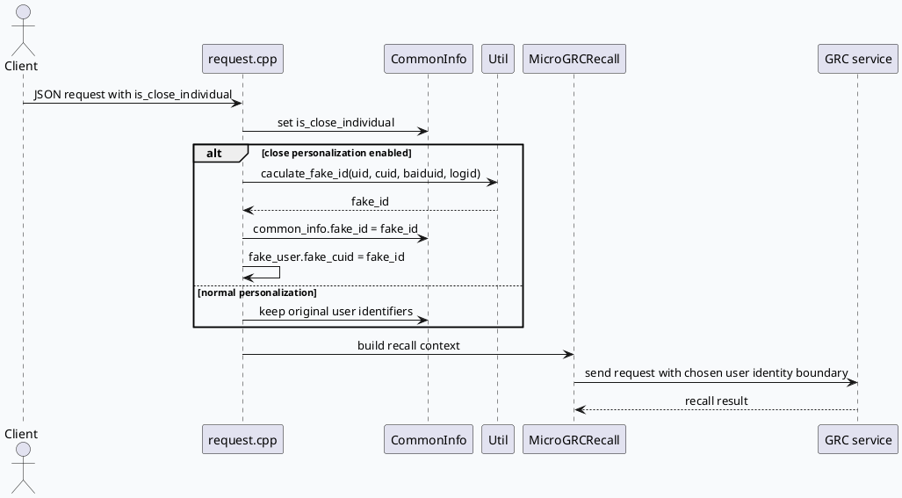
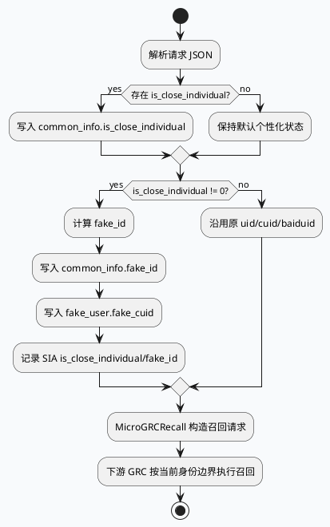

# MV-GR 关闭个性化：fake_id 生成与 MicroGRC 透传边界
<!-- topic-nav:start -->
> 主题：`business/personalization-id` · 同题补充 / 历史版本 · [主题目录](README.md) · [先读主文](2026-07-04-close-individual-fakeid-cross-service-boundary.md)
<!-- topic-nav:end -->


> 生成日期：2026-08-08  
> 计划状态：未找到今日 daily-plan，按相邻未覆盖主题 fallback。KU/业务上下文需人工补充；本文以代码证据为主。

## 架构全景

<style>.fi-arch{font-family:Inter,Arial,sans-serif;background:#f8fafc;border:1px solid #d8e1ea;border-radius:8px;padding:18px;margin:16px 0;color:#1f2937}.fi-title{font-size:20px;font-weight:800;margin-bottom:12px}.fi-row{display:grid;grid-template-columns:repeat(5,minmax(0,1fr));gap:9px;align-items:stretch}.fi-box{background:#fff;border:1px solid #cbd5e1;border-radius:8px;padding:10px;font-size:12px;line-height:1.45}.fi-box strong{display:block;color:#7a3f28;font-size:13px;margin-bottom:3px}.fi-box.hot{border-left:4px solid #b85d3b;background:#fff8f3}.fi-arrow{text-align:center;color:#64748b;font-size:12px;padding:6px 0}.fi-band{margin-top:10px;border-radius:8px;background:#eef6f5;border:1px solid #c8ded9;padding:10px;font-size:13px;line-height:1.55}@media(max-width:900px){.fi-row{grid-template-columns:1fr}}</style><div class="fi-arch"><div class="fi-title">关闭个性化请求链路</div><div class="fi-row"><div class="fi-box"><strong>入口 JSON</strong>读取 is_close_individual，允许上游显式关闭个性化</div><div class="fi-box hot"><strong>request.cpp</strong>关闭时调用 caculate_fake_id，并写入 fake_user.fake_cuid</div><div class="fi-box"><strong>CommonInfo</strong>保存 uid/cuid/baiduid 与 fake_id 的替换态</div><div class="fi-box hot"><strong>MicroGRC Recall</strong>根据关闭个性化状态组装下游召回请求</div><div class="fi-box"><strong>下游 GRC</strong>以去标识化用户标识执行召回与策略处理</div></div><div class="fi-arrow">请求解析 → fake_id 生成 → 用户标识替换 → GRC 请求透传 → 下游召回</div><div class="fi-band"><strong>边界判断：</strong>fake_id 不是通用降级标识，而是关闭个性化语义下的跨服务隐私边界。排查召回差异时要同时看入口字段、fake_id 生成日志和 MicroGRC 请求参数。</div></div>

## 核心调用链



## 字段与边界信息图

```infographic
infographic compare-hierarchy-left-right-circle-node-pill-badge
data
  title 关闭个性化前后字段语义
  desc 核心差异不是是否调用 GRC，而是用户标识是否进入 fake_id 边界
  items
    - label 正常个性化
      desc uid/cuid/baiduid 保持原始用户语义，召回可使用个性化画像
      icon mdi/account-check
      children
        - label uid
          desc 原始用户 ID
          icon mdi/identifier
        - label cuid
          desc 原始设备/客户端标识
          icon mdi/cellphone-link
        - label baiduid
          desc 原始浏览器/账号侧标识
          icon mdi/web
    - label 关闭个性化
      desc is_close_individual 非 0 时生成 fake_id，作为跨服务去标识化边界
      icon mdi/account-cancel
      children
        - label fake_id
          desc 由 uid/cuid/baiduid/logid 计算
          icon mdi/incognito
        - label fake_cuid
          desc fake_user 侧承接 fake_id
          icon mdi/account-convert
        - label SIA 日志
          desc 打点 is_close_individual 与 fake_id 便于排障
          icon mdi/text-search

theme
  palette #b85d3b #2f7d73 #3d5a80
```

## 状态活动图



## Pitfalls 卡片

<style>.fi-card{font-family:Inter,Arial,sans-serif;background:#f6f3f2;border:1px solid #decac1;border-radius:8px;padding:18px;margin:16px 0;color:#30231f}.fi-meta{font-size:12px;font-weight:800;color:#b85d3b;letter-spacing:.04em;text-transform:uppercase}.fi-card h3{font-size:22px;margin:6px 0 10px}.fi-grid{display:grid;grid-template-columns:2fr 1fr;gap:12px}.fi-panel{background:#fff;border-top:3px solid #b85d3b;border-radius:6px;padding:10px;font-size:13px;line-height:1.6}.fi-card p{font-size:14px;line-height:1.65;margin:0 0 10px}@media(max-width:760px){.fi-grid{grid-template-columns:1fr}}</style><div class="fi-card"><div class="fi-meta">Pitfall</div><h3>只查下游 GRC 会漏掉入口语义</h3><p>关闭个性化的关键开关先在请求解析阶段落到 `common_info.is_close_individual`。如果只看 MicroGRC 的召回结果，很容易把召回差异误判成策略问题，而不是身份边界切换。</p><div class="fi-grid"><div class="fi-panel"><strong>排查顺序</strong><br>先确认入口 JSON 是否带 is_close_individual，再确认 request.cpp 是否生成 fake_id，最后检查 MicroGRC 请求是否使用了去标识化用户信息。</div><div class="fi-panel"><strong>证据</strong><br>request.cpp:302-369<br>micro_grc_recall.cpp</div></div></div>

## 调试 Checklist

```infographic
infographic list-column-done-list
data
  title fake_id 链路排查清单
  desc 适用于关闭个性化、召回差异、隐私边界异常排查
  items
    - label 校验入口字段
      desc 请求 JSON 中 is_close_individual 是否存在且为非 0
      done false
      icon mdi/form-textbox
    - label 校验 fake_id 生成
      desc request.cpp 是否调用 Util::caculate_fake_id 并写入 common_info.fake_id
      done false
      icon mdi/incognito
    - label 校验 fake_user
      desc fake_user.fake_cuid 是否承接 fake_id
      done false
      icon mdi/account-convert
    - label 校验 SIA 打点
      desc is_close_individual 与 fake_id 是否进入排障日志
      done false
      icon mdi/text-search
    - label 校验 MicroGRC 请求
      desc 召回请求是否按关闭个性化边界透传用户标识
      done false
      icon mdi/cloud-search-outline

theme
  palette #b85d3b #2f7d73 #3d5a80
```

## 证据来源

- `feeda-mv-gr/src/processor/request.cpp:302-303`：从 JSON 读取 `is_close_individual`。
- `feeda-mv-gr/src/processor/request.cpp:358-365`：关闭个性化时计算 `fake_id` 并写入 `fake_user.fake_cuid`。
- `feeda-mv-gr/src/processor/request.cpp:367-369`：SIA 记录 `is_close_individual` 与 `fake_id`。
- `feeda-mv-gr/src/processor/feed_ufs_function.cpp:163-166`：使用 `common_info->fake_id` 替换 cuid、uid、baiduid 的调用点。
- `feeda-mv-gr/src/processor/zeroton_user_recall.cpp:232-236`：将 fake_id 写入 common_info 的多种用户标识字段。
- `feeda-mv-gr/src/processor/micro_grc_recall.cpp`：MicroGRC 召回链路的业务边界入口。
