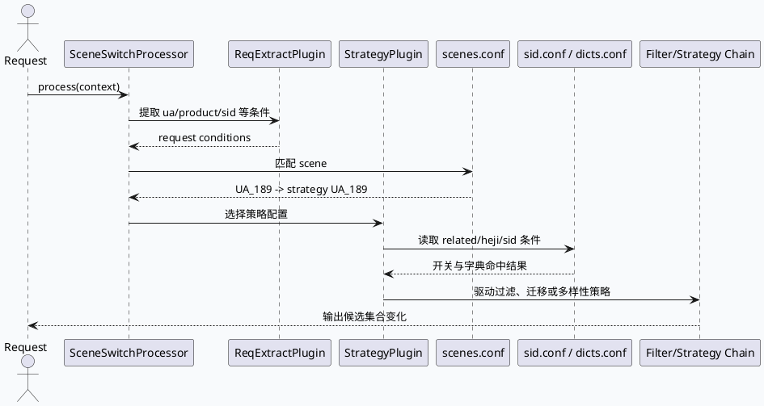

# MV-GR 过滤入口：SceneSwitch、UA_189 与 related/heji 条件边界
<!-- topic-nav:start -->
> 主题：`business/related-filter` · 同题补充 / 历史版本 · [主题目录](README.md) · [先读主文](2026-06-23-ua189-postplay-related-filter-business-chain.md)
<!-- topic-nav:end -->


> 生成日期：2026-08-09  
> 计划状态：未找到今日 daily-plan，按相邻未覆盖主题 fallback。KU/业务上下文需人工补充；本文以代码证据为主。

## 架构全景

<style>.mgr-arch{font-family:Inter,Arial,sans-serif;background:#f8fafc;border:1px solid #d7e0ea;border-radius:8px;padding:18px;margin:16px 0;color:#1f2937}.mgr-title{font-size:20px;font-weight:800;margin-bottom:12px}.mgr-grid{display:grid;grid-template-columns:1fr 1.15fr 1fr;gap:12px}.mgr-layer{background:#fff;border:1px solid #cbd5e1;border-radius:8px;padding:12px}.mgr-layer h3{font-size:14px;margin:0 0 8px;color:#334155}.mgr-box{border:1px solid #d8dee8;border-radius:7px;background:#fbfdff;padding:9px;margin:7px 0;font-size:12px;line-height:1.45}.mgr-box strong{display:block;color:#6f4b1e;font-size:13px;margin-bottom:3px}.mgr-core{background:#f3f7ee;border-color:#a5b88a}.mgr-note{font-size:12px;color:#64748b;margin-top:10px}@media(max-width:900px){.mgr-grid{grid-template-columns:1fr}}</style><div class="mgr-arch"><div class="mgr-title">MV-GR 业务过滤入口的三段式边界</div><div class="mgr-grid"><div class="mgr-layer"><h3>请求归类</h3><div class="mgr-box"><strong>SceneSwitchProcessor</strong>从请求提取条件，匹配 scene，再选择 strategy。</div><div class="mgr-box"><strong>UA_189</strong>`scenes.conf` 中以 `ua: 189` 绑定到 `name: UA_189` strategy。</div></div><div class="mgr-layer"><h3>业务条件</h3><div class="mgr-box mgr-core"><strong>sid 开关</strong>`searchc_related_mvgrc_fz`、`searchc_related_diversity_exp` 控制 related 请求迁移/多样性实验。</div><div class="mgr-box mgr-core"><strong>dict 资源</strong>`dibar_related_prompt_group_dict`、`heji_nid_dict`、`new_heji_nid_dict` 提供 related/heji 判定物料。</div><div class="mgr-box mgr-core"><strong>Filter 框架</strong>条件最终需要落到 common-processor 的 handler 或下游策略节点，不应在 scene 配置中寻找全部过滤逻辑。</div></div><div class="mgr-layer"><h3>输出影响</h3><div class="mgr-box"><strong>过滤/迁移决策</strong>决定是否走 MicroGRC、related 队列、个性化或 diversity 逻辑。</div><div class="mgr-box"><strong>调试边界</strong>先确认 scene 命中，再看 sid/dict，再追具体 FilterGroup 和策略节点。</div></div></div><div class="mgr-note">证据：scene_switch_processor.cpp:16-126；scenes.conf:515-518；sid.conf:529-536；dicts.conf:107-130。</div></div>

## 调用链



业务侧最重要的边界是：`SceneSwitchProcessor` 负责把请求映射到 scene/strategy，`sid.conf` 和 `dicts.conf` 提供业务条件，真正的过滤执行则由 Filter/Strategy chain 完成。`UA_189` 只说明 UA 维度的路由入口；`searchc_related_*` 和 heji/related 字典说明业务实验与物料条件，不能单独证明某个 item 被过滤，需要继续追到具体 handler 或策略节点。

## 条件结构

```infographic
infographic compare-hierarchy-left-right-circle-node-pill-badge
data
  title MV-GR 过滤条件分层
  desc scene 路由、实验开关、字典资源分别承担不同职责
  items
    - label 路由层
      desc scenes.conf:515-518 将 ua:189 绑定到 UA_189 strategy
      icon mdi/routes
      children
        - label SceneSwitchProcessor
          desc 请求条件提取与 strategy 选择
    - label 实验层
      desc sid.conf:529-536 控制 related 迁移与 diversity 实验
      icon mdi/toggle-switch-outline
      children
        - label searchc_related_mvgrc_fz
          desc 前 N 条请求 MicroGRC 或推搜队列相关逻辑
        - label searchc_related_diversity_exp
          desc related 场景多样性实验入口
    - label 资源层
      desc dicts.conf:107-130 提供 related/heji 词典或 nid 集合
      icon mdi/database-outline
      children
        - label dibar_related_prompt_group_dict
          desc related prompt group 字典
        - label heji_nid_dict
          desc 合集 nid 字典
        - label new_heji_nid_dict
          desc 新合集 nid 字典
theme
  palette #6f4b1e #7f9a62 #c46f4a
```

`sid.conf:529-536` 的注释指出“根据当前 gr 判断前 N 条请求相关性”的迁移实验，这更像业务路由/实验开关；`dicts.conf:107-130` 提供 related prompt group 和 heji nid 字典，属于判定输入。把这两类配置和 `scenes.conf:515-518` 的 UA_189 路由合起来，才能解释“为什么某些请求进入特定过滤/策略链”。

## Pitfalls

<style>.mgr-card{font-family:Inter,Arial,sans-serif;background:#fbfaf7;border:1px solid #ded7ca;border-radius:8px;padding:16px;margin:16px 0;color:#2f2f2f}.mgr-card-title{font-size:18px;font-weight:800;color:#5a3e24;margin-bottom:10px}.mgr-panels{display:grid;grid-template-columns:1fr 1fr;gap:12px}.mgr-panel{background:#fff;border-top:4px solid #7f9a62;border-radius:6px;padding:12px;font-size:13px;line-height:1.6}.mgr-panel strong{display:block;margin-bottom:4px;color:#344023}@media(max-width:760px){.mgr-panels{grid-template-columns:1fr}}</style><div class="mgr-card"><div class="mgr-card-title">业务排查不要跨层误判</div><div class="mgr-panels"><div class="mgr-panel"><strong>UA_189 不是过滤规则本身</strong>它只是 scene 到 strategy 的入口，后续 filter/strategy 才决定候选变化。</div><div class="mgr-panel"><strong>sid 是实验开关，不是字典命中</strong>`searchc_related_*` 说明实验分流，不能替代 item 级判定。</div><div class="mgr-panel"><strong>dict 是判定输入，不是执行链</strong>heji/related 字典只提供资源，仍需追使用方。</div><div class="mgr-panel"><strong>common-processor 是框架边界</strong>业务语义通常落在配置注册的 handler 或策略函数，不在 FilterProcessor 主体。</div></div></div>

## 调试 Checklist

```infographic
infographic list-grid-badge-card
data
  title MV-GR related/heji 过滤排查顺序
  desc 从请求路由到业务资源再到执行链
  items
    - label 1. 确认 scene 命中
      desc scenes.conf:515-518 是否进入 UA_189 strategy
      icon mdi/numeric-1-circle-outline
    - label 2. 确认 sid 实验
      desc sid.conf:529-536 是否打开 related 迁移或 diversity 实验
      icon mdi/numeric-2-circle-outline
    - label 3. 确认 dict 资源
      desc dicts.conf:107-130 是否加载 related/heji 字典
      icon mdi/numeric-3-circle-outline
    - label 4. 追 StrategyPlugin
      desc scene_switch_processor.cpp:88-126 之后继续看策略注册与执行
      icon mdi/numeric-4-circle-outline
    - label 5. 追 FilterGroup
      desc 若进入 common-processor，回到 FilterProcessor handler 顺序
      icon mdi/numeric-5-circle-outline
theme
  palette #6f4b1e #7f9a62 #c46f4a
```

## 证据来源

- `src/processor/scene_switch_processor.cpp:16-126`（common-processor）：SceneSwitchProcessor、ReqExtractPlugin、StrategyPlugin 的请求条件到策略选择路径。
- `conf/plugins/scenes.conf:515-518`（MV-GR 配置）：`ua: 189` 命中后绑定 `name: UA_189` strategy。
- `conf/sid.conf:529-536`（MV-GR 配置）：`searchc_related_mvgrc_fz` 与 `searchc_related_diversity_exp` 实验开关。
- `conf/dicts.conf:107-130`（MV-GR 配置）：`dibar_related_prompt_group_dict`、`heji_nid_dict`、`new_heji_nid_dict` 字典资源。
- `src/microframe/filter/filter_processor.cpp:57-103`（common-processor）：业务过滤执行需要落到 handler 链，不能只看 scene/sid/dict 配置。

## 需人工补充

今日未找到 daily-plan，内网 KU 业务背景未能自动补齐。本文仅确认 MV-GR 本地配置中的 scene/sid/dict 入口和 common-processor 框架边界；线上 UA_189 的完整策略树、related/heji 字典消费方、以及具体过滤 handler 需要人工补充或由服务配置导出后继续追踪。
