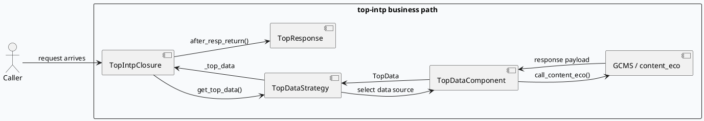
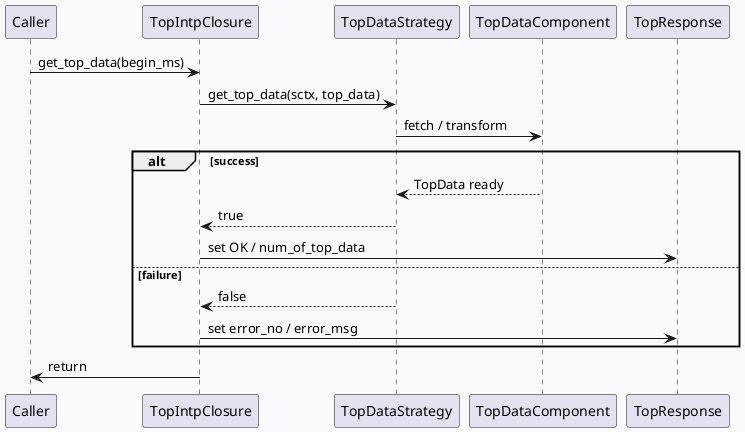

# 2026-08-18 周二代码理解：top-intp GCMS 请求与响应边界

> 日期：2026-08-18  
> 主题来源：2026-08-18 daily-plan 文件未找到，按历史未覆盖主题 fallback 到 `top-intp` 的请求到 GCMS 取数与响应装配链路；KU/业务背景需人工补充。  
> 范围：只分析 `src/service/top_service.cc`、`src/strategy/top_data_strategy.cc`、`src/component/top_data_component.cc`、`src/component/gcms_component.h`、`src/common/gcms_data.h`、`conf/common_component/gcms_plugin_pb.conf`，关注请求封装、策略分发、GCMS 响应回填和结果出网，不展开服务启动。

---

## 0. 架构全景图
<div style="font-family:system-ui,-apple-system,BlinkMacSystemFont,'Segoe UI',Roboto,sans-serif;background:#f8fafc;border:1px solid #d9e2ec;border-radius:14px;padding:18px;margin:16px 0;color:#243b53"><div style="font-size:22px;font-weight:800;margin-bottom:12px;color:#102a43">请求进入后如何走到 GCMS，再回到 TopResponse</div><div style="display:grid;grid-template-columns:1.05fr 1.15fr 1fr;gap:12px"><div style="background:#fff;border:1px solid #d9e2ec;border-radius:10px;padding:12px"><div style="font-weight:700;margin-bottom:8px;color:#1d4e89">入口封装</div><div>• `TopIntpClosure::get_top_data()` 持有请求上下文</div><div>• `DeleteTopIntpClosure` 管理 closure 生命周期</div><div>• `TopDataStrategy::get_top_data()` 接管业务取数</div></div><div style="background:#fff;border:1px solid #d9e2ec;border-radius:10px;padding:12px"><div style="font-weight:700;margin-bottom:8px;color:#1d4e89">GCMS 取数</div><div>• `content_eco` HTTP 调用拿回介质数据</div><div>• `req_batch_size` / `req_max_concurrency` 限制吞吐</div><div>• `req_type=2` 允许广播查找场景</div><div>• `timeoutms=100` 约束尾延迟</div></div><div style="background:#fff;border:1px solid #d9e2ec;border-radius:10px;padding:12px"><div style="font-weight:700;margin-bottom:8px;color:#1d4e89">出网装配</div><div>• `transform_response()` 整理 `TopData`</div><div>• `SmfwGcmsRespItem` 承载结构字段</div><div>• `TopResponse` 写回成功态和数量</div></div></div><div style="margin-top:12px;background:#eef4f9;border:1px dashed #b6c6d6;border-radius:10px;padding:10px 12px;font-size:13px;line-height:1.55">业务判断：这条链路的核心不是单纯“请求返回”，而是把策略选择、GCMS 查询语义和 TopResponse 的错误/成功状态统一起来。真正的业务边界在 `TopIntpClosure` 和 `TopDataStrategy` 之间。</div></div>

## 1. 请求到响应的主路径
`TopIntpClosure::get_top_data()` 先用 `std::unique_ptr` 持有自身，避免 closure 在异步路径上泄漏，再转到 `TopDataStrategy::get_top_data()`。策略对象成功后，`after_resp_return()` 会把结果回写到 `TopResponse`，失败则设置错误状态。

### 关键路径
- `src/service/top_service.cc:15-18`：closure 删除器
- `src/service/top_service.cc:21-39`：请求上下文驱动的取数和结束回调
- `src/service/top_service.cc:42-64`：策略获取 `TopData`
- `src/service/top_service.cc:68-95`：回填 `TopResponse` 状态
- `src/strategy/top_data_strategy.cc:12-20`：策略入口

## 2. 核心流程图


### 时序图：成功与失败两条分支


## 3. 配置/结构信息图
```infographic
infographic list-grid-badge-card
 data
  title GCMS 业务配置面
  desc 请求语义和服务质量阈值都由插件配置约束
  items
   - label service_name
     desc topintp
     value 1
     icon mdi/cube-outline
   - label need_report_data
     desc 1
     value 1
     icon mdi/checkbox-marked-circle-outline
   - label need_check_srv
     desc 1
     value 1
     icon mdi/shield-check-outline
   - label req_batch_size
     desc 10
     value 10
     icon mdi/view-grid-plus
   - label req_max_concurrency
     desc 100
     value 100
     icon mdi/axis-arrow
   - label req_type
     desc 2
     value 2
     icon mdi/route
   - label timeoutms
     desc 100
     value 100
     icon mdi/timer-outline
   - label ttl_sec
     desc 1200
     value 1200
     icon mdi/cache-clock
 theme
  palette #0f766e #2563eb #f59e0b
```

## 4. 业务边界
`TopDataStrategy` 目前只保留 `initialize()`、`wireup()` 和 `get_top_data()` 的最小策略接口。这个形态说明业务代码把“选什么源、怎么回填”从传输层剥离出来，后续扩展时更适合在策略里加分流，而不是在 closure 里堆 if/else。

`TopDataComponent` 则负责把外部返回整理成统一结构：`call_content_eco()` 取数，`transform_response()` 处理响应，`parse_one_item()` 拆字段，`SmfwGcmsRespItem` 作为结构承载。`gcms_data.h` 提供 `MEMBER_BEGIN` 系列字段宏，说明这个层更接近协议适配器，而不是业务规则本身。

### 证据来源
- `src/service/top_service.cc:15-18`
- `src/service/top_service.cc:21-39`
- `src/service/top_service.cc:42-95`
- `src/strategy/top_data_strategy.h:19-22`
- `src/strategy/top_data_strategy.cc:12-20`
- `src/component/top_data_component.cc:15-18`
- `src/component/top_data_component.cc:30-33`
- `src/component/top_data_component.cc:73-77`
- `src/component/top_data_component.cc:144-249`
- `src/component/gcms_component.h:17-21`
- `src/common/gcms_data.h:17-29`
- `conf/common_component/gcms_plugin_pb.conf:3-17`

## 5. Pitfalls
<div style="display:grid;grid-template-columns:1fr;gap:10px;margin:14px 0"><div style="background:#fff7ed;border:1px solid #fdba74;border-radius:10px;padding:12px 14px"><div style="font-weight:800;color:#9a3412;margin-bottom:4px">closure 退出顺序要稳</div><div style="color:#7c2d12;line-height:1.55">`TopIntpClosure` 在异步/回调尾部负责回收自身，若把 `done` 生命周期和结果回填拆开，容易出现重复释放或悬空引用。</div></div><div style="background:#eff6ff;border:1px solid #93c5fd;border-radius:10px;padding:12px 14px"><div style="font-weight:800;color:#1d4ed8;margin-bottom:4px">错误态不能只看返回值</div><div style="color:#1e3a8a;line-height:1.55">成功与否最终要落到 `TopResponse` 的 `error_no`、`error_msg` 和 `num_of_top_data`。只看 `bool` 返回值会漏掉空结果和业务降级态。</div></div><div style="background:#f0fdf4;border:1px solid #86efac;border-radius:10px;padding:12px 14px"><div style="font-weight:800;color:#166534;margin-bottom:4px">配置值会改变业务语义</div><div style="color:#14532d;line-height:1.55">`req_type=2`、`req_batch_size=10`、`timeoutms=100` 不只是性能参数，它们会直接改变可查范围、并发和尾延迟，必须和策略层一起看。</div></div></div>

## 6. 调试 checklist
```infographic
infographic list-column-done-list
 data
  title 调试 checklist
  items
   - label TopIntpClosure 是否走到 get_top_data() 主分支
     done true
   - label TopDataStrategy 是否成功返回 TopData
     done true
   - label content_eco 调用是否有返回且解析成功
     done true
   - label transform_response 是否填充了内部结构
     done true
   - label TopResponse 是否写入 OK / error_no / num_of_top_data
     done true
   - label gcms_plugin_pb.conf 的并发和超时是否匹配预期
     done true
 theme
  palette #0f766e #2563eb #f59e0b
```

## 7. 结论
这条业务链路的关键不是“有没有调用 GCMS”，而是“请求、策略、协议适配、结果回填”是否被稳定地分层。`TopIntpClosure` 管的是请求出口，`TopDataStrategy` 管的是数据源选择，`TopDataComponent` 管的是协议和结构转换，四者分工清楚时，错误态和扩展点才不会互相污染。

> 内容整理：重复扫描统计驱动的历史适配附录；不作为已核实的迁移结论，已移出正文。[查看原始版本及附录](https://github.com/1998-program/cpp-core-notes/blob/5738832bab4b13ba26356af0a37a0a32e477b675/notes/business-lib/20260818-top-intp-gcms-request-and-response-boundary.md)。
