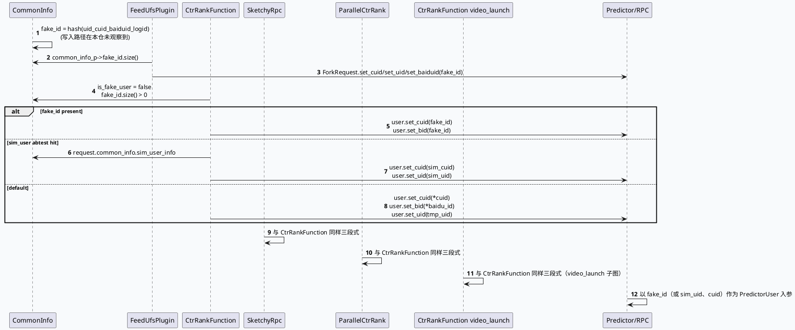

# 2026-09-26 业务代码理解：GRC fake_id 替换链路与下游精排消费者
<!-- topic-nav:start -->
> 主题：`business/personalization-id` · 同题补充 / 历史版本 · [主题目录](README.md) · [先读主文](2026-07-04-close-individual-fakeid-cross-service-boundary.md)
<!-- topic-nav:end -->


> 日期：2026-09-26（周六）
> 主题选择：未发现目标日期有效 daily-plan；仓库中仅保留 2026-05-29 的过期 weekly-plan。本次按 plan 中 `Sat: GRC fake_id 关闭/替换链路` 回退。前一篇基础库笔记已覆盖 `DynamicTimeOutPlugin` 的池化合同；本篇只追踪 `CommonInfo.fake_id` 字段从构造到下游 9 处消费者（`feed_ufs`、`ctr_rank`、`ctr_rerank`、`parallel_ctr_rank`、`sketchy_rpc`、`sketchy_rpc_config`、`sketchy_rpc_pipeline`、`ctr_rank_function`、`ec_sketchy_rank`、`ec_cvr_rank`）的覆盖顺序、`is_fake_user` 状态以及精排时的 cuid/bid 写入。KU 正文未读取，业务背景需人工补充；以下只陈述源码和 graph 配置可验证的行为。
> 范围：`src/plugin/feed_ufs_plugin.cpp`、`src/processor/ctr_rank.{cpp,h}`、`src/processor/sketchy_rpc.cpp`、`src/processor/parallel_ctr_rank.cpp`、`src/processor/{ctr_rerank,ec_sketchy_rank,ec_cvr_rank}.cpp`、`src/processor/video_launch/{ctr_rank_function,sketchy_rpc_pipeline,sketchy_rpc_config}.cpp`、`src/data/base.h`、`src/util/util.hpp`、`conf/plugins/graph/vertex.conf`。

## 0. 架构全景图

<div style="font-family:system-ui,-apple-system,BlinkMacSystemFont,'Segoe UI',sans-serif;background:#f5f7fa;border:1px solid #d8e1ea;border-radius:8px;padding:16px;margin:16px 0;color:#243b53;line-height:1.45;"><div style="display:grid;grid-template-columns:1fr 1.25fr 1.4fr 1fr;gap:10px;align-items:stretch;"><div style="background:#fff;border:1px solid #cbd5e1;border-left:4px solid #3d5a80;border-radius:6px;padding:11px;"><div style="font-size:11px;font-weight:800;color:#52606d;text-transform:uppercase;">请求侧</div><div style="margin-top:7px;font-size:15px;color:#102a43;font-weight:700;">GRCRequest</div><div style="margin-top:7px;font-size:12px;color:#52606d;">uid/cuid/baiduid；logid；通过 framework 写入 CommonInfo.fake_id。</div></div><div style="background:#fff;border:1px solid #cbd5e1;border-left:4px solid #2d6a4f;border-radius:6px;padding:11px;"><div style="font-size:11px;font-weight:800;color:#52606d;text-transform:uppercase;">CommonInfo 状态</div><div style="margin-top:7px;font-size:15px;color:#102a43;font-weight:700;">CommonInfo.fake_id</div><div style="margin-top:7px;font-size:12px;color:#52606d;">仓内 reset 把 fake_id 置空；本仓未观察到上游计算路径。</div></div><div style="background:#fff;border:1px solid #cbd5e1;border-left:4px solid #9a5b28;border-radius:6px;padding:11px;"><div style="font-size:11px;font-weight:800;color:#52606d;text-transform:uppercase;">消费侧</div><div style="margin-top:7px;font-size:15px;color:#102a43;font-weight:700;">9 个精排/UFS 入口</div><div style="margin-top:7px;font-size:12px;color:#52606d;">先 fake_id 覆盖 cuid/bid，再走 sim_user 或真 cuid 分支；同时置 is_fake_user。</div></div><div style="background:#fff;border:1px solid #cbd5e1;border-left:4px solid #b8432f;border-radius:6px;padding:11px;"><div style="font-size:11px;font-weight:800;color:#52606d;text-transform:uppercase;">业务影响</div><div style="margin-top:7px;font-size:15px;color:#102a43;font-weight:700;">Predictor/精排结果</div><div style="margin-top:7px;font-size:12px;color:#52606d;">用 fake_id 替换实 cuid/bid 后，下游 predictor/grpc/UFS 都看到 hash 值。</div></div></div><div style="margin-top:10px;font-size:12px;color:#52606d;">本次未观察到 fake_id 字段的写入源码路径，仅在 reset() 中把它置空；下游消费者构成这条业务合同的可见边界。</div></div>

## 1. 主题判断与代码边界

前一篇基础库笔记已覆盖 `DynamicTimeOutPlugin` 的池化与 scene 注入，本篇把边界向下游推进：fake_id 在仓内的存储位置、reset 行为，以及下游精排/UFS 入口的覆盖顺序和回退分支。

源码证据显示：

- `CommonInfo.fake_id` 字段在 `data/base.h:126` 声明为 `std::string{"\"}""`，并通过 `CommonInfo::clear()` 在 `data/base.h:162` 显式置空。
- `feed_ufs_plugin.cpp:114-118` 把 fake_id 写入 ForkRequest 的 cuid/uid/baiduid 三个字段。
- `ctr_rank.cpp:604-611`、`ctr_rerank.cpp:255-257`、`parallel_ctr_rank.cpp:197-199`、`sketchy_rpc.cpp:1014-1016`、`ec_sketchy_rank.cpp:225-227`、`ec_cvr_rank.cpp:155-157` 都先检查 `common_info_ptr->fake_id.size() > 0`，再用 fake_id 覆盖 cuid/bid。
- `video_launch/ctr_rank_function.cpp:635-637`、`video_launch/sketchy_rpc_pipeline.cpp:236-238`、`video_launch/sketchy_rpc_config.cpp:417-419` 是 video_launch 子图的消费者，覆盖顺序与主图一致。
- `ctr_rank.cpp:604-850` 在覆盖前把 `is_fake_user` 置 false，`:886`、`:1552` 在 SIA 与下游分支里消费这个状态。

本篇不重复 DynamicTimeOutPlugin 的合同分析，也不展开 ctr/erank 的排序语义；只陈述 fake_id 在 9 个精排/UFS 入口的覆盖顺序和回退分支。

## 2. CommonInfo 状态与字段边界

### 2.1 fake_id 字段声明

`CommonInfo` 是 GRC 内传递用户/请求公共数据的扁平结构，`fake_id` 与 `device`、`network`、`guanzhu` 等并列存在（`data/base.h:115-165`）。从命名上看，它本应是某个 hash 计算结果，但本仓 `parser/recall_parser_new.cpp:107-117` 中只存在 `hash_userid()` 函数定义，仓内未观察到任何调用点；同理 `util/util.hpp:4134-4140` 中只存在 `caculate_fake_id()` 函数定义，也未观察到任何调用点。这意味着 fake_id 的实际写入路径在本仓看不全，可能由上游框架或不在快照中的模块负责。

### 2.2 clear() 的兜底

`CommonInfo::clear()` 在 `data/base.h:162` 显式把 `fake_id` 置空。结合 `GenericGRCService::run()` 中 `graph->reset()` 之后的清空，可以推断 fake_id 是每次 graph 请求的生命周期内有效；跨请求不会保留任何 hash 值。

### 2.3 "fake_id 是否存在"是分支条件

下游消费者都用 `if (common_info_ptr->fake_id.size() > 0)` 作为分支条件；当 fake_id 为空时，处理器会进入 sim_user 分支（实验 10377282/10377283/10377285/10377286）或真实 cuid/bid 分支。也就是说 fake_id 的存在性是覆盖关系中的最高优先级，并不与 sim_user 或真 uid 叠加。

## 3. fake_id 覆盖顺序与回退分支



### 3.1 覆盖前必须先看 fake_id

9 个消费者中 8 个都在调用 `user.set_cuid/bid` 前先读 `fake_id.size()`；只有这样才能保证后续的 sim_user/真 uid 分支不把 fake_id 又覆盖回去。这是 fake_id 业务合同的"先到先得"语义。

### 3.2 sim_user 实验只接管 fake_id 不在的情况

`ctr_rank.cpp:617-633` 显示 sim_user 分支条件包含 `Util::hit_abtest(10377282/10377283/10377285/10377286)`、`is_slide`、`is_slight_user_7d`、`mv_ums_detail_confidence_*` 和 `request_ptr->common_info().has_sim_user_info()`。sim_user 分支只有在 fake_id 不存在时才可能命中，因此 sim_user 与 fake_id 是互斥的。

### 3.3 is_fake_user 仅由 ctr_rank 主图写入

`ctr_rank.cpp:604` 显式置 `is_fake_user = false`，之后 `ctr_rank.cpp:886` 在 SIA_ADD 中把状态打点，`ctr_rank.cpp:1552` 在某个分支读取后写日志。`is_fake_user` 仅在 ctr_rank 主图出现，video_launch 子图没有对应写入点；说明下游其它函数靠 `fake_id.size() > 0` 这条同步条件就够了。

### 3.4 FeedUfsPlugin 同步覆盖三个字段

`feed_ufs_plugin.cpp:114-118` 把 fake_id 同时写到 ForkRequest 的 cuid/uid/baiduid；这是仓内唯一一处把 fake_id 写到三个字段的入口，反映出 fake_id 不只用于精排，也用于 UFS 这种 recall 阶段的服务。

## 4. 关键风险与排障卡片

```infographic
infographic sequence-ascending-steps
data
  title fake_id 业务消费链
  desc 从写入到精排的四道可观测门槛
  items
    - label 写入路径
      desc fake_id 字段由上游 hash 计算写入，本仓未观察到调用方
      icon mdi/key-chain
    - label CommonInfo 状态
      desc clear() 强制清空；graph reset 不再保留 fake_id
      icon mdi/broom
    - label 覆盖优先级
      desc fake_id > sim_user > 真 cuid/bid；命中后两个分支互斥
      icon mdi/star-check
    - label observability
      desc is_fake_user 在 ctr_rank 主图 SIA_ADD；fake_id_size 在 GRC_FLOW_LOG
      icon mdi/chart-line
  theme
    palette #3d5a80 #2d6a4f #b8432f #9a5b28
```

<div style="font-family:system-ui,-apple-system,BlinkMacSystemFont,'Segoe UI',sans-serif;background:#fffaf5;border:1px solid #ead7c2;border-left:6px solid #b8432f;border-radius:6px;padding:15px;margin:14px 0;color:#3f2d22;line-height:1.55;"><div style="font-size:12px;font-weight:800;color:#9a3d2a;text-transform:uppercase;letter-spacing:.04em;">Pitfall 01 · 写入路径不可见</div><div style="margin-top:6px;font-size:16px;font-weight:750;color:#3f2d22;">fake_id 写入在本仓看不全</div><div style="margin-top:6px;font-size:13px;color:#6b5141;">`hash_userid()` 与 `caculate_fake_id()` 都已定义但未观察到调用方；fake_id 字段可能由上游框架或不在快照中的模块负责。需要人工补充真实上游调用链。</div></div>

<div style="font-family:system-ui,-apple-system,BlinkMacSystemFont,'Segoe UI',sans-serif;background:#f7faf5;border:1px solid #d7e5d0;border-left:6px solid #2d6a4f;border-radius:6px;padding:15px;margin:14px 0;color:#243126;line-height:1.55;"><div style="font-size:12px;font-weight:800;color:#2d6a4f;text-transform:uppercase;letter-spacing:.04em;">Pitfall 02 · 覆盖优先级</div><div style="margin-top:6px;font-size:16px;font-weight:750;color:#243126;">fake_id 与 sim_user、真 uid 互斥</div><div style="margin-top:6px;font-size:13px;color:#52615a;">`fake_id.size() > 0` 命中后，下游不会再尝试 sim_user 或真 cuid；命中 fake_id 但实际应该用 sim_user 时会导致精排请求带着 hash 值。</div></div>

<div style="font-family:system-ui,-apple-system,BlinkMacSystemFont,'Segoe UI',sans-serif;background:#f5f7fa;border:1px solid #d6dee8;border-left:6px solid #3d5a80;border-radius:6px;padding:15px;margin:14px 0;color:#243b53;line-height:1.55;"><div style="font-size:12px;font-weight:800;color:#3d5a80;text-transform:uppercase;letter-spacing:.04em;">Pitfall 03 · is_fake_user 只在主图</div><div style="margin-top:6px;font-size:16px;font-weight:750;color:#243b53;">video_launch 子图没有同步标记</div><div style="margin-top:6px;font-size:13px;color:#52606d;">`is_fake_user` 只在 `ctr_rank.cpp` 写，video_launch 三个 fake_id 消费者没有对应字段；排查"video_launch 是否走了 fake_id"必须看 fake_id.size() 与 sim_user 实验，而不是 is_fake_user。</div></div>

## 5. 调试 Checklist

```infographic
infographic list-column-done-list
data
  title fake_id 业务链路调试清单
  desc 从写入路径到下游消费逐层确认
  items
    - label 确认 CommonInfo.fake_id 在 graph run 起始不为空
      done false
    - label 确认上游 hash_userid / caculate_fake_id 调用方（需人工补充）
      done false
    - label 确认 9 个消费者按 fake_id → sim_user → 真 cuid 顺序覆盖
      done false
    - label 确认 FeedUfsPlugin 把 fake_id 同时写入 cuid/uid/baiduid
      done false
    - label 确认 is_fake_user 仅在 ctr_rank 主图写入并打点
      done false
    - label 确认 graph reset/clear 后 fake_id 被显式置空
      done false
    - label 确认 sid 表里没有"关闭 fake_id"的实验覆写，否则需要人工补充
      done false
  theme
    palette #3d5a80 #2d6a4f #b8432f
```

## 6. 结论

fake_id 的可见边界是"CommonInfo 字段 + 9 个消费者的覆盖顺序"；其中写入路径在本仓看不全，必须人工补上游框架调用链。精排语义在 simplex 上是"fake_id > sim_user > 真 cuid/bid"的三段式，feed_ufs 作为唯一覆盖三个字段的入口需要单独核查。

出现"fake_id 为空但仍走 fake_id 路径"时，先看是否命中 sim_user 实验或真 cuid；出现"fake_id 不为空但分支走错"时，核对 `fake_id.size() > 0` 与 sim_user 条件的先后顺序。DynamicTimeOutPlugin 合同、controller 池化与 scene 注入属于配对基础库笔记的范围。

## 证据来源

- `src/data/base.h:115-165`：`CommonInfo` 字段声明与 `clear()` 行为。
- `src/parser/recall_parser_new.cpp:107-117`：`hash_userid()` 函数定义（本仓未观察到调用点）。
- `src/util/util.hpp:4134-4140`：`caculate_fake_id()` 函数定义（本仓未观察到调用点）。
- `src/plugin/feed_ufs_plugin.cpp:1-78`、`114-118`：plugin 初始化、`call()` 与 `gen_request()`，fake_id 覆盖 ForkRequest 三字段。
- `src/processor/ctr_rank.cpp:604-633`、`850`、`886`、`1552`：fake_id 覆盖、is_fake_user 写入、SIA 打点与下游消费。
- `src/processor/ctr_rerank.cpp:255-257`、`src/processor/parallel_ctr_rank.cpp:197-199`、`src/processor/sketchy_rpc.cpp:1014-1016`、`src/processor/ec_sketchy_rank.cpp:225-227`、`src/processor/ec_cvr_rank.cpp:155-157`：主图其它精排入口。
- `src/processor/video_launch/ctr_rank_function.cpp:635-637`、`src/processor/video_launch/sketchy_rpc_pipeline.cpp:236-238`、`src/processor/video_launch/sketchy_rpc_config.cpp:417-419`：video_launch 子图 fake_id 消费者。
- `conf/plugins/graph/vertex.conf`：fake_id 依赖与 sim_user 实验相关 vertex（需人工核对配置值）。

> 说明：本次没有读取 KU 业务背景文档，业务背景需人工补充；文档中的结论均限定在上述源码和 graph 配置证据范围内。fake_id 字段的写入路径在本仓看不全，需要结合上游框架或不在快照中的模块补全。