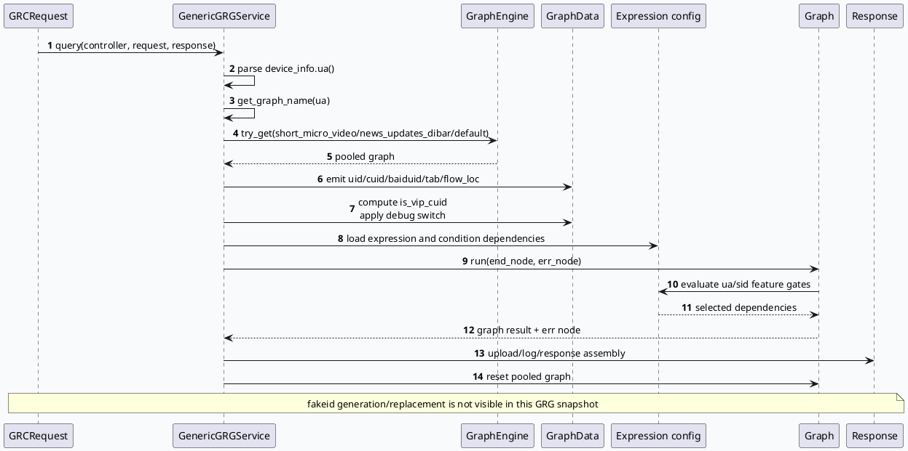

# 2026-09-27 业务代码理解：GRG 个性化推荐入口与 fakeid 兼容边界
<!-- topic-nav:start -->
> 主题：`business/personalization-id` · 同题补充 / 历史版本 · [主题目录](README.md) · [先读主文](2026-07-04-close-individual-fakeid-cross-service-boundary.md)
<!-- topic-nav:end -->


> 日期：2026-09-27（周日）
> 主题选择：目标日期没有新的 daily-plan；仓内唯一计划 `daily-plan-20260529.json` 已过期。本次读取其周日槽位，选择未覆盖的 **GRG 个性化推荐关闭开关 fakeid 兼容**。基础库侧配对分析 Graph Expression/SelectProcessor 条件门控；本文只分析 GRG service 的 graph 选择、用户身份字段注入、VIP/debug 开关和可见的个性化表达式。KU 正文未读取，业务背景需人工补充；以下只陈述源码和 graph 配置可验证的行为。
> 重要边界：GRG 当前源码快照中没有 `fake_id`、`fakeid`、`is_fake_user` 字面量；因此不能把 fakeid 的写入、替换或关闭逻辑伪造为 GRG 已实现路径。本文将上游/跨仓缺口明确标出，并分析本仓真正可见的兼容入口。
> 范围：`src/service/grg_service.cpp`、`src/plugin/graph_parser.h`、`conf/plugins/graph/short_micro_video/expression.conf`、`conf/plugins/graph/short_micro_video/showlist.conf`。

## 0. 架构全景图

<div style="font-family:system-ui,-apple-system,BlinkMacSystemFont,'Segoe UI',sans-serif;background:#f5f7fa;border:1px solid #d8e1ea;border-radius:8px;padding:16px;margin:16px 0;color:#243b53;line-height:1.45;"><div style="font-size:12px;font-weight:800;color:#52606d;text-transform:uppercase;letter-spacing:.05em;">GRG 个性化入口与身份兼容边界</div><div style="display:grid;grid-template-columns:1.05fr 24px 1.25fr 24px 1.35fr 24px 1.05fr;gap:8px;align-items:center;margin-top:12px;"><div style="background:#fff;border:1px solid #cbd5e1;border-left:4px solid #3d5a80;border-radius:6px;padding:11px;"><div style="font-size:15px;color:#102a43;font-weight:700;">GRCRequest</div><div style="margin-top:7px;font-size:12px;color:#52606d;">device_info.ua、common_info.uid/cuid/baiduid、tab、flow_loc、实验参数。</div></div><div style="text-align:center;color:#64748b;font-size:20px;">→</div><div style="background:#fff;border:1px solid #cbd5e1;border-left:4px solid #2d6a4f;border-radius:6px;padding:11px;"><div style="font-size:15px;color:#102a43;font-weight:700;">GRG service</div><div style="margin-top:7px;font-size:12px;color:#52606d;">UA 选择 graph；公共字段写入 GraphData；计算 `is_vip_cuid` 与 debug gate。</div></div><div style="text-align:center;color:#64748b;font-size:20px;">→</div><div style="background:#fff;border:1px solid #cbd5e1;border-left:4px solid #9a5b28;border-radius:6px;padding:11px;"><div style="font-size:15px;color:#102a43;font-weight:700;">short_micro_video graph</div><div style="margin-top:7px;font-size:12px;color:#52606d;">表达式按 UA/sid 控制个性化、DNN、PK、quota 与 showlist 依赖。</div></div><div style="text-align:center;color:#64748b;font-size:20px;">→</div><div style="background:#fff;border:1px solid #cbd5e1;border-left:4px solid #b8432f;border-radius:6px;padding:11px;"><div style="font-size:15px;color:#102a43;font-weight:700;">业务输出</div><div style="margin-top:7px;font-size:12px;color:#52606d;">graph run、error node、response assembly；fakeid 兼容实现不在本仓可见范围。</div></div></div><div style="margin-top:10px;font-size:12px;color:#52606d;">可观测事实：GRG 消费原始 uid/cuid/baiduid；本仓没有 fakeid 字段替换代码，需结合上游请求构造或其他仓库补链路。</div></div>

## 1. 主题边界与核心结论

GRG 的“个性化推荐入口”由 service 层完成三件事：

1. 从 `device_info.ua()` 解析 UA，并用 UA 选择 graph。85、87、123 进入 `short_micro_video`，102 进入 `news_updates_dibar`，其他 UA 使用 `default`（`src/service/grg_service.cpp:56-65`、`:113-120`）。
2. 把 `uid`、`cuid`、`baiduid`、`tab`、`tabfrom`、`product`、`flow_loc` 写入 graph；VIP 标记由 `is_hit_vip(cuid, uid)` 计算，debug 标记由全局开关与请求字段共同决定（`src/service/grg_service.cpp:121-176`）。
3. 通过 `short_micro_video/expression.conf` 和 `showlist.conf` 的表达式/条件依赖控制个性化推荐、DNN、PK、quota 与 showlist 分支，而不是在 service 中直接关闭某个推荐算法。

计划中的 fakeid 兼容主题在当前 GRG 快照中存在明确证据缺口：对源码和配置做直接扫描，没有找到 `fake_id`、`fakeid` 或 `is_fake_user`。因此本文只记录 GRG 的消费边界和可观察字段；fakeid 的生成、替换、关闭开关及其跨服务传递需要人工补充上游调用链。

## 2. service 入口与 graph 选择

### 2.1 请求失败和池化 graph

`GenericGRGService::query()` 先检查 RPC controller 和 `DynamicTimeOutPlugin`，解析 UA，按 graph_name 从 `GraphEngine` 获取 pooled graph，再获取动态超时 controller。graph 或 controller 为空时直接走错误响应；正常路径填充基础数据、执行 graph，最后 `pooled_graph->reset()`（`src/service/grg_service.cpp:35-93`）。

### 2.2 身份字段是原始输入，不是 fakeid 替换结果

`fill_basic_data_for_graph()` 直接把 `request->common_info().uid/cuid/baiduid` 引用到 graph 的同名数据（`src/service/grg_service.cpp:127-140`）。这里没有对字段做 hash、fakeid 替换或 fallback。`is_vip_cuid` 还使用原始 cuid/uid 计算（`:153-154`），所以如果上游已经完成身份替换，GRG 只会消费替换后的请求值；如果上游没有替换，GRG 也不会在本仓自行补做。

### 2.3 动态超时 scene 兼容不是 fakeid 兼容

GRG 将 graph_name 作为动态超时 scene，但把 `news_updates_dibar` 映射为 `short_micro_video`（`src/service/grg_service.cpp:177-194`）。这是超时预算的场景兼容，不能解释成个性化 fakeid 开关；两条路径的字段和职责必须分开排查。



## 3. 个性化开关与条件依赖

### 3.1 UA 是主入口条件

`short_micro_video/expression.conf` 将 `is_rec_news` 定义为 `ua == 85`，`is_slide` 定义为 `ua == 85 || ua == 87 || ua == 123`，并据此打开部分推荐、showlist 和 diversity 分支（`conf/plugins/graph/short_micro_video/expression.conf:1-31`）。`is_open_grg_pcs` 也只在 UA 85 时为真（`:61-63`），`is_deepes_quota` 同样按 UA 85 门控（`:85-90`）。

### 3.2 sid 是实验开关层

表达式把 sid 命中作为更细粒度的实验门控，例如 `is_session_vec_diversity` 读取多个 sid，`is_hit_searchc_mmr_refresh_exp` 组合 sid 排除与 UA，`is_open_rkcj_bge_adj` 组合 UA 85 与两个 sid（`conf/plugins/graph/short_micro_video/expression.conf:17-39`）。这说明“关闭个性化推荐”如果存在，应该先定位具体 expression 名和 sid 语义，而不是只看 service 的 `is_debug` 或 VIP 分支。

### 3.3 showlist 依赖必须和条件一致

`showlist.conf` 中 `DocFeatureFunction_last_showlist` 依赖多个 DNN/PK/longterm 数据，并把 `ShowItemQueueWithMetaForNewsFillMetaDone` 以 `condition: is_rec_news` 方式限制到新闻推荐场景（`conf/plugins/graph/short_micro_video/showlist.conf:103-167`）。后续 longterm 依赖又组合 `is_open_pk_generate_longterm_v1 && is_open_dnn_soft_rule`（`:265-300`）。排查个性化关闭后是否仍有分支执行，应对照表达式值与每个 conditional dependency，而不是仅看最终响应数量。

## 4. 配置/边界信息图

```infographic
infographic sequence-ascending-steps
data
  title GRG 个性化入口四层开关
  desc 先选场景，再叠加实验和模型分支
  items
    - label UA 场景路由
      desc 85/87/123 进入 short_micro_video，102 进入 news_updates_dibar
      icon mdi:cellphone-link
    - label sid 实验门控
      desc session diversity、MMR、RKCJ 等表达式读取 sid 命中状态
      icon mdi:toggle-switch
    - label processor 条件依赖
      desc showlist 用 condition 和组合表达式控制 DNN、PK、longterm 输入
      icon mdi:source-branch-check
    - label response 边界
      desc graph 输出后才进入 upload/log/response；fakeid 替换不在当前快照中
      icon mdi:transit-connection-variant
  theme
    palette #3d5a80 #2d6a4f #9a5b28 #b8432f
```

```infographic
infographic compare-binary-horizontal-underline-text-vs
data
  title GRG 当前可见身份边界
  left
    label 本仓可证
    desc 原始 uid/cuid/baiduid 注入、VIP 判定、UA graph 选择、sid/UA 条件门控
  right
    label 需要人工补充
    desc fakeid 生成、fake_id 替换、关闭开关、上游 writer 与跨仓传递协议
  theme
    palette #2d6a4f #b8432f #3d5a80
```

## 5. Pitfalls 与调试 checklist

<div style="font-family:system-ui,-apple-system,BlinkMacSystemFont,'Segoe UI',sans-serif;background:#fffaf5;border:1px solid #ead7c2;border-left:6px solid #b8432f;border-radius:6px;padding:15px;margin:14px 0;color:#3f2d22;line-height:1.55;"><div style="font-size:12px;font-weight:800;color:#9a3d2a;text-transform:uppercase;letter-spacing:.04em;">Pitfall 01 · fakeid 证据缺口</div><div style="margin-top:6px;font-size:16px;font-weight:750;color:#3f2d22;">定义或计划主题不能替代调用链证据</div><div style="margin-top:6px;font-size:13px;color:#6b5141;">GRG 快照没有 `fake_id`、`fakeid`、`is_fake_user` 字面量。不能根据 GRC 的同名业务逻辑推断 GRG 已完成替换；应继续追上游 request producer 或其他仓库。</div></div>

<div style="font-family:system-ui,-apple-system,BlinkMacSystemFont,'Segoe UI',sans-serif;background:#f4f8f6;border:1px solid #c8dfd1;border-left:6px solid #2d6a4f;border-radius:6px;padding:15px;margin:14px 0;color:#20352a;line-height:1.55;"><div style="font-size:12px;font-weight:800;color:#23613f;text-transform:uppercase;letter-spacing:.04em;">Pitfall 02 · scene 与身份分离</div><div style="margin-top:6px;font-size:16px;font-weight:750;color:#20352a;">news_updates_dibar 到 short_micro_video 是 timeout scene 兼容</div><div style="margin-top:6px;font-size:13px;color:#486052;">这一映射只服务动态超时预算；它不代表个性化推荐开关，也不代表 fakeid 已被兼容。</div></div>

```infographic
infographic list-column-done-list
data
  title GRG 个性化/身份问题排查清单
  items
    - label 记录 device_info.ua 与最终 graph_name
      done true
    - label 对照 sid 命中和 expression.conf 的具体 expression
      done true
    - label 检查 uid/cuid/baiduid 是否在 graph 注入前已被上游替换
      done true
    - label 区分 is_vip_cuid、is_debug 与 fakeid 开关职责
      done true
    - label 若源码无 fakeid caller，标记上游缺口并补查 producer
      done true
    - label graph run 后确认 error node、response 和 pooled graph reset
      done true
  theme
    palette #3d5a80 #2d6a4f #9a5b28
```

## 6. 证据来源

- `src/service/grg_service.cpp:35-93`（GRG RPC 入口、graph/controller 获取、run 与 reset）
- `src/service/grg_service.cpp:113-120`（UA 到 graph_name 的映射）
- `src/service/grg_service.cpp:121-176`（uid/cuid/baiduid、VIP、debug、实验参数注入）
- `src/service/grg_service.cpp:177-194`（动态超时 scene 映射）
- `src/plugin/graph_parser.h:7-30`（ExpressionProcessor、SelectProcessor 绑定）
- `conf/plugins/graph/short_micro_video/expression.conf:1-39`、`:57-90`（UA/sid/模型开关表达式）
- `conf/plugins/graph/short_micro_video/showlist.conf:103-167`、`:265-300`（条件依赖与 showlist 分支）

> 外部 KU 正文未读取，业务上下文需人工补充。GRG 快照中未找到 fakeid 相关字面量，fakeid 生成/替换/关闭链路必须由上游 producer 或其他代码仓补全。
